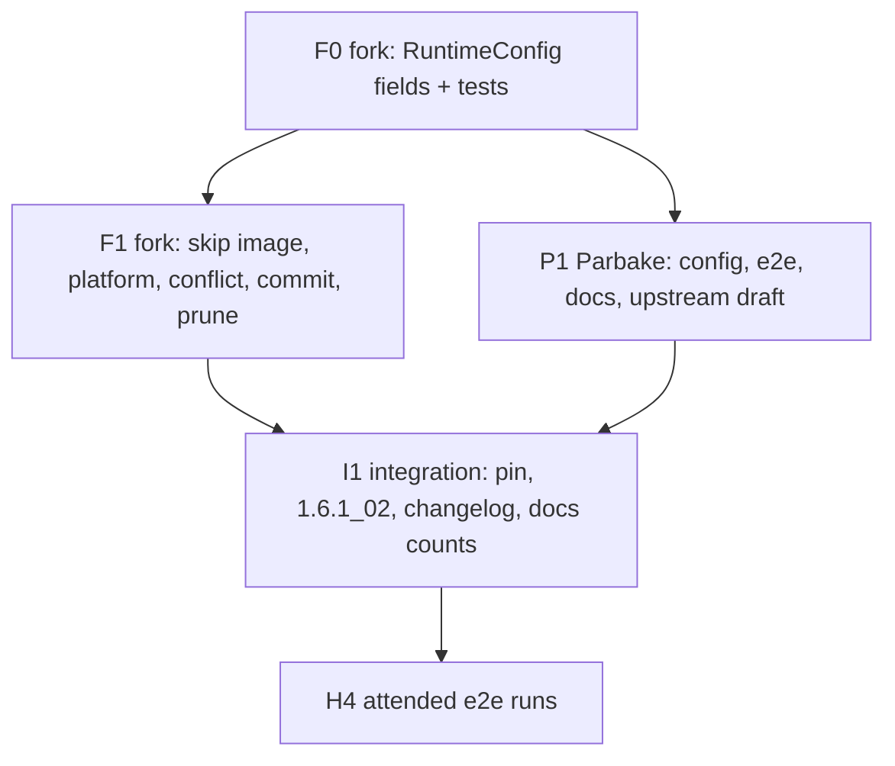

# Plan: Runtime plugins that need no image and declare their own platform

## Status

- State:   done
- Tier:    high
- Tier-grammar: 5
- Updated: 2026-11-13
- Next:    none — merged as PR #10, v0.2.0 tagged; open: H4 step 2 (attended published-path run) and the fork rulesets below
- Executed: F0, F1 (fork abc48183, pushed, tag parbake-804209b1.2), P1, I1 merged; one review call (fork seat, Parbake seat), Parbake fix pass; `task check` green at 6ca0d37, self-test green at dcb98c7
- H4 step 1 (2026-10-30, attended): candidate `RESULT pass` (run-id 20261030T185550Z-997a8793); E13 without pull, E14 `<none> darwin arm64`, unsigned candidates verify exit 79, archive SHA-256 unchanged
- Fork release (2026-10-30/31): `ocx-1.6.1_02` at `5bd4ddf9`, `container:1.6.1_02` pushed and signed (digest `sha256:15cd9fa3`); OCX package run 41134959892 red at `Verify the pushed signature` (401 from the ghcr referrers endpoint), a later anonymous verify passes; announce job skipped there, OCX announce run 41181740576 green, ocx-sh/index#1347 merged
- Open (fork, human): I1 step 5 rulesets not applied as of 2026-11-05; `ocx tags` covers `refs/tags/ocx-*` only, `parbake` carries `deletion` only
- Deferred (fork, Warn): configurationError ignores legacy config.json (safe fallback); unparsable plugin platform with requiresImage=false would take the image branch (unreachable, validate() rejects it); server accepts `<none>` for a snapshot-requiring runtime from non-CLI clients; raw error text in configurationError
- Repos:   <!-- frozen at execution start; bases are never re-resolved -->
  - `.`      this repository (Parbake), trunk `main`, feature branch `hex/fork-imageless-runtime` base `6fb54f2`  landed: no
  - `fork`   `../container-fork` (extra-code/container), trunk `main` (origin/HEAD); patch base `origin/parbake` `0f824548`, release base `origin/ocx-package` `2c8bc36a`  landed: `parbake` `abc48183`, `ocx-package` `5bd4ddf9`
- Candidate (I1, 2026-10-30): fork `abc48183`, `out/container-1.6.1_02.tar.xz` SHA-256 `45cec327d17204a12df87ad153c8535f18678eb7e8742e25281203038025d123`; `container --version` prints `parbake-804209b1-3-gabc48183` before the pin tag exists
- Branches: agents create no branches (AGENTS.md). Fork work runs in a detached worktree of the fork
  on `origin/parbake` and ends as commit SHAs; the human moves `parbake` and pushes.

---

## Overview

**Author:** Christian Semmelmann, with an automated planning assistant
**Date:** 2026-10-30
**Scope:** medium, two repositories · **Reversibility:** two-way door. A new fork patch and a new
container package tag `1.6.1_02`; the earlier `1.6.1_01` package stays installable.
**Source:** `.agents/discussions/fork-imageless-runtime.md` (ratified 2026-10-30 → plan). Variant B
is parked in `.agents/discussions/fork-imageless-runtime-b.md` and is out of scope here.
**Design:** inline, from the ratified discussion. ADR 0015 covers the fork and the two packages; this
plan adds a patch, not a new boundary.
**Research:** `.agents/research/research_imageless_runtime_prior_art.md`,
`.agents/research/research_imageless_runtime_upstream_threads.md`,
`.agents/research/research_imageless_runtime_archaeology.md`, plus the planning recon below.

## Objective

- A runtime plugin whose `config.toml` says `requiresImage = false` and `platform = "darwin/arm64"`
  makes `container run`/`create --runtime <plugin>` skip the image lookup and pull, store the
  placeholder image `<none>`, and record the plugin's platform.
- `container ls` shows `<none>` and `darwin arm64` for a Parbake guest. No image is pulled and no
  registry login is read from the keychain.
- Parbake ships the new plugin config, pairs with the fork package `1.6.1_02`, and its e2e run proves
  the change. A draft for a Discussion at apple/container is ready, not posted.

## Scope

### In scope

- Fork (`Repo` `fork`), branch `parbake`: `Sources/ContainerPlugin/PluginConfig.swift`,
  `Sources/ContainerResource/Image/ImageDescription.swift`, the plugin-config fallback in
  `Utility+PluginLoader.swift`,
  `Sources/Services/ContainerAPIService/Client/Utility.swift`, `Parser.swift`,
  `Sources/Services/ContainerAPIService/Server/Containers/ContainersService.swift`,
  `Sources/ContainerCommands/Container/ContainerCommit.swift`, `ImagePrune.swift`, and tests under
  `Tests/ContainerPluginTests/` and `Tests/ContainerAPIClientTests/`.
- Fork, branch `ocx-package`: `ocx/source-revision` for the release `ocx-1.6.1_02`.
- Parbake: `config.toml`, `Package.swift`/`Package.resolved` pin, `packaging/container.tag`,
  `scripts/package-e2e.sh` (E13, E14 and the self-test stubs), `docs/quickstart.md`, `README.md`,
  `docs/end_to_end_checklist.md`, `docs/package-troubleshooting.md`, `CHANGELOG.md`, `AGENTS.md` and ADR 0015 (patch count and pin),
  `CONTRIBUTING.md` (pin tag), and a draft `.agents/research/draft_upstream_discussion_imageless_runtime.md`.

### Out of scope

- Variant B (optional image argument), `container machine`, PR #1701's runtime abstraction and
  `runtimeData`.
- Posting anything at apple/container. The draft waits for the e2e evidence and the user.
- Behaviour without `--runtime`: unchanged, the default runtime still follows the image's OS.

## Planning recon (2026-10-30)

- No container create, start, network or DNS path reads `platform.os`. `darwin` breaks nothing there.
  Sites that touch os or arch: the default runtime `container-runtime-<os>` (`Utility.swift:95`),
  rosetta (`Utility.swift:251`, false for `darwin/arm64`), and the snapshot unpacker's linux guard
  (`SnapshotStore.swift:40`), which is never reached with snapshots off.
- `ImageDescription(reference:descriptor:)` is not validated on store or decode. `ls`, `inspect`,
  JSON output, `image prune`, disk usage and `getActiveImageReferences` only print or compare the
  reference string. `<none>` breaks none of them. `container commit` is the one real break: it looks
  up the image config by descriptor (`ContainerCommit.swift:46-47`).
- `Reference.parse` rejects `<none>`, but only image-store paths parse references; container
  configs are never parsed.
- The CLI does not validate the image argument before the fetch; the first parse is
  `ClientImage.platforms` (`Utility.swift:77`). With the fetch skipped, any string is accepted.
- `runtimeRequirements(runtime:)` (`Utility.swift:385`) loads the plugin config through the
  apiserver's plugin loader; it can run before the image step whenever `--runtime` is set.
  `--platform`, `--os`, `--arch` and `--runtime` are optional strings, nil when unset.
- **`Parser.process(config: nil)` with no command throws "command/entrypoint not specified".**
  Parbake passes no command. The Parbake plugin reads only mounts, ports, labels, resources and the
  id from the configuration, never the process.
- Tests are Swift Testing. `PluginConfigTest` writes a TOML file and loads it; `PlatformResolverTests`
  uses `@Test(arguments:)`. No test calls `containerConfigFromFlags` (it needs XPC). The fork runs
  no CI (`common.yml` is gated on `apple/container`); the local gate is `make test` (unit tests,
  integration skipped) and `make fmt`/`make check`.
- Parbake pins the fork by revision `0f824548` (`Package.swift:17`), tagged `parbake-804209b1`.
  ADR 0015 says "four patches", AGENTS.md says three; the fork carries three.

## Technical Approach

### Key decisions (ratified in the discussion unless marked)

| # | Decision |
|---|---|
| D1 | Variant A: the image argument stays required; nothing is fetched for a `requiresImage = false` runtime |
| D2 | The plugin declares its platform statically in `[runtimeConfig] platform` |
| D3 | The stored image is the fixed placeholder `<none>`, whatever the user passed |
| D4 | The plugin platform wins; a conflicting `--platform`, `--os` or `--arch` is an error |
| D5 | Fork first, proven by Parbake's e2e runs, then a Discussion at apple/container |
| D6 | (plan) Without a command, an image-less runtime gets an empty process: executable `""`, no arguments, the user flag as given, working directory `/` unless `--workdir` is set. Reason: the image normally supplies the entrypoint; the plugin owns what runs. |
| D7 | (plan) The placeholder: reference `<none>`, descriptor media type `application/vnd.oci.image.index.v1+json`, digest `sha256:0000000000000000000000000000000000000000000000000000000000000000`, size 0. Every skip and refusal keys on the reference `<none>`, never on the digest. Reason: a syntactically valid descriptor that matches no stored image. |
| D8 | (plan) `container commit` refuses a `<none>` container with "container <id> runs on runtime <name> without an image; commit is not supported" before any image lookup, including before `normalizeReference` (`ContainerCommit.swift:41`). |
| D9 | (plan) All CLI failures in this plan exit 1 with the message on stderr: `Application.exit(withError:)` maps every thrown error to exit 1 (`Application.swift:138-140`). |
| D10 | (plan, security) The skip applies only when `--runtime` is set explicitly, the named plugin is found and decodes, and its `requiresImage` is false. A missing or undecodable plugin never means "skip". Planting or editing a plugin config already needs write access to the user's plugin directories, which is code execution as the user (SECURITY.md trust model); this adds no privilege. The skipped work is the registry lookup and fetch with its keychain login — this CLI verifies no image signature, so nothing is weakened there. |

### Constitution deviations

None.

## Component Contracts

### Fork

**C-001 `RuntimeConfig` fields.** `PluginConfig.RuntimeConfig` gains `requiresImage: Bool`
(decode default `true`) and `platform: String?` (decode default nil). `init` gains both with the
same defaults; `.default` keeps all requirements true and no platform. Equatable and Codable cover
both fields.

**C-002 Config validation.** A pure `RuntimeConfig.validate() -> String?` (in `PluginConfig.swift`)
returns nil for a valid config and a message otherwise. Invalid:
- `requiresImage = false` without `platform`;
- a `platform` that `Parser.platform(from:)`-equivalent parsing rejects (validation lives in
  `ContainerPlugin`, so it parses `os/arch[/variant]` itself);
- `requiresImage = false` together with `requiresImageSnapshot = true` or `requiresKernel = true`
  (a runtime that needs a snapshot or a Linux kernel needs an image).
`RuntimeConfig.init(from:)` throws a decoding error with that message, so the existing loader drops
such a plugin with its "invalid configuration" warning (`PluginLoader.swift:172-178`).
Fail-closed on the CLI: when `--runtime <name>` is set and `findPlugin` returns nil, the CLI looks for
`<plugin dir>/<name>/config.toml` in the loader's plugin directories. If that file exists, `run` and
`create` fail with "runtime plugin <name> has an invalid configuration (<file>): <reason>" instead
of falling back to `.default`. If no such file exists, behaviour is unchanged (the server later
reports the unknown runtime).

**C-003 Run and create skip the image.** In `containerConfigFromFlags`, when D10's gate holds:
- `ClientImage.platforms`, `PlatformResolver.resolve`, `ClientImage.fetch`, the image config read
  and the image snapshot are skipped;
- `config.platform` is the plugin's platform;
- the process comes from `Parser.process(arguments:processFlags:managementFlags:config: nil,
  allowEmptyCommand: true)`; the new parameter defaults to `false`, so the existing callers
  (`Utility.swift:166`, `ParserTest.swift:1017,1030,1043,1056`) are unchanged; with `true` and no
  command, D6 applies; an explicit `--entrypoint ""` without arguments also yields D6;
- `config.image` is `ImageDescription.none` (D3, D7), whatever `image` the user passed; the
  argument is never parsed as a reference;
- `config.rosetta` follows the existing rule from the plugin platform (false for `darwin/arm64`);
- kernel and init image follow the existing `requiresKernel`/`requiresInitImage` flags.
With `management.runtime` nil, or a runtime whose `requiresImage` is true, behaviour is unchanged
byte for byte.

**C-004 Platform conflict.** A pure `static func platformConflict(runtime: String, pluginPlatform:
Platform, platform: String?, os: String?, arch: String?) -> String?` in `Parser` returns nil or the
message; `containerConfigFromFlags` throws it before any XPC create. Rules:
- `--os` differs from the plugin os → "runtime <name> runs <os>/<arch>; --os <value> conflicts";
- `--arch` differs → the same with `--arch <value>`;
- `--platform` differs in os or arch → the same with `--platform <value>`; a variant given on one
  side only passes; two different variants conflict;
- unset or equal values pass.

**C-005 Server side.** `ContainersService` creates and starts a container whose image is
`ImageDescription.none` without building `ClientImage(description:)` or touching the image store.
Its log line names the placeholder. No unit seam exists (XPC); the candidate e2e run covers it.

**C-006 Placeholder home and image references in use.** `ImageDescription.none` and
`var isNone: Bool` (reference equals `<none>`) live in `Sources/ContainerResource/Image/
ImageDescription.swift`, which the CLI, the server and `commit` all link. `getActiveImageReferences`
(`ContainersService.swift:256`) skips `isNone`, so disk usage never counts it. `image prune --all`
needs no change: its in-use set only filters stored images, and no stored image has the reference
`<none>`. No path fetches by a container config's descriptor (grep checked in F1 step 3).

**C-007 Commit.** `container commit` on an `isNone` container fails with D8's message, exit 1 (D9),
before `normalizeReference` and any image lookup.

**C-008 Fork tests.** Swift Testing cases:
- `PluginConfigTest`: defaults when omitted; `requiresImage = false` with `platform`; the C-002
  errors (missing platform, malformed platform).
- `RuntimeConfig.validate()` cases for each C-002 rule.
- `ParserTest`: `allowEmptyCommand: true` with no command yields D6; `false` keeps the existing
  error; `--entrypoint ""` case.
- `platformConflict` with `@Test(arguments:)`: equal, conflicting os, arch, platform, variant rules,
  unset.
- `ImageDescription.none` fields equal D7's literals; `isNone` true only for `<none>`.
- A gate test for D10 as a pure helper `skipsImage(runtime: String?, config: RuntimeConfig?) ->
  Bool`: nil runtime never skips, also when a `container-runtime-<os>` plugin would carry
  `requiresImage = false`; nil config never skips.
- `make test` and `make fmt` (or `make check`) green.
- Covered only by the candidate e2e or by hand (no unit seam): C-005, S-001, S-002 (`inspect`,
  `--format json`), S-005, S-006, S-007.

### Parbake

**C-009 Plugin config.** `config.toml` `[runtimeConfig]` adds `requiresImage = false` and
`platform = "darwin/arm64"`.

**C-010 Pin and pairing.** `Package.swift` and `Package.resolved` pin the new fork revision;
`packaging/container.tag` is `1.6.1_02`; AGENTS.md, CONTRIBUTING.md and ADR 0015 name the new pin
tag `parbake-804209b1.2` and the correct patch count (four after this patch). `CHANGELOG.md`
records the pairing under a new unreleased entry.

**C-011 E2E script.**
- E13 no longer runs `container image pull`; it runs `container run … none` and passes when it prints the name.
- E14 additionally requires the row's IMAGE column `<none>`, OS `darwin` and ARCH `arm64`.
- The self-test stub prints `<none> darwin arm64` rows, and a case fails E14 on a `linux` row.
- The registry-login note before E13 goes.

**C-012 Docs.** Quickstart, README and the checklist state that nothing is pulled and that `ls`
shows `<none>` with `darwin arm64`; the run command passes `none`; the
troubleshooting entry for the first-run wait at `[0/6]` names that it applies to `1.6.1_01` and
earlier. The doc-sync self-test keeps passing.

**C-012a Hygiene.** Before H4, `git grep` over the changed Parbake files and the draft finds no
user name, no `/Users/` path, no external-volume name, no restore-image path and no name of the
host's container-poller app. The Status block records result lines and run-ids only.

**C-013 Upstream draft.** `.agents/research/draft_upstream_discussion_imageless_runtime.md`: a
Discussion text for apple/container in English that links issue #1376 and PR #2422, states the
problem generically (runtime plugins that run no OCI image), shows the `config.toml` keys and the
CLI behaviour, names the fork commit as a running example and the e2e evidence, and asks whether a
PR is welcome (CONTRIBUTING). No macOS marketing, no other projects named.

## User-Experience Scenarios

- **S-001 Parbake run.** `~/.parbake/root/bin/container run -d --name mac1 --runtime
  container-runtime-macos --label runtime-macos.bundle=… <placeholder>` → prints `mac1`; no
  `Fetching image` progress; no keychain dialog. Error: the bundle label missing → the plugin's
  existing error.
- **S-002 Listing.** `container ls` → the row shows IMAGE `<none>`, OS `darwin`, ARCH `arm64`.
  `inspect` and `ls --format json` show `"reference":"<none>"` and the platform.
- **S-003 Conflict.** Adding `--platform linux/arm64` (or `--os linux`) → fails before creating
  anything, naming the runtime's platform and the flag. `--platform darwin/arm64` passes.
- **S-004 Broken plugin config.** `requiresImage = false` without `platform` → `run` fails, naming
  the config file and the missing key.
- **S-005 Commit.** `container commit mac1 x` → fails with D8's message; no image is created.
- **S-006 Linux unchanged.** `container run alpine echo hi` without `--runtime` → pulls and runs as
  before; `ls` shows the image and `linux`.
- **S-007 Prune.** `container image prune --all` with a Parbake guest present → does not report
  `<none>` and removes nothing because of it.
- **S-008 E2E.** `task e2e:package:candidate VERSION=…` with the fork candidate, then
  `task e2e:package` after the `1.6.1_02` release → pass; E13 has no pull, E14 sees `<none> darwin
  arm64`.

### Error taxonomy

| Condition | Where | Message names | Exit |
|---|---|---|---|
| Invalid image-less plugin config (C-002) with explicit `--runtime` | CLI, before the image step | plugin, file, reason | 1 |
| Flag conflicts with plugin platform | CLI, before create | runtime, platform, flag | 1 |
| Commit of a `<none>` container | CLI | container, runtime | 1 |

### Edge cases

- `--runtime` naming a plugin that is not installed: unchanged (`.default` requirements, image path).
- A command given with an image-less runtime: passed through as the process; the plugin decides.
- `--platform darwin/arm64/v8` against `darwin/arm64`: compare os and arch; a variant on one side only
  passes; two different variants conflict.
- An existing `1.6.1_01` container config: decodes unchanged; it keeps its `alpine` reference.

## Parallelization

| Pipeline | Repo | Scope | Expected files | Wave | Depends on | Marks | Status |
|---|---|---|---|---|---|---|---|
| F0 | fork | C-001, C-002 (contract wave: fields, validation, tests) | `PluginConfig.swift`, `PluginConfigTest.swift` | 0 | — | — | merged (fork a6dfee2) |
| F1 | fork | C-003–C-008, S-001–S-007 | `Utility.swift`, `Utility+PluginLoader.swift`, `Parser.swift`, `ImageDescription.swift`, `ContainersService.swift`, `ContainerCommit.swift`, tests in `Tests/ContainerAPIClientTests/` and `Tests/ContainerResourceTests/` | 1 | F0 | review | merged (fork 64b6b63, abc4818) |
| P1 | . | C-009, C-011, C-012, C-012a, C-013 | `config.toml`, `scripts/package-e2e.sh`, `docs/quickstart.md`, `README.md`, `docs/end_to_end_checklist.md`, `docs/package-troubleshooting.md`, `.agents/research/draft_upstream_discussion_imageless_runtime.md` | 1 | F0 | — | merged (1ae3059, 33211b6, 4a7c118) |
| I1 | . + fork | C-010, S-008 (integration: pin, tag, docs, candidate e2e) | `Package.swift`, `Package.resolved`, `packaging/container.tag`, `CHANGELOG.md`, `AGENTS.md`, `CONTRIBUTING.md`, ADR 0015; fork `ocx/source-revision` on `ocx-package` | 2 | F1, P1 | — | merged (6ca0d37; fork ocx-package d544080, 3bd144b) |
| H4 | . | S-008 on the host (attended) | none (receipts outside the repo) | 3 | I1 | — | step 1 pass; step 2 after the Parbake release |

Critical path: F0 → F1 → I1 → H4. Shippable after wave 2: the fork commit and the Parbake changes on
local branches; H4 adds the evidence before the human pushes and tags.

## Implementation Steps

### Contract wave (F0, fork)

1. In a detached worktree of the fork on `origin/parbake`: add `requiresImage` and `platform` to
   `RuntimeConfig` (C-001), `validate()` and the decode-time error (C-002), with `PluginConfigTest`
   cases. Commit once. **Every fork commit in this plan** is signed with the fork's SSH flags
   (`-c gpg.format=ssh -c user.signingkey=/Users/…/extra-code-GitHub.pub`, the path the human uses)
   and carries no attribution trailer; `git log --show-signature` (with the Parbake allowed-signers
   file) confirms each before handoff.

### Pipeline F1 (fork, mark: review)

1. Pure helpers with tests first: `ImageDescription.none`/`isNone` (D7, C-006), `platformConflict`
   (C-004), `allowEmptyCommand` (D6), `skipsImage` (D10).
2. `containerConfigFromFlags`: read the runtime requirements before the image step when
   `--runtime` is set; the fail-closed plugin-config lookup (C-002); C-003 and C-004.
3. `ContainersService` (C-005), `getActiveImageReferences` (C-006), `ContainerCommit` (C-007);
   grep that no fetch-by-descriptor path takes a container config's image.
4. `make test` and `make fmt`; one or two signed commits.

### Pipeline P1 (Parbake)

1. `config.toml` (C-009).
2. `scripts/package-e2e.sh` E13/E14 and the stubs (C-011); `/bin/bash scripts/package-e2e.sh --self-test`.
3. Docs (C-012) and the upstream draft (C-013).

### Integration I1

1. Build the fork candidate from F1's commit, with `ocx` on `PATH`:
   - worktree A of the fork, detached at the F1 commit (the source);
   - worktree B of the fork, detached at `origin/ocx-package` (for `scripts/ocx-package.sh` and
     `ocx/metadata.json`);
   - in B: `scripts/ocx-package.sh build <A> <root>` (a release build and install into an empty
     root), then `scripts/ocx-package.sh create <root> ocx-1.6.1_02`, which writes
     `out/container-1.6.1_02.tar.xz` and `out/container-1.6.1_02-metadata.json` (the shape
     `PKG_E2E_CONTAINER_ARCHIVE` requires); do not run `check`, which needs the network refs;
   - confirm `<root>/bin/container --version` matches the e2e script's `CONTAINER_VERSION_RE`
     (`package-e2e.sh:1006`); if the detached build prints another prefix, record it and adjust
     the check or the build, not the receipt;
   - record the archive's SHA-256 in this Status block.
2. Parbake: pin the F1 commit in `Package.swift`, regenerate `Package.resolved` with
   `/usr/bin/swift package resolve`, set `packaging/container.tag` to `1.6.1_02`, update AGENTS.md,
   CONTRIBUTING.md and ADR 0015 (patch count four, the new pin tag), and add the CHANGELOG entry.
3. Fork `ocx-package`: a commit that sets `ocx/source-revision` to the F1 commit (no tag; tagging
   is the human's). Check that `ocx/source-revision` equals the revision in `Package.swift` and
   `Package.resolved`: this equality is the only binding between the pinned source and the
   published package.
4. `task check` in Parbake; C-012a grep.
5. Prepare, for the human, the fork ruleset changes: add `refs/tags/parbake-*` to the tag ruleset
   (no update, no deletion) and `non_fast_forward` to the `parbake` branch ruleset. Applied by
   `gh api` only on the user's go. `Package.swift` pins by revision SHA; the tag is a reachability
   and readability aid.

### H4 (attended, human present)

1. `task package VERSION=0.2.0` (candidate mode needs the Parbake archive as well), then
   `PKG_E2E_CONTAINER_ARCHIVE=<fork candidate> PKG_E2E_RESTORE_IMAGE=<local image>
   task e2e:package:candidate VERSION=0.2.0` → pass; E13 without pull; E14 `<none> darwin arm64`;
   the candidate archive's SHA-256 matches the one I1 recorded.
2. After the human pushes `parbake`, pushes `ocx-package`, creates the pin tag and `ocx-1.6.1_02`
   and approves the release: `task e2e:package` against the published `1.6.1_02` → pass.
3. Record result lines and run-ids in this Status block.

### Release order (from the review)

1. H4 step 1 (candidate) green.
2. The human pushes the fork's `ocx-package` commits and the tag `ocx-1.6.1_02`, approves `release`;
   the container package `1.6.1_02` is published and announced.
3. The human merges the Parbake PR, then tags `v0.2.0` right away: `main` names `0.2.0` and
   `1.6.1_02` in the quickstart, so the gap stays minutes. `task package` before step 2 needs
   `PACKAGE_PAIR_LOCATION` pointing at a fork clone, because `pair` fetches `ocx-1.6.1_02`.
4. H4 step 2 (published) after the Parbake release.

## Dependencies

- `make`, Xcode toolchain for the fork; `task`, ocx 0.6.5 for Parbake.
- The human: pushes to `parbake` and `ocx-package`, the pin tag, the `ocx-1.6.1_02` tag, the
  `release` approval.

## Rollback Plan

Revert the Parbake commits to the `0f824548` pin and `1.6.1_01`. The fork commit stays on `parbake`
unused; the `1.6.1_01` package remains published.

## Risks

| Risk | Mitigation |
|---|---|
| A path validates an empty process executable | F1 step 1 tests D6; the candidate e2e run exercises create and start |
| A tampered config makes the Linux runtime run without an image | C-002 rejects `requiresImage = false` with a snapshot or kernel requirement |
| Pin tag or `parbake` branch moved after the fact | Revision pin in `Package.swift`; I1 step 5 ruleset changes; the `source-revision` equality check |
| The plugin-config error path changes the loader's warn-and-default behaviour for other plugins | C-002 applies only to the new keys; existing configs decode as before (PluginConfigTest) |
| Apple prefers a different shape | The patch is small and isolated; the draft asks before any PR; variant B is documented |
| The fork has no CI | `make test` and `make fmt` locally, plus the Parbake e2e runs |

## Open Questions

Resolved by the user on 2026-10-30:
- Placeholder argument in the docs and E13: `none`. The CLI accepts it, nothing resolves it, and the
  stored image is `<none>` regardless.
- New pin tag in the fork: `parbake-804209b1.2`, immutable; `parbake-804209b1` stays.
- Parbake version pairing with `1.6.1_02`: `0.2.0`.

## Checklist

- [x] F0 committed in the fork worktree; `PluginConfigTest` green.
- [x] F1 and P1 committed; `make test`, `make fmt` (fork) and the Parbake self-test green.
- [x] I1: pin, tag file, docs, changelog; `task check` green.
- [x] Review done; security findings resolved.
- [ ] H4: candidate pass and published pass receipts.

## Spec Deltas

None yet.
