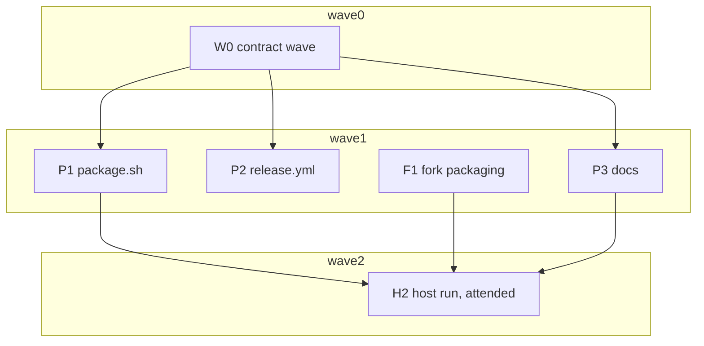

# Plan: Ship the fork's container and Parbake as two OCX packages on ghcr.io

## Status

- State:   review
- Tier:    xhigh
- Tier-grammar: 5
- Updated: 2026-10-28
- Next:    human: push the branch, open the PR, land the fork's `ocx-package` (see Integration)
- Finalized: 2026-10-28 local-only by request — five commits on origin/main 106c2c7, release gate `task clean check` green, not pushed
- Repos:   <!-- frozen at execution start; bases are never re-resolved -->
  - `.`      /Users/christian/workspace/apple/extra-code/container-runtime-macos  trunk `main` base `1dd84f56ef70d3583e29dd4e96a7b0b8551351e0`  landed: no
  - `fork`   /Users/christian/workspace/apple/extra-code/container-fork  trunk `main` (origin/HEAD) base `0f8245481903d4db3fe701bbf0750924b450bc4d` (branch `parbake`, per plan F1)  landed: no
  - F1 result: commit `3d04f93d2d2e043f645831fca34dba6f10313b41` (one signed commit on `0f82454`), held by the detached worktree `.agents/worktrees/f1` until the human creates `ocx-package` from it
- Branches: AGENTS.md forbids agents creating branches, so pipelines run in detached worktrees and
  merge by SHA. F1 ends as one commit SHA in the fork; the human creates `ocx-package` from it.

---

## Overview

**Author:** Christian Semmelmann, with an automated planning assistant
**Date:** 2026-10-28 (replaces the one-package plan of 2026-10-26)
**Scope:** large, two repositories · **Reversibility:** one-way door (high). A public GHCR package
cannot be made private again, and an index claim fixes the package names.
**Source:** `.agents/discussions/fork-container-ocx-delivery.md`, plus the replan decisions of
2026-10-28: two packages, the container package built in the fork, both claimed in the ocx.sh
index.
**Design:** [ADR 0015](../../docs/adr/adr_0015_ship_the_fork_and_parbake_as_two_ocx_packages.md)
(Proposed; amends ADR 0013)
**Research:**
- `.agents/research/research_fork_ocx_delivery_*.md` (five lanes, 2026-10-26);
- `.agents/research/research_ocx_own_index.md` (an own index is possible but costs every user a
  config line, so this plan lists in ocx.sh instead);
- `.agents/research/research_two_package_spikes.md` (the root of symlinks and the signing matrix).

## Objective

- A fork tag `ocx-1.6.1_N` publishes `ghcr.io/extra-code/container:1.6.1_N`: the fork's install
  root, ephemeral, signed ad hoc.
- A Parbake tag `vX.Y.Z` publishes `ghcr.io/extra-code/parbake:X.Y.Z`: the plugin directory,
  durable, signed ad hoc.
- Both are listed as `ocx.sh/extra-code/container` and `ocx.sh/extra-code/parbake`.
- A user with OCX and macOS 27 on Apple silicon follows `docs/quickstart.md`. They install both
  packages, create a root of three symlinks, run a macOS guest and switch back to stock `container`.

## Scope

### In scope

- Parbake: `scripts/package.sh` reduced to the plugin package plus the pairing check,
  `packaging/metadata.json`, `packaging/container.tag`, `task package`, `release.yml`, and the docs.
- The fork (`Repo` key `fork`): `ocx/`, `scripts/ocx-package.sh` and
  `.github/workflows/ocx-package.yml` on a branch built from `parbake`.
- Renaming ADR 0015 and every link to it.
- Rebuilding the unpushed series on `hex/fork-container-ocx-delivery`. `/hex-finalize` recomposes it
  from the branch diff, so the history reads as if two packages were always the plan.

### Out of scope

- Running stock and the fork at the same time, or a label patch.
- `parbake service`, `parbake doctor` or a `parbake` command that creates the root of symlinks.
- Developer ID, notarisation or a stable identity.
- Shipping Parbake's own network plugin. ADR 0015 names it as an untested option for the later
  Apple release.
- An own OCX index or catalog.
- Bundle image distribution, Linux kernel provisioning and Intel hosts.

## Research

Research is not repeated. The three sources above inform the plan, as does one Discover read of the
fork's workflows (their triggers are cited in ADR 0015 § The container package).

## Technical Approach

### Key decisions

All are recorded in ADR 0015.
- **Two packages.** The fork's container is ephemeral, and Parbake is durable.
- **Joining the packages.** A root of symlinks under `~/.parbake/root` and
  `system start --install-root` join them. There is no fork patch.
- **No dependency.** The Parbake package declares no OCX dependency.
  `packaging/container.tag` names the container tag it is built and tested against.
- **Container tags.** The scheme is `<upstream X.Y.Z>_<two-digit counter>`, starting at
  `1.6.1_01`, and `--cascade` maintains `1.6.1`, `1.6` and `1`. OCX compares build parts as text,
  so the counter is fixed-width. The researcher confirmed this in `version.rs`.
- **Container build.** A workflow on the fork's branch `ocx-package` builds it. The fork tag is
  `ocx-<tag>`, and `ocx/source-revision` names the revision to build.
- **Signing.** Everything is signed ad hoc.
- **Workflow permissions.** Build jobs hold `contents: read`. Publish jobs hold `packages: write`
  and `id-token: write`.
- **Index listing.** Each package is claimed once by hand. The announce steps in CI are gated by
  the repository variable `OCX_INDEX_ANNOUNCE`. The container package is pushed with
  `--no-keep-tag` and announced with `--ephemeral`.

Carried over from the one-package plan, unchanged:
- **Release binaries.** They come from `.build/release-assets/X.Y.Z/`, never from `task install`.
- **Fork cache.** There is none: tag runs build cold.
- **Publish hardening.** The publish job downloads by artifact id, compares SHA-256 values, pins
  OCX 0.6.5 with no project and no cache, and scopes credentials to the push and verify steps. It
  ends with `ocx package verify`.
- **Push credentials.** `OCX_AUTH_ghcr_io_TYPE=basic` with `github.actor` and `GITHUB_TOKEN`.
- **Fork build.** It runs the two `make` calls from ADR 0015 and drops the two sudo scripts.

### Constitution deviations

None. The project names no constitution.

## Component Contracts

### Parbake repository

#### C-001 `scripts/package.sh` command surface

```
scripts/package.sh stage VERSION     # plugin root from the stamped release assets and config.toml
scripts/package.sh verify            # codesign and entitlement checks on the plugin root
scripts/package.sh create VERSION    # ocx package create into .build/package/
scripts/package.sh pair              # the container tag builds the revision Package.resolved pins
scripts/package.sh all VERSION       # pair, stage, verify, create in order
scripts/package.sh --self-test       # offline checks, no network
scripts/package.sh -h | --help       # usage from the header
```

- `fetch` and `build` are gone, along with every fork path and fixture they used.
- Shell style, exit codes (0, 1 with `package.sh: <step>:`, 2 for usage), the VERSION rule and the
  `rm -rf` guard stay as they are.
- Paths:
  - the plugin root `.build/package/root`;
  - the output `.build/package/parbake-X.Y.Z.tar.xz` plus its compiled metadata;
  - the stamp `.build/package/verified`.
- No step uses `sudo`, starts or stops a service, or writes outside `.build/package/`.

#### C-002 `stage VERSION`

- Requires `.build/release-assets/VERSION/{container-runtime-macos,parbake,parbake-agent}`. A
  missing asset fails with "run task release:build VERSION=… first".
- Recreates the plugin root through the guard. It copies the three binaries to `bin/` with mode 0755
  and keeps their signatures.
- Writes `config.toml` at the root with mode 0644, from `git show <release commit>:config.toml`.
  The release commit is the `vVERSION` tag, else HEAD.
- `bin/parbake --version` and `bin/container-runtime-macos --version` must print VERSION.

#### C-003 `verify`

- The plugin root holds exactly `bin/container-runtime-macos`, `bin/parbake`,
  `bin/parbake-agent` and `config.toml`. An extra or missing entry fails and names the path.
- Every Mach-O file found by `file -b` passes `codesign --verify --strict` and is signed ad hoc. A
  count of zero fails.
- `com.apple.security.virtualization` is `true` on `container-runtime-macos` and `parbake`, and
  absent on `parbake-agent`. No binary carries another entitlement.
- No setuid, setgid or world-writable file, no symlink, and no `com.apple.quarantine`.
- Matched command output is captured first, so a SIGPIPE cannot turn a match into a miss.
- On success it writes the stamp holding VERSION.

#### C-004 `create VERSION` and `packaging/metadata.json`

- `packaging/metadata.json`:
  - `"type": "bundle"` and `"version": 1`;
  - one public `PATH` entry, `${installPath}/bin`;
  - `binaries` lists `container-runtime-macos`, `parbake` and `parbake-agent`.
  It stays annotated in `REUSE.toml`.
- `create` runs `ocx package create .build/package/root -p darwin/arm64 -m packaging/metadata.json
  --bin-scan -o .build/package/parbake-VERSION.tar.xz`.
  - It refuses a missing, stale or mismatched stamp.
  - `tar -tf` must list no absolute and no `..` member.
  - It prints the paths of `parbake-VERSION-metadata.json` and the archive.

#### C-005 `pair` and `packaging/container.tag`

- `packaging/container.tag` holds one line matching `^[0-9]+\.[0-9]+\.[0-9]+_[0-9]{2}$`, starting with
  `1.6.1_01`. It is annotated in `REUSE.toml`.
- `pair` reads the tag and the fork revision from `Package.resolved`. The existing pin parsing and
  validation are kept: a 40-hex revision and the `extra-code/container` location regexp.
- It fetches `refs/tags/ocx-<tag>` with `git fetch --depth 1 --no-tags` into a temp dir under
  `.build/package/`. It reads `git show 'FETCH_HEAD^{commit}:ocx/source-revision'`, because the tag
  may be annotated.
- An absent `packaging/container.tag` means the fork has retired. `pair` then prints
  "no container tag, pairing skipped" and exits 0.
- It fails with "container tag ocx-<tag> builds <rev>, Package.resolved pins <pin>" on a mismatch.
  It fails with "container tag ocx-<tag> not found" when the tag is missing, and with "invalid
  container tag" on a malformed file.
- `PACKAGE_PAIR_LOCATION` overrides only the fetch location, never the pin validation. It serves
  the self-test and a local dry run against a fork clone before the fork tag is pushed. CI never
  sets it.
- Without the override it needs the network. It is the only step that does.

#### C-006 Self-test

`--self-test` runs offline under `task lint` (`lint:release`), in a temp dir, with fixtures under
`scripts/fixtures/package/`. It proves:
1. `--help` exits 0. Each of these exits 2: no subcommand, an unknown subcommand, `fetch` or
   `build`, a missing VERSION and a malformed VERSION.
2. `packaging/metadata.json` parses, and its `binaries` equal the files `stage` writes.
3. The rm guard refuses an empty path, `/` and a path outside `.build/package/`.
4. `stage` fails on a missing asset, and writes `config.toml` at the plugin root.
5. `verify` fails on each of these: an extra file, a broken signature, the agent carrying the
   entitlement, an extra entitlement, and a symlink.
6. `create` refuses a missing, stale or mismatched stamp.
7. `pair` validates the tag-file format and skips when the file is absent. It compares against a fixture fork repository created with
   `git init` at test time, which holds a tag `ocx-1.6.1_01` and an `ocx/source-revision`. The check
   passes on a match and fails on a mismatch and on a missing tag. It uses `PACKAGE_PAIR_LOCATION`
   with a `file://` location, so no network is needed.
8. The self-test leaves no file outside its temp dir.

#### C-007 Taskfile

- `task package VERSION=X.Y.Z` runs `task release:build VERSION=…`, then
  `scripts/package.sh all VERSION`.
- `RELEASE_ALLOW_NON_MAIN` passes through.
- `lint:release` runs `scripts/package.sh --self-test`.

#### C-008 `release.yml`, job `release`

- Top-level `permissions: contents: read` stays, and the existing steps stay.
- `timeout-minutes` drops from 90 to 60, because the fork no longer builds here.
- The SwiftPM cache keeps its `!.build/package` exclusion, because `task package` still writes there.
- `task package VERSION="${TAG#v}"` replaces `task release:build`, with the tag passed through
  `env:`. This includes `pair`.
- It uploads the artifact `ocx-package`, holding the archive and the compiled metadata, with
  `if-no-files-found: error` and `retention-days: 7`.
- Outputs: the version, the artifact id and both SHA-256 values.
- `setup-ocx` pins `version: 0.6.5`.

#### C-009 `release.yml`, job `publish`

- `needs: release`, `if: startsWith(github.ref, 'refs/tags/v')`, the concurrency group
  `publish-parbake`, and `runs-on: xcode-27`.
- Permissions are exactly `packages: write` and `id-token: write`. It has no checkout, no cache and
  no build.
- Steps:
  1. Download by artifact id.
  2. Compare both SHA-256 values.
  3. Set up OCX 0.6.5 with `project: ""` and `cache: false`.
  4. `ocx package push -p darwin/arm64 -m <metadata> --ci-annotations=github --sign --cascade
     --annotation org.extra-code.parbake.container-tag=<container tag> -i
     ghcr.io/extra-code/parbake:<version> <archive>`. The container tag comes from a release-job
     output.
  5. `ocx package verify` with the identity
     `https://github.com/extra-code/parbake/.github/workflows/release.yml@refs/tags/v<version>`.
- Job `announce`:
  - `needs: publish`, with a job-level `if:` on the tag condition and
    `vars.OCX_INDEX_ANNOUNCE == 'true'`;
  - `environment: release`, `permissions: {}`, `runs-on: xcode-27`, and no checkout;
  - it sets up OCX the same way, because each job runs on a fresh runner;
  - it runs `ocx package announce --tags-file tags.txt --fork "$OCX_INDEX_FORK" extra-code/parbake`, with the
    tags the push wrote (`push --tags-file`, passed as a `publish` job output), as the OCX CI recipes do;
  - it runs on `ubuntu-latest`, because announcing needs no macOS runner.
- `claim.yml` (`workflow_dispatch` only, `environment: release`, `permissions: {}`) runs the one-time claim.
  - `OCX_ANNOUNCE_TOKEN` comes from `secrets.OCX_ANNOUNCE_TOKEN`, and `OCX_INDEX_FORK` from
    `vars.OCX_INDEX_FORK`. Both are set in that step's `env:` only.
- Every context value reaches `run:` through `env:`, and no step uses `set -x`.

#### C-010 Docs: quickstart, package how-to, troubleshooting

`docs/quickstart.md` (`tutorial`, `first-steps`) holds one path that ends at its result. Each step
shows its expected output. The page names where the trust policy's `config.toml` lives and says
that the shell variables last only for the current terminal. Sections, in order:
- **Requirements:** macOS 27 on Apple silicon, OCX linked to https://ocx.sh, and an SSH key. Both
  packages link to their pages, `https://ocx.sh/catalog/extra-code/container` and
  `https://ocx.sh/catalog/extra-code/parbake`.
- **Verify:**
  - `ocx package verify` for both packages, each with its identity from ADR 0015 § Trust policies;
  - exit codes 77 and 79;
  - the two `[[trust.policy]]` blocks;
  - the statements that a signature attests the workflow, not the content, and that the binaries
    are not notarised.
- **Install:** both `ocx package install --link` commands, then the three `ln -s` lines from
  ADR 0015 § Commands. Then comes an `ls` of the plugin's `config.toml` through the root, with its
  expected output. The container package is marked as a temporary patched build of
  apple/container.
- **Entry point:** `~/.parbake/root/bin/container` is the only way to run the fork's `container`.
  The page says why: a `container` reached through `ocx package exec` misses the plugin.
- **Switch to Parbake:**
  1. If stock is installed, `container ls -a` on stock, then stop stock.
  2. `~/.parbake/root/bin/container system start --install-root ~/.parbake/root --app-root
     ~/.parbake/app --disable-kernel-install`.
  3. The `launchctl print … | grep program` line, which shows a path in the OCX store.
- **Bundle:** `ocx package exec "$PARBAKE_PKG" -- parbake create …`, with the bundle-roots file
  (`README.md` › bundle roots).
- **Run a guest:** `run`, `exec … sw_vers`, `stop` and `rm` through `~/.parbake/root/bin/container`.
  The flags come from README › Run.
- **Switch back:** stop through the root's `container`, then start stock.

`docs/package.md` (`how-to`, `everyday`):
- **Upgrade:** stop, re-run `--link` with the new tag, then start. The page says when a container
  tag needs an app-root reset.
- **Order rule:** stop the services before moving or removing a link and before `ocx clean`. The
  running services use the resolved store paths.
- **Uninstall:**
  - stop, remove `~/.parbake/root` and both links, then run `ocx clean`;
  - `~/.parbake/app` stays, with the labelled warning about what it holds.

`docs/package-troubleshooting.md` covers four cases:
- the three traps (apple/container#1757, a stock CLI against the fork's apiserver, an old apiserver
  left running after an upgrade);
- a private package's pull error;
- a link path that is not a link, which makes `--link` exit 65;
- a root symlink that points at nothing, which shows as a missing macOS runtime at `run`;
- `ocx clean` run while the services were up, which shows as failed helper or plugin starts.

Every page (the first two items are reviewer checks, not scripts):
- names no host, volume, account or team identifier;
- names no projects other than Apple's, the fork and OCX;
- has no sentence over 25 words and a language tag on every fence.

#### C-011 Docs edits and the ADR rename

- `docs/adr/adr_0015_ship_the_fork_and_parbake_as_one_ocx_package.md` is renamed to
  `…_as_two_ocx_packages.md`, which is done in the working tree. Every link moves with it:
  `CONTRIBUTING.md`, `SECURITY.md`, `docs/signing.md` and ADR 0013. `.agents/memory/hex.md` was
  updated during planning.
- `README.md`:
  - Requirements and Quick start link the quickstart;
  - Build and install stays the from-source path;
  - each required OCX package links to its ocx.sh catalog page.
- `docs/signing.md`:
  - releases ship two ad-hoc-signed OCX packages (ADR 0015);
  - the signing-domain paragraph gains the matrix from ADR 0015 § Facts from the spikes.
- `CONTRIBUTING.md` › Release:
  - a fork release is the tag `ocx-<tag>` on `ocx-package` after `ocx/source-revision` is set, and a
    Parbake release needs `packaging/container.tag` to match;
  - `task package` is the local dry run. Before the fork tag is pushed, it needs
    `PACKAGE_PAIR_LOCATION` pointing at a fork clone;
  - the first publish of each package needs the public flip, the claim and `OCX_INDEX_ANNOUNCE`;
  - a 403 on the first push means "Manage Actions access".
- `SECURITY.md`:
  - both identity regexps and the issuer;
  - the job permission split;
  - the announce token, a classic `repo` token, which lives only in the `release` environment
    behind the owner's approval;
  - ad-hoc signing and no notarisation;
  - opt-in verification;
  - the fork's apiserver runs as the user with the virtualization entitlement;
  - the fork's Makefile is a first-party trust assumption in the fork's build job.
- `CHANGELOG.md`: the release's Added section names both packages, the quickstart and the
  container tag it pairs with.
- `AGENTS.md`:
  - Scratch gains `.build/package/`;
  - the security-sensitive paths gain `.github/workflows/release.yml`;
  - the other-projects rule names the fork and OCX.
- ADR 0015 stays `Proposed` in P3. H2 sets it to `Accepted`. ADR 0013 gains "Amended by ADR 0015".

### Fork repository (`Repo` = `fork`)

#### C-012 `ocx/` files

- `ocx/source-revision`: one 40-hex line, the revision to build, initially
  `0f8245481903d4db3fe701bbf0750924b450bc4d`.
- `ocx/metadata.json`:
  - `"type": "bundle"` and `"version": 1`;
  - a public `PATH` entry `${installPath}/bin`;
  - `binaries` lists `container` and `container-apiserver`.
- `ocx/README.md`: what the branch is for, how to cut `ocx-<tag>`, and the verification commands
  (`shellcheck scripts/ocx-package.sh`, `scripts/ocx-package.sh --self-test`). It names Parbake and
  states that the package is temporary.
- Each file carries the fork's license header style, and the files touch nothing outside `ocx/`,
  `scripts/ocx-package.sh` and `.github/workflows/ocx-package.yml`.

#### C-013 `scripts/ocx-package.sh`

```
scripts/ocx-package.sh check TAG          # TAG is ocx-X.Y.Z_N, X.Y.Z is the upstream tag of the source revision
scripts/ocx-package.sh build SRC ROOT     # the two make calls in SRC, install into ROOT, drop sudo scripts
scripts/ocx-package.sh verify ROOT        # codesign and entitlements on the container root
scripts/ocx-package.sh create ROOT TAG    # ocx package create into out/container-<X.Y.Z_N>.tar.xz
scripts/ocx-package.sh --self-test        # offline checks
```

- `check`:
  - `TAG` must match `^ocx-[0-9]+\.[0-9]+\.[0-9]+_[0-9]{2}$`;
  - `ocx/source-revision` must be 40-hex, exist (`git cat-file -e <rev>^{commit}`) and be an
    ancestor of both `HEAD` and `origin/parbake` (`git merge-base --is-ancestor`);
  - `HEAD` must be an ancestor of `origin/ocx-package`, so the tag sits on the packaging branch;
  - `git describe --tags --abbrev=0 --match '[0-9]*.[0-9]*.[0-9]*' <rev>` must equal `X.Y.Z`.
  Each failure names the rule.
- `build`:
  - it removes a stale `bin/release/staging/`;
  - it runs the two `make` calls from ADR 0015 with `SUDO=` and the default ad-hoc `CODESIGN_OPTS`;
  - it checks `bin/container`, `bin/container-apiserver` and `container-runtime-linux`,
    `container-network-vmnet`, `container-core-images` under `libexec/container/plugins/`;
  - it removes `bin/update-container.sh` and `bin/uninstall-container.sh`.
- `verify`:
  - every Mach-O file is signed ad hoc and passes `--strict`;
  - `com.apple.security.virtualization` is present on `container-runtime-linux` and
    `container-network-vmnet`, and no other entitlement exists;
  - no symlink leaves the root, no quarantine, no setuid, no world-writable file;
  - the sudo scripts are absent.
- `create` runs `ocx package create ROOT -p darwin/arm64 -m ocx/metadata.json --bin-scan -o …` and
  refuses an archive with an absolute or `..` member.
- Style: `set -euo pipefail`, `die`, exit 0, 1 or 2, and shellcheck clean. The rm guard is limited to
  `out/` and the build root.
- The self-test covers `check` and the guards against a `git init` fixture, plus `verify` failures
  on copies of `/usr/bin/true` signed at test time.

#### C-014 `.github/workflows/ocx-package.yml`

- `on: push: tags: ['ocx-*']` only, and `permissions: contents: read` at the top.
- Job `build`:
  - `runs-on: xcode-27` with `timeout-minutes: 90`;
  - checkout with `fetch-depth: 0`, then `scripts/ocx-package.sh check "$TAG"`;
  - `git worktree add .build/src <source-revision>`, then `build .build/src .build/root`, then
    `verify`, then `create`;
  - upload the archive and the compiled metadata as `ocx-package`;
  - outputs: the tag without `ocx-`, the artifact id and both SHA-256 values.
- Job `publish`, the C-009 shape for `ghcr.io/extra-code/container:<X.Y.Z_N>`:
  - the push adds `--no-keep-tag` and
    `--annotation org.extra-code.container.source-revision=<rev>`;
  - the concurrency group is `publish-container`;
  - the verify identity is
    `https://github.com/extra-code/container/.github/workflows/ocx-package.yml@refs/tags/ocx-<X.Y.Z_N>`.
- Job `announce`, the C-009 shape for `extra-code/container`, with `--ephemeral` from the first run.
- `publish` needs `build`, so a failed `check` or `verify` stops the run before anything is pushed
  (S-003).
- Every action is SHA-pinned with a version comment, and only GitHub-owned actions and
  `ocx-sh/setup-ocx` are used.

## User-Experience Scenarios

- **S-001 Maintainer dry run, Parbake.**
  - Action: `RELEASE_ALLOW_NON_MAIN=1 task package VERSION=0.1.0`.
  - Outcome: `parbake-0.1.0.tar.xz` and its metadata.
  - Errors:
    - a malformed VERSION exits 2;
    - a missing asset names `task release:build`;
    - a container tag that pairs with another revision names both revisions;
    - before the fork tag is pushed, the run needs `PACKAGE_PAIR_LOCATION` to point at a fork clone.
- **S-002 Maintainer dry run, fork.**
  - Action: in the fork clone, run `check`, `build`, `verify` and `create` for `ocx-1.6.1_01`.
  - Outcome: `out/container-1.6.1_01.tar.xz`.
  - Errors: a malformed tag, or an `X.Y.Z` that does not match the source revision, names the rule.
- **S-003 Container release.**
  - Action: the maintainer pushes `ocx-1.6.1_01`.
  - Outcome: `ghcr.io/extra-code/container:1.6.1_01`, `1.6.1`, `1.6` and `1` are signed. When
    enabled, an announce pull request marks them ephemeral.
  - Errors: a failed `check` or `verify` stops the run before `publish`, and a SHA-256 mismatch
    fails `publish`.
- **S-004 Parbake release.**
  - Action: the maintainer pushes `v0.1.0`.
  - Outcome: `ghcr.io/extra-code/parbake:0.1.0` and its rolling tags, signed, and an announce pull
    request when enabled.
  - Errors: `pair` fails the release job when the container tag does not build the pinned revision.
- **S-005 First install.**
  - Action: verify, install both packages with `--link`, and create the three symlinks.
  - Outcome: no quarantine, and nothing on the shell PATH.
  - Errors: a link path that already exists as a directory exits 65, and the troubleshooting page
    names it.
- **S-006 Switch and run.**
  - Action: stop stock, start through the root, create or use a bundle, then run, exec, stop and
    remove a guest.
  - Outcome: `program` shows the container package's store path, and `exec sw_vers` answers.
  - Errors: each trap shows its documented symptom.
- **S-007 Switch back.**
  - Outcome: `program` shows the stock apiserver, and stock `container ls` works.
- **S-008 Upgrade.**
  - Action: with Parbake N running, follow `docs/package.md` to N+1, and the same for a container
    tag.
  - Outcome: the root is unchanged, and the guest runs on the new package.
- **S-009 Index.**
  - Action: after the claims and a merged announce.
  - Outcome: `ocx package install --link … ocx.sh/extra-code/parbake:0.1.0` resolves through the
    index, and the container root shows `apple` as upstream.

## Parallelization

| Id | Repo | Scope | Expected files | Wave | Depends on | Marks | Status |
|---|---|---|---|---|---|---|---|
| W0 | . | contract wave: C-001 surface (`fetch` and `build` removed, `pair` stub), C-004 metadata, C-005 tag file, C-007, C-006 items 1–3 | `scripts/package.sh`, `packaging/metadata.json`, `packaging/container.tag`, `REUSE.toml`, `Taskfile.yml`, `scripts/fixtures/package/**` | 0 | — | — | merged |
| P1 | . | C-002–C-006 (items 4–8), S-001 | `scripts/package.sh`, `scripts/fixtures/package/**` | 1 | W0 | review | merged |
| P2 | . | C-008, C-009, S-004 | `.github/workflows/release.yml` | 1 | W0 | review | merged |
| P3 | . | C-010, C-011; documents S-005–S-009 | `docs/quickstart.md`, `docs/package.md`, `docs/package-troubleshooting.md`, `README.md`, `docs/signing.md`, `CONTRIBUTING.md`, `SECURITY.md`, `CHANGELOG.md`, `AGENTS.md`, `docs/adr/adr_0013_*.md`, `docs/adr/adr_0015_*.md` | 1 | W0 | — | merged |
| F1 | fork | C-012–C-014, S-002, S-003 | `ocx/source-revision`, `ocx/metadata.json`, `ocx/README.md`, `scripts/ocx-package.sh`, `.github/workflows/ocx-package.yml` | 1 | — | hard, review | merged |
| H2 | . | S-001, S-002 and S-005–S-007 on the host, attended, with both archives materialised and the quickstart's root | `docs/adr/adr_0015_*.md` (Status `Accepted` on success); the run record stays outside the repo | 2 | P1, F1, P3 | — | merged |



Critical path: F1 → H2. F1 is a new script and workflow in another repository, so it is marked
`hard`.

Shippable after wave 2: both repositories hold a dry-run-tested packaging path, workflows and docs.
The tags, public flips, claims and the S-003 to S-009 runs are the human's steps, listed under
Integration.

The four wave-1 pipelines are file-disjoint. W0 owns `Taskfile.yml`, `REUSE.toml` and both
`packaging/` files. F1 shares no file with the lead.

## Implementation Steps

### Prerequisite (human, before /hex-execute)

1. Clone the fork beside this repository and switch to `parbake`:
   `git clone git@github.com:extra-code/container.git ../container-fork` and
   `git -C ../container-fork switch parbake`.
2. Start the session with `--add-dir ../container-fork`.

The `Federation: fork` pointer in `.agents/memory/hex.md` names that path.

### Contract wave (W0)

1. `scripts/package.sh`:
   - remove `fetch`, `build` and their helpers;
   - add `pair` to the dispatcher as a known subcommand, with a stub that fails with
     `die "pair: not implemented"`;
   - update the usage header and the dispatcher. `fetch` and `build` now exit 2.
2. Rewrite `packaging/metadata.json` per C-004. Add `packaging/container.tag` with `1.6.1_01` and its
   `REUSE.toml` annotation.
3. Trim the fixtures under `scripts/fixtures/package/`:
   - drop the fork root;
   - keep the `Package.resolved` pair, now used by `pair`'s pin parsing;
   - add a plugin-root layout.
4. Self-test items 1–3 pass. `git add` before `task lint`. `task check` green. Commit.

### Pipeline steps

**P1 (`scripts/package.sh`, `review`)**
1. C-002 `stage`, plus item 4.
2. C-003 `verify`, plus item 5.
3. C-004 `create` and `all`, plus item 6.
4. C-005 `pair`, plus item 7 with the `git init` fixture, then item 8. `task check` green.

**P2 (`release.yml`, `review`)**
1. Release job per C-008.
2. Publish and announce jobs per C-009.
3. Check that:
   - the YAML parses;
   - every action is SHA-pinned;
   - permissions match exactly, and `announce` holds none;
   - the job-level `if:` and concurrency are right;
   - `publish` needs `release`, so a failed `pair` stops the run before anything is pushed (S-004);
   - every context value goes through `env:`.

**P3 (docs)**
1. The rename links per C-011, first, so every later link check sees the new name.
2. The quickstart, package and troubleshooting pages per C-010. Flags come from README › Run, the
   bundle roots and `parbake create --help`.
3. The remaining C-011 edits.
4. Run the docs checks (`doc_declaration.py`, `prose.py`, `page_type.py`, `links_raw.py`) on the
   changed pages, then `task lint`.

**F1 (fork, `hard`, `review`)** — in `../container-fork`, in a detached worktree from `parbake`.
1. C-012 files.
2. C-013 script with its self-test.
3. C-014 workflow. Check that it parses, that actions are pinned, that the permissions match and
   that no Apple workflow trigger matches `ocx-*`.
4. Run `shellcheck` and `--self-test`. End with exactly one signed commit on top of `parbake`, in a
   detached worktree. The human creates `ocx-package` from that SHA and pushes it, and the tag
   points at that commit.

**H2 (attended host run)**
1. Tag `ocx-1.6.1_01` locally in `../container-fork` on F1's commit, without pushing it. Then run
   `PACKAGE_PAIR_LOCATION=file://$PWD/../container-fork RELEASE_ALLOW_NON_MAIN=1 task package
   VERSION=0.1.0`.
2. In the fork clone, run the S-002 steps for `ocx-1.6.1_01`, and record the cold build time.
3. Materialise both archives with `ocx package test -o`, then create the root exactly as the
   quickstart says. The two `ocx package test -o` dirs stand in for the `--link` paths.
4. Stop stock and start through the root. Check `program`, boot a guest and run `exec sw_vers`.
   Stop and remove the guest, then switch back. Record any prompt or delay.
5. On success, set ADR 0015 to `Accepted` with a Changelog line.

**H2 result (2026-10-28).**
- The fork build ran `check`, `build`, `verify` and `create` in 209 s cold, giving a 117 MB archive.
- The Parbake plugin package is 47 MB.
- Both were materialised with `ocx package test -o` under `~/.parbake`, the root was built with the
  quickstart's three links, and its `config.toml` check passed. No quarantine attribute was set.
- The services started through the root in 2 s, with `program` in the container package.
- A guest ran after 37 s with a DHCP address and answered `exec sw_vers`. Stop and remove worked,
  and the stock services came back.
- `pair` was not run, because it needs the fork tag. Its self-test covers it.
- No prompt or delay was observed by the shell. The user watched the screen.

### Integration and review

- `task clean check` green on the merged lead branch. The fork's `--self-test` and `shellcheck` are
  green on its branch. Then `/hex-review` runs over both.
- `/hex-finalize` recomposes the lead series from the branch diff, so the old one-package commits do
  not survive. Nothing is pushed without the user.
- Human steps after the merge, in order:
  1. Repository settings:
     - fork Actions with SHA pinning required and selected actions only (GitHub-owned plus
       `ocx-sh/setup-ocx@*`), as Parbake already has;
     - in both repositories, a `release` environment that requires the owner's approval and admits
       only `v*` tags (Parbake) or `ocx-*` tags (fork);
     - in the fork, rulesets for the branch `ocx-package` and the `ocx-*` tags.
  2. Push the fork branch as `ocx-package`. Tag `ocx-1.6.1_01` and push the tag. Watch the build and
     publish jobs.
  3. Tag `v0.1.0` in Parbake and push. Watch its jobs.
  4. Verify both packages privately from a second host, then make both GHCR packages public, once
     and irreversibly.
  5. Run the claim workflow in each repository (`claim.yml` in Parbake, `ocx-claim.yml` in the fork). Each
     opens a pull request against `ocx-sh/index`.
  6. Once both claims are merged (`announce` exits 79 before that), set the following in both
     repositories:
     - the `OCX_ANNOUNCE_TOKEN` secret in `release`: preferably a fine-grained token with read and
       pull-request write on `ocx-sh/index` and the index fork, else a classic token with `repo` scope;
     - the variables `OCX_INDEX_FORK` and `OCX_INDEX_ANNOUNCE=true`.

     Run the first announces by hand with the same commands the jobs use.
  7. Once the index pull requests merge, run S-005 to S-007 and S-009 from the quickstart word for
     word. Run S-008 at the next release.

## Dependencies

- **Code:** the fork at `0f824548`; OCX 0.6.5 and `ocx-sh/setup-ocx` v1.4.0; the `xcode-27`
  runner in both repositories.
- **Services:** GHCR, the GitHub OIDC token, and `ocx-sh/index` with its review bot.

## Rollback Plan

- Before a public flip: delete the GHCR versions, and drop the fork branch and tag.
- After it: supersede rather than delete. For the container package:
  - `ocx package announce --yank <tag> --yank-reason …` marks a bad tag;
  - marking it `deprecated` retires the whole package.
- An index claim is not undone. A wrong claim is fixed by a pull request against `ocx-sh/index`.

## Risks

- **The announce token.** It is a fine-grained personal token where possible, else a classic `repo` token, broader than the index
  fork needs, because OCX documents that a fine-grained token cannot open the index pull request.
  It lives only in the `release` environment, behind the owner's approval, and the announce job
  holds no repository permissions.
- **Pruned container tags.** A pruned tag breaks every quickstart that names it. Tags are pruned
  only when no Parbake release in the quickstart pairs with them.
- **The final verify proves less than it looks.** It uses the identity the same workflow signed
  with. The human's verify from a second host is the independent check.
- **A cold fork build in the fork's CI is slow or flaky.** H2 measures it, and C-014 sets the
  timeout.
- **A user creates the root wrongly.** The troubleshooting page covers a dangling link, and the
  `program` line shows which apiserver runs.
- **A per-tag store path disturbs TCC Local Network** (apple/container PR #1415). The risk is
  accepted as in ADR 0015.
- **A first start of fresh binaries stalls for minutes**, as seen once in the spikes. H2 records it.

## Open Questions

- [NEEDS CLARIFICATION: Does `ocx package claim` need the package to be public first?]
  Recommended: claim after the public flip, as the human steps order it, since the index bot checks
  registry truth.
- [NEEDS CLARIFICATION: Does `container system start` called through `~/.parbake/root/bin/container`
  need `--install-root`, given the default is the unresolved grandparent of the executable?]
  Recommended: always pass it. The spikes used it, and the cost is one flag.

## Checklist

- [x] Prerequisite: fork clone at `../container-fork`, session with `--add-dir`
- [x] W0 committed with `task check` green
- [x] P1, P2, P3 and F1 merged; `task clean check` and the fork checks green
- [x] H2 recorded; ADR 0015 Accepted
- [x] Review panel (spec, quality, security, docs, fork) and one fix pass in both repos
- [ ] Human: fork settings, tags, publishes, public flips, claims, announces, quickstart run

## Spec Deltas

None. No spec in `docs/specs/` covers releases or packaging.
