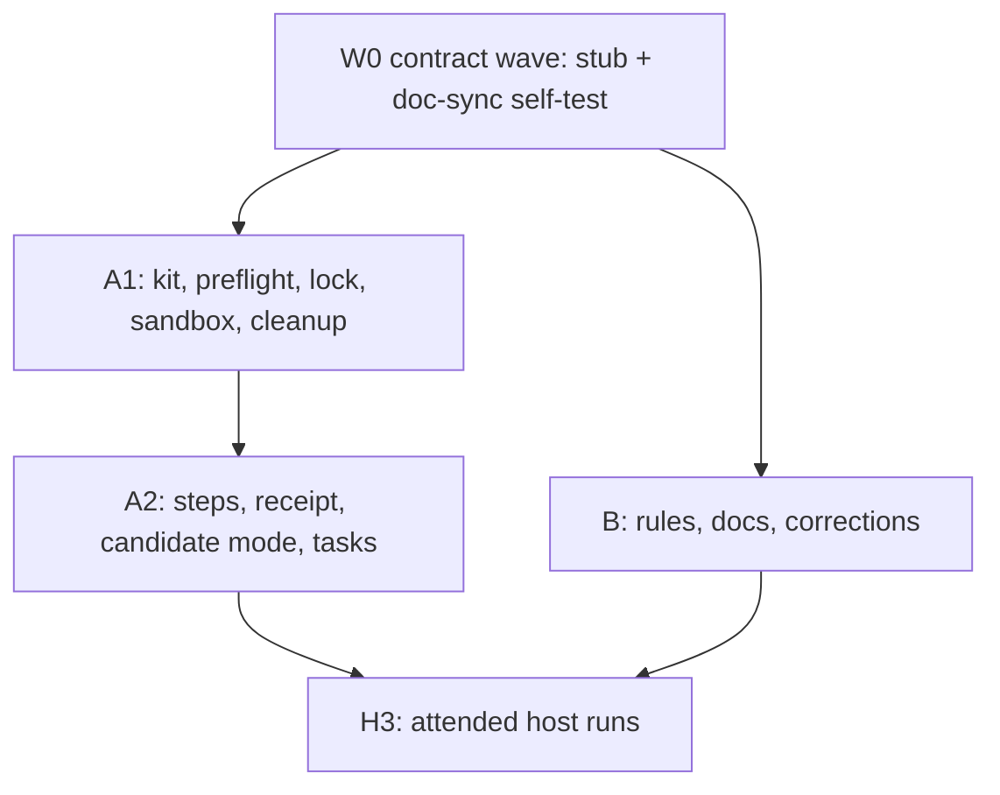

# Plan: A repeatable package end-to-end run from a fresh, isolated state

## Status

- State:   review
- Tier:    high
- Tier-grammar: 5
- Updated: 2026-10-30
- Next:    human: push the branch, open the PR, merge
- Finalized: 2026-10-30 local-only by request — four signed commits on origin/main cef6209, release gate `task clean check` green, not pushed
- H3 (2026-10-30, attended): published run `RESULT pass` (run-id 20261030T133021Z-975ec09d); parallel start
  `RESULT refused` by P04 (20261030T133042Z-2ed7c5ae); repeat `RESULT pass` (20261030T134115Z-3c52dcba);
  candidate `RESULT pass` (20261030T135010Z-5372bb19, E05 unsigned with verify exit 79 confirmed live).
  Receipts under `~/.parbake-e2e/receipts/`. No keychain dialog at E12; stock services restored after each run.
- Executed: W0, A1, A2, B merged; one review call (security, spec+quality), one fix pass; `task check` green at b2dc63e

---

## Overview

**Author:** Christian Semmelmann, with an automated planning assistant
**Date:** 2026-10-30
**Scope:** small to medium, one repository · **Reversibility:** two-way door. The run is test tooling.
It changes no package, release or index state.
**Design:** inline. [ADR 0015](../../docs/adr/adr_0015_ship_the_fork_and_parbake_as_two_ocx_packages.md)
covers the two packages and the root of symlinks this run exercises.
**Research:**
- `.agents/research/research_package_e2e_ocx.md`: OCX isolation, candidate installs through a local
  registry, trust-policy scope, exit codes.
- `.agents/research/research_two_package_spikes.md`: the root of symlinks, the signing domain.

**Decisions taken by the user (2026-10-30):**
- Isolation: a sandbox per run. The user's `~/.ocx`, `~/.parbake`, `~/VM.bundle` and the guest
  keychain item stay untouched.
- Scope: published packages by default, plus a candidate mode for locally built packages.
- Process: plan first, then `/hex-execute`, then an attended host run. A local restore image, for
  example on an external disk, is allowed.

## Objective

- One command, `task e2e:package`, runs the quickstart path end to end from a fresh state: verify,
  install through OCX, join, switch services, create a bundle, run a guest, exec, stop, remove, switch
  back, clean up.
- `task e2e:package:candidate VERSION=X.Y.Z` runs the same path for a Parbake package built by
  `task package`, served from a local registry, before anything is published.
- Every run writes a machine-readable receipt. The receipt is the evidence that a given pair of
  packages passed, and runs compare across time.
- The run is safe to repeat. It refuses when it could harm the user's state, restores the stock
  services on every exit path, and leaves nothing behind but the receipt.
- AGENTS.md tells an agent which changes call for the run and that the run is attended.

## Scope

### In scope

- `scripts/package-e2e.sh` with `run`, `--self-test` and `-h`.
- `scripts/fixtures/package-e2e/` for the self-test stubs.
- `Taskfile.yml`: `e2e:package`, `e2e:package:candidate`, `lint:e2e` (in `lint`).
- Docs: `docs/end_to_end_checklist.md` (points to the scripted package run), `CONTRIBUTING.md`
  (release order), `AGENTS.md` › Verification (the agent rule).
- Two doc corrections found while planning:
  - `docs/quickstart.md` swaps exit 77 and 79. In ocx 0.6.5, 79 means no signature was found and 77
    means the signer does not match (`crates/ocx_cli/src/exit/ocx_sign.rs`).
  - `docs/package-troubleshooting.md` and `research_two_package_spikes.md` blame the guest keychain
    item for the long first `run`. The plugin never reads that item; only `parbake` does. The wait
    sits before `[1/6] Fetching image`, where the fork's images service looks up a registry login in
    the keychain (`ContainerImagesService/Server/ImagesService.swift:444-447`, keychain domain
    `com.apple.container.registry`). A login that the stock build stored asks once per new build.

### Out of scope

- A CI job that boots a guest. CI runs only the self-test.
- Candidate builds of the container package inside the fork. Candidate mode takes a container
  archive by path when one is given, else the published container package.
- Fixing ocx-sh/ocx#670. The run uses `ghcr.io` names, as the docs do.
- Changing the quickstart's paths. The run mirrors its commands under sandbox paths.

## Technical Approach

### Key decisions

| # | Decision | Options weighed | Choice and reason |
|---|---|---|---|
| D1 | Isolation | sandbox per run · reset the quickstart paths | Sandbox (user decision). A run never deletes the user's state, so an agent can run it. |
| D2 | Sandbox home | under `~/.parbake-e2e/<run-id>` · `/tmp` | Under home. The plugin boots only bundles under the real home (`BundlePathPolicy.swift:23,59-80`). |
| D3 | OCX hermeticity | `OCX_HOME` only · `OCX_HOME` + `OCX_NO_CONFIG=1` + `OCX_NO_PROJECT=1` + empty `DOCKER_CONFIG` + `--config <trust.toml>` | The full set. `OCX_HOME` alone still reads the user config and Docker credentials (research). |
| D4 | Keychain | default service · a service per run | `--keychain --keychain-service container-runtime-macos.e2e.<run-id>`. A fresh item per run, deleted at the end. Proves the no-dialog path for a new item. |
| D5 | Guest key | user's key · a throwaway key per run | `ssh-keygen -t ed25519 -N ''` in the sandbox. A fresh system has no key either. |
| D6 | Candidate source | `ocx package test -o` · local zot registry | zot, itself an OCX package (`ocx.sh/project-zot/zot:2.1.21`), on port 0, plain HTTP via `OCX_INSECURE_REGISTRIES`. Keeps the same `install --link <ref>` path as published mode. Upstream OCX tests do the same. |
| D7 | Receipt location | in the repo · `.build/` · outside the repo | `~/.parbake-e2e/receipts/<run-id>.json`, outside the repo. The checklist forbids host identifiers and timings in the repo; `.build/` is removed by `task clean`. |
| D8 | Containers already present | stop them · refuse | Refuse, with no override. An agent must never stop the user's containers. The user stops them and reruns. |
| D9 | Doc drift | trust the docs · self-test checks the docs | The self-test asserts that `docs/quickstart.md` still carries the script's identity regexps, verify flags and the three `ln -s` lines. A doc edit that drifts fails `task check`. |

### Constitution deviations

None. AGENTS.md is the project's rule set; the plan follows it (`--no-verify` in hex runs, signed
commits, no agent pushes).

## Component Contracts

### `scripts/package-e2e.sh`

**C-001 Interface.**
- `package-e2e.sh run [--candidate VERSION] [--keep]`, `package-e2e.sh --self-test`,
  `package-e2e.sh -h|--help`.
- Header: SPDX lines, `#!/bin/bash`, `set -euo pipefail`, bash 3.2, a `# --- usage ---` block that
  `-h` prints, as in `scripts/package.sh`.
- Exit codes: 0 every check passed and cleanup finished; 1 a check failed (cleanup still ran);
  2 usage error; 3 refused before any change (a preflight failed); 4 cleanup failed (the stock
  services or the sandbox could not be restored; the message names what is left); 129, 130, 131,
  141 and 143 after SIGHUP, SIGINT, SIGQUIT, SIGPIPE and SIGTERM (cleanup ran).
- `-h` prints the usage block on stdout and exits 0.
- Output: `==> <step id> <name>` per step on stdout, `package-e2e.sh: <msg>` on stderr, a final
  line `RESULT pass|fail|refused <receipt path>`.
- Attended guard: `run` refuses with exit 3 when stdin is not a TTY, unless `PKG_E2E_ATTENDED=1`.
  This is a speed bump for unattended agents, not a trust boundary.
- `run --recover` stops an apiserver whose `program` lies under `PKG_E2E_ROOT` (left by a killed
  run), restarts the stock services when they are installed, removes stale sandboxes through the
  guarded remover and exits 0. It never touches anything outside `PKG_E2E_ROOT`.
- The step ids (E01–E16), the receipt keys and the exit codes are readonly constants in the script,
  fixed in W0.
- Hygiene: the script unsets inherited `OCX_*` and `DOCKER_CONFIG`, sets
  `PATH=/usr/bin:/bin:/usr/sbin:/sbin` plus the directory of the resolved `ocx`, never uses `eval`
  or `sh -c`, and passes every value as a quoted array element. The `_PKG_E2E_SELFTEST_*` hooks are
  unset unless a per-self-test nonce file under the system temp directory, owned by the user,
  holds the nonce in `_PKG_E2E_SELFTEST_NONCE`; a real run never has one and uses the system tools
  by absolute path.

**C-002 Parameters** (environment, each optional):

| Variable | Default | Meaning |
|---|---|---|
| `PKG_E2E_CONTAINER_REF` | `ghcr.io/extra-code/container:<packaging/container.tag>` | Container package reference |
| `PKG_E2E_PARBAKE_REF` | `ghcr.io/extra-code/parbake:<first CHANGELOG.md line matching ^## v([0-9]+\.[0-9]+\.[0-9]+)$>` | Parbake package reference (published mode) |
| `PKG_E2E_CONTAINER_ARCHIVE` | unset | Candidate mode: a container archive (regular file, no URL, no leading `-`; made absolute and pushed after `--`) and its `-metadata.json` to push instead of the published container |
| `PKG_E2E_RESTORE_IMAGE` | unset (parbake picks the latest image) | Restore image: an existing regular file, or an `https://` URL matching a strict regexp; passed to `parbake create --restore-image` |
| `PKG_E2E_MIN_FREE_GB` | `60` | Free space the preflight demands under home: the bundle's used blocks (about 30 GB of the 100 GiB sparse disk) plus a downloaded image (about 18 GB) plus margin |
| `PKG_E2E_RUN_TIMEOUT` | `900` | Seconds to wait for `running` (E14) |
| `PKG_E2E_TOTAL_TIMEOUT` | `5400` | Ceiling for the whole run; exceeding it fails the current step and cleans up |
| `PKG_E2E_OCX_VERSION` | `0.6.5` | The `ocx version` the preflight requires |
| `PKG_E2E_ROOT` | `~/.parbake-e2e` | Parent of sandboxes, receipts and the lock. An existing directory must be empty or hold the marker file `.parbake-e2e-root`; the run creates the marker and never changes the mode of a directory without it |
| `PKG_E2E_ATTENDED` | unset | `1` allows a run without a TTY |

Validation (exit 2 on violation, before anything else runs):
- A reference is `ghcr.io/extra-code/container` or `ghcr.io/extra-code/parbake`, then `:<tag>`
  with the tag matching `^[A-Za-z0-9_][A-Za-z0-9._-]{0,127}$`, optionally followed by
  `@sha256:<64 hex>`. In candidate mode the script builds the `127.0.0.1:<port>/…` references
  itself; `PKG_E2E_*_REF` is refused there.
- `PKG_E2E_ROOT` is absolute, has no `//`, `/./`, `/../` or trailing `/`, matches
  `^[A-Za-z0-9/._-]+$`, is not a symlink, and its `pwd -P` lies strictly below the canonical home;
  the run uses that canonical path from then on.
- Numeric values match `^(0|[1-9][0-9]{0,6})$` before any arithmetic.
- The run-id is never read from the environment.

**C-003 Preflight** (exit 3 on any failure, nothing changed yet, a receipt with `result: refused`
and the failing check's id P01–P11 in `refused_by`):

| Id | Check | Message names |
|---|---|---|
| P01 | macOS 27, `uname -m` is `arm64`, `sysctl -n kern.hv_vmm_present` is `0` | the host property |
| P02 | `ocx`, `ssh-keygen`, `security`, `launchctl`, `plutil`, `lsof` resolve; `ocx version` equals `PKG_E2E_OCX_VERSION` | the missing tool or version |
| P03 | Attended (C-001) | `PKG_E2E_ATTENDED=1` |
| P04 | The lock (below) is free | the holder's PID |
| P05 | Free space under home ≥ `PKG_E2E_MIN_FREE_GB` | needed and free GB |
| P06 | The login keychain is unlocked (`security show-keychain-info "$HOME/Library/Keychains/login.keychain-db"` exit 0; without a path the command answers for no keychain and always exits 0, so the path is named; a non-zero exit counts as locked) | how to unlock |
| P07 | No item exists for the run's keychain service | the service |
| P08 | The running apiserver, if any, has `program = /usr/local/bin/container-apiserver`; a `program` under `PKG_E2E_ROOT` names `run --recover`; any other path refuses | the path |
| P09 | When the stock apiserver runs, `container ls -a` lists no container (D8) | the containers, and to stop them |
| P10 | Each reference resolves for `darwin/arm64`: `ocx --remote --format json index list --platforms <ref>` returns `{"<ref>": ["darwin/arm64"]}` (parsed as JSON; a warning with exit 0 is a failure); the tag then resolves to a digest that the run uses from here on | the reference |
| P11 | `PKG_E2E_RESTORE_IMAGE`, when set, passes C-002 validation and exists | the value |

Lock: `PKG_E2E_ROOT/.lock` is a directory created with `mkdir -m 700`, holding `pid` and `cmd`. It
is taken first, before any state is read, and released last, after the receipt is written. A lock
counts as stale only when `ps -p <pid> -o command=` no longer shows this script. A stale lock is
taken over by an atomic `mv` to `.lock.stale.<run-id>`, then `mkdir` again; a second run that loses
the `mkdir` refuses.

Informational, never a refusal: a keychain internet password for `registry-1.docker.io` exists
(`security find-internet-password -s registry-1.docker.io`, attributes only). The run then prints
that macOS may ask once at E13 for the new `container` build to read that login.

**C-004 Sandbox.** `run-id` is `<UTC yyyymmddThhmmssZ>-<8 hex>`, generated once, readonly, and
checked against `^[0-9]{8}T[0-9]{6}Z-[0-9a-f]{8}$`. The sandbox `S` is `PKG_E2E_ROOT/<run-id>`,
created with `mkdir -m 700` (no `-p`; an existing path refuses), with `ocx/` (`OCX_HOME`), `docker/`
(empty, `DOCKER_CONFIG`), `trust.toml`, `state`, `link/{container,plugin}`, `root/`, `app/`,
`cache/`, `bundle/` (empty: `parbake create` refuses an existing `bundle/VM.bundle`), `key/` (mode 700, `id_ed25519{,.pub}` from `ssh-keygen -t ed25519
-N '' -f S/key/id_ed25519`), and in candidate mode `zot/` (mode 700).
Every ocx call runs with `OCX_HOME=S/ocx OCX_NO_CONFIG=1 OCX_NO_PROJECT=1 DOCKER_CONFIG=S/docker
OCX_NO_UPDATE_CHECK=1 --config S/trust.toml`. `OCX_INSECURE_REGISTRIES` is never exported; it is
set only on the single ocx calls that talk to `127.0.0.1:<port>` in candidate mode.
The keychain service is `container-runtime-macos.e2e.<run-id>`; the script asserts it matches
`^container-runtime-macos\.e2e\.[0-9]{8}T[0-9]{6}Z-[0-9a-f]{8}$` and is not
`container-runtime-macos.guest` before any keychain call.
Stock state: right before E10 the script writes `S/state` with `stock_ran=1` only when
`launchctl print gui/<uid>/com.apple.container.apiserver` shows `program =
/usr/local/bin/container-apiserver` and a running state, else `stock_ran=0`. Cleanup reads that file,
never a guess.

**C-005 Steps and expectations** (each step is a receipt entry with a timeout; the first failure ends
the run and jumps to cleanup; `detail` carries a short reason class, `product`, `network` or
`timeout`, plus a filtered message):

| Id | Step | Timeout | Pass when |
|---|---|---|---|
| E01 | Write `trust.toml` with the two policies, byte for byte the quickstart's policy block with no scope changes | — | file written mode 600; E02 is the proof the policy loads |
| E02 | Verify container by digest (published mode) with the quickstart identity, `ocx --format json package verify …` | 120 s | exit 0; `data.certificate_identity` of the JSON output equals the expected identity exactly |
| E03 | Verify Parbake by digest (published mode) | 120 s | as E02 |
| E04 | Negative verify: Parbake with identity `…@refs/tags/v0.0.0-e2e` | 120 s | exit 77 and the message `certificate identity mismatch` (confirmed on 2026-10-30 against ocx 0.6.5: stderr `Error: <ref>: certificate identity mismatch`) |
| E05 | Candidate mode only: start zot (C-006a), push the archive(s), read the pushed digest, verify the unsigned candidate | 300 s | push exit 0; digest recorded; verify exits 79 (`pass`); any other exit is a `warn` with the exit code in `detail` (79 as "no signature" is not confirmed against a live run) |
| E06 | `ocx package install --link S/link/container "<ref>@<digest>"` | 600 s, one retry on `network` | exit 0; the link exists. Published mode: no line contains `no trust policy covers` or `without signature verification`, and the receipt records `verified: true` only after E02 passed. Candidate mode with an unsigned package: that line is expected and the receipt records `verified: false` |
| E07 | Same for Parbake into `S/link/plugin` | as E06 | as E06 |
| E08 | Build the root with the quickstart's three `ln -s` lines, `S/root` for `~/.parbake/root` and `S/link` for `~/.parbake` | — | `S/root/libexec/container-plugins/container-runtime-macos/config.toml` exists |
| E09 | `S/root/bin/container --version`; `ocx package exec <parbake ref> -- parbake --version` | 60 s | the first prints `container CLI version parbake-<hash> (build: release, commit: <hash>)` (observed: `container CLI version parbake-804209b1 (build: release, commit: 0f82454)`); the second prints the expected Parbake version |
| E10 | Re-check P09, write `S/state`, then `/usr/local/bin/container system stop` (when `stock_ran=1`) | 120 s | exit 0; `launchctl print` shows no running apiserver |
| E11 | `S/root/bin/container system start --install-root S/root --app-root S/app --disable-kernel-install` | 180 s | exit 0; the apiserver `program` path lies under `S/ocx/packages/` (the exit code alone is not trusted, apple/container#1757; launchd records the resolved store path `<OCX_HOME>/packages/ghcr.io/sha256/<xx>/<…>/content/bin/container-apiserver`) |
| E12 | `ocx package exec <parbake ref> -- parbake create --bundle S/bundle/VM.bundle --cache-dir S/cache --username ci --authorized-key S/key/id_ed25519.pub --keychain --keychain-service <svc>` (+ `--restore-image`) | 3600 s; a hint after 10 min without output | exit 0; a line `==> Created S/bundle/VM.bundle`; the item for `<svc>` now exists |
| E13 | `S/root/bin/container image pull alpine`, then `container run -d --name e2e-<run-id> --runtime container-runtime-macos --label runtime-macos.bundle=S/bundle/VM.bundle --cpus 4 --memory 8G alpine` | pull 600 s, one retry on `network`; run 120 s | both exit 0; the run prints the name. A pull that stalls with a registry login present fails as `timeout` with the keychain hint |
| E14 | Poll `container ls` until the row for the name has STATE `running` and an IP matching `^[0-9]+(\.[0-9]+){3}/[0-9]+$` | `PKG_E2E_RUN_TIMEOUT` | the row matches; else fail with the last row |
| E15 | `container exec <name> sw_vers` | 120 s | exit 0; `ProductName:` is `macOS`; `ProductVersion` is recorded as major.minor |
| E16 | `container stop <name>`, `container rm <name>` | 120 s each | each exits 0 and prints the name; `container ls -a` lists nothing |

**C-006 Cleanup.** Traps: `trap cleanup EXIT`, and `INT`, `TERM`, `HUP`, `PIPE`, `QUIT` each
`exit` with 130, 143, 129, 141, 131 so that EXIT runs cleanup; every handler starts with
`trap '' INT TERM HUP PIPE QUIT`, so a second signal cannot skip cleanup. The EXIT handler first
stops the step still running: TERM to its whole process tree, up to 10 s for it to exit, then KILL
to the tree, so cleanup never deletes the keychain item while `parbake create` may still write it.
Never `kill 0` or `kill -1`. `cleanup` starts with `set +e`, sets a `cleaned=1` guard so a second
call returns at once, runs each action as `action || rc=4`, and does not depend on free disk space.
The sandbox `system stop`, the stock `system start` and the keychain calls run through the timeout
helper (120 s, 30 s for keychain calls); children get the default signal dispositions back, so the
timeout can kill them. Order:
1. Remove every container the sandbox services list (`rm -f`).
2. `S/root/bin/container system stop` when the sandbox apiserver runs.
3. When `S/state` says `stock_ran=1`: `/usr/local/bin/container system start`, then poll for up to
   60 s until the `program` line reads `/usr/local/bin/container-apiserver`, then rewrite `S/state`
   to `stock_ran=0` so a kept sandbox never triggers a second restart (`--keep`, `--recover`).
   Services the user had stopped stay stopped.
4. When this run created the item (P07 found none, E12 ran): `security delete-generic-password -s
   <svc> -a ci`, after the C-004 assertion. Never a prefix match, never a loop.
5. Candidate mode: stop zot by its recorded PID, only while `ps -p <pid> -o command=` still shows
   the zot binary from `S`: TERM, up to 10 s, then KILL.
6. Unless `--keep`: the guarded remover on `S`, only after two `launchctl print` answers one second
   apart that both show no apiserver `program` under `PKG_E2E_ROOT` (an error other than "service
   not found" counts as a sandbox apiserver that may run); otherwise `S` stays, the exit is 4 and the
   message names `scripts/package-e2e.sh run --recover`. `--recover` applies the same rule and never
   removes a sandbox whose apiserver stop failed. The remover requires the canonical `PKG_E2E_ROOT` (C-002),
   a valid run-id, `[[ -d S && ! -L S ]]`, `cd -P S && pwd -P` equal to `<root>/<run-id>`, and then
   runs only `rm -rf -- "$S"`. `rm -rf` removes the symlinks under `S/link` and `S/root` without
   following them. With `--keep` it prints that `S/key` holds a private key. The remaining TOCTOU
   window is small: `S` is user-owned, mode 700.
7. Write the receipt, then release the lock. `--keep` never skips 1–5 or 7.

A failed action sets exit 4 (a failed check's 1 stays), and the receipt records it.

**C-006a Local registry (candidate mode).** zot comes from the constant
`ocx.sh/project-zot/zot:2.1.21@sha256:<digest>`, pinned by digest in the script (W0 fills the
digest), installed into the bootstrap home `S/zot/ocx` with the same hermetic environment. It runs
with a config written by the script: address `127.0.0.1`, a port chosen by the script (bind check
with `lsof -nP -iTCP:<port> -sTCP:LISTEN` showing `127.0.0.1:<port>` and the zot PID), storage under
`S/zot/data`, no UI, no search or other extensions. zot is trusted by its pinned digest only; it
runs as the user for the duration of E05–E07. Packages are installed by the pushed digest, so a
concurrent push by another local process cannot swap them.

**C-007 Receipt.** `PKG_E2E_ROOT/receipts/<run-id>.json`, mode 600, written at the end of cleanup,
also for `refused` runs. It is valid JSON: `plutil -convert json -o /dev/null <file>` exits 0. Every
string goes through one escaping function; no raw command output is interpolated. Home paths are
written as `~`, and `detail` holds a filtered message (no tokens, no `Authorization` text, no key
material):

```json
{
  "schema": 1,
  "run_id": "…",
  "mode": "published | candidate",
  "started": "UTC ISO-8601", "finished": "UTC ISO-8601",
  "result": "pass | fail | refused",
  "refused_by": "P01..P11 or null",
  "exit": 0,
  "script_commit": "git rev-parse HEAD, with -dirty when the tree is not clean",
  "host": { "macos": "27.x", "arch": "arm64" },
  "ocx": "0.6.5",
  "packages": {
    "container": { "ref": "…", "digest": "sha256:…", "verified": true },
    "parbake":   { "ref": "…", "digest": "sha256:…", "verified": true }
  },
  "guest": { "macos": "27.x" },
  "steps": [ { "id": "E01", "name": "…", "result": "pass | fail | skip | warn", "seconds": 0, "detail": "…" } ],
  "cleanup": { "containers_removed": true, "stock_restored": true, "keychain_item_removed": true, "zot_stopped": null, "sandbox_removed": true }
}
```

A `warn` step records an unexpected but harmless outcome (E05 only) and does not fail the run.
The receipt holds no password, no key and no keychain content. `host.macos` and `guest.macos` carry
the major and minor version only. A candidate receipt is not evidence for a published pass; the
`mode` field says which one it is.

**C-008 Self-test** (`--self-test`, offline, no services, no VM, about 80 s):
- Stubs for `ocx`, `container` (stock and sandbox), `launchctl`, `security`, `sysctl`, `sw_vers`,
  `df`, `uname`, `ssh-keygen`, `lsof`, `ps`, in `scripts/fixtures/package-e2e/` or generated. The
  self-test runs with a fixed `PATH` of the stub directory plus `/bin:/usr/bin` for coreutils; a
  missing stub fails the case, so real `launchctl` and `security` are unreachable. `PKG_E2E_ROOT`
  points into the self-test's temp directory under a fake home.
- Cases, each a `self-test ok:` line:
  - a full stubbed pass writes a receipt that `plutil -convert json` accepts and has `result: pass`;
  - a `refused` run writes a receipt with `refused_by`;
  - SIGINT, SIGTERM and SIGHUP during E12 each run cleanup once, restore the stock services and
    exit 130, 143 or 129;
  - a failing cleanup action does not stop the later ones;
  - `stock_ran=0` leaves the stock services stopped after the run;
  - the keychain deleter refuses `container-runtime-macos.guest` and any service that does not
    match the run pattern;
  - a `detail` with quotes and newlines still yields valid JSON;
  - a non-numeric `PKG_E2E_RUN_TIMEOUT` and a `PKG_E2E_ROOT` with `..` or a space exit 2;
  - no TTY without `PKG_E2E_ATTENDED=1` exits 3;
  - `--recover` stops only a stub apiserver whose `program` lies under `PKG_E2E_ROOT`;
  - the remover removes a sandbox with symlinks into a fake store and leaves the store intact;
  - an existing stock container refuses with exit 3 and changes nothing;
  - a foreign apiserver `program` path refuses with exit 3;
  - a failure at E14 still runs cleanup 1–7, restores the stock services and exits 1;
  - a failing stock restart exits 4 and the receipt says `stock_restored: false`;
  - the guarded remover refuses `/`, `$HOME`, `PKG_E2E_ROOT` itself and a malformed run-id;
  - a held lock with a live PID refuses with exit 3;
  - an install output with `no trust policy covers` fails E06;
  - a bad reference exits 2;
  - doc sync (D9): `docs/quickstart.md` contains the script's policy block, both verify identities
    and the three `ln -s` lines with `~/.parbake` in place of the sandbox, and states exit 79 for a
    missing signature and 77 for a signer mismatch (C-013);
  - doc sync for C-014: `docs/package-troubleshooting.md` has the heading
    ``## Error: the first `run` waits at `[0/6]` `` and names `com.apple.container.registry`;
  - Taskfile: `task --list-all` names `e2e:package`, `e2e:package:candidate` and `lint:e2e`
    (skipped with a message when `task` is absent).
- It leaves the repository unchanged (the `repo_state` check from `package.sh`).

### Taskfile

**C-009** `e2e:package` (desc: runs the package e2e run against the published packages; attended)
calls `scripts/package-e2e.sh run`. `e2e:package:candidate` requires `VERSION`, runs `task package
VERSION=…` when `.build/package/parbake-$VERSION.tar.xz` is missing, then `scripts/package-e2e.sh
run --candidate $VERSION`. `lint:e2e` runs `scripts/package-e2e.sh --self-test` and is part of
`lint`. Neither `e2e:*` task is part of `check`.

### Docs and rules

**C-010** AGENTS.md › Verification gets the rule:
- Changes to `packaging/**`, `scripts/package.sh`, `scripts/package-e2e.sh`, the `container` pin in
  `Package.resolved`, `.github/workflows/release.yml`, `docs/quickstart.md`, `docs/package.md` or
  `docs/package-troubleshooting.md` need `task e2e:package` (published path), or
  `task e2e:package:candidate VERSION=…` when the package content changed.
- The run is attended. It stops the stock services and takes about 30 minutes. The agent asks the
  user before it starts, and never starts it in an unattended loop.
- The agent reports the result line, the run-id and the receipt path, never the receipt content, in
  the plan Status or the PR description.

**C-011** `CONTRIBUTING.md` release order: `task e2e:package:candidate VERSION=X.Y.Z` before the
`vX.Y.Z` tag, `task e2e:package` after the publish (and after the index announce), each with a pass
receipt.

**C-012** `docs/end_to_end_checklist.md` gets a short section that names the scripted run for the
package path, its two tasks and the receipt location, and states that the checklist itself still
covers the dev-build failure paths.

**C-013** `docs/quickstart.md`: exit 79 means no signature was found, exit 77 means the signer does
not match. The same wording anywhere else in the docs.

**C-014** `docs/package-troubleshooting.md` keeps the heading ``## Error: the first `run` waits at
`[0/6]` `` and rewrites the entry:
- Issue: a registry login in the keychain (domain `com.apple.container.registry`) that another
  `container` build stored. The fork's images service reads it before it fetches the image, and
  macOS asks once per new build.
- Check: `run` shows `[0/6]` for minutes, and a keychain dialog asks to allow access for the
  registry host, such as `registry-1.docker.io`.
- Fix: answer each dialog with "Always Allow" and the login password, or log in again with the new
  build (`~/.parbake/root/bin/container registry login <host>`).

The guest-item explanation goes. `research_two_package_spikes.md` replaces its update paragraph
with the same cause, marked as derived from the code path and the timing, not observed in a
dialog's text.

## User-Experience Scenarios

- **S-001 Published pass.** Action: `task e2e:package` on a host with stock services and no
  containers. Outcome: steps E01–E16 print `==>` lines, cleanup restores the stock services,
  `RESULT pass ~/.parbake-e2e/receipts/<run-id>.json`, exit 0, and `~/.parbake-e2e/<run-id>` is gone.
  Errors: any failed step prints the step id and the reason, cleanup runs, exit 1.
- **S-002 Candidate pass.** Action: `task e2e:package:candidate VERSION=0.1.1`. Outcome: as S-001,
  with E02/E03 skipped and E05 run; the receipt says `mode: candidate` and names the
  `127.0.0.1:<port>` references and `verified` per package. Errors: zot does not start or the push fails → exit 1 after cleanup.
- **S-003 Refusal.** Action: the run with a stock container present. Outcome: exit 3, a message that
  names the containers and says to stop them, nothing changed, a receipt with `result: refused`.
- **S-004 Interrupt.** Action: Ctrl-C (or a closed terminal) during E12. Outcome: cleanup runs once,
  the stock services run again, the keychain item is gone, exit 130 (129 for a hangup), receipt
  `result: fail`.
- **S-008 Recovery.** Action: a run was killed with `kill -9`, so the sandbox services still run.
  The next `run` refuses at P08 and names `run --recover`. `run --recover` stops the sandbox
  services, restarts the stock ones, removes the stale sandbox and exits 0.
- **S-005 Cleanup failure.** Action: the stock restart fails. Outcome: exit 4, the message names the
  command to run by hand (`/usr/local/bin/container system start`), receipt `stock_restored: false`.
- **S-006 Agent use.** Action: an agent changes `docs/quickstart.md`. Outcome: `task check` runs the
  doc-sync self-test; the agent asks the user to start `task e2e:package` and records the result line
  and run-id in the PR description.
- **S-007 Repeat.** Action: two runs one after the other. Outcome: both pass with distinct run-ids
  and receipts; the second finds no state of the first. A parallel second run refuses with exit 3
  (lock).

### Error taxonomy

| Exit | Class | Remediation |
|---|---|---|
| 2 | Usage: bad flag, bad reference, bad parameter value, missing `VERSION` | Fix the call |
| 3 | Refused (P01–P11): host, tools, ocx version, TTY, lock, space, keychain, foreign services, containers present, unresolved reference | Fix the named condition and rerun; nothing changed; `run --recover` for a leftover sandbox |
| 1 | A step failed (`product`, `network` or `timeout` in `detail`) | Read the step id and detail in the receipt; the stock services run again |
| 129, 130, 143 | Interrupted | Cleanup ran; rerun |
| 4 | Cleanup incomplete | Run the named command; remove the named path |

### Edge cases

- No stock install at all: E10 and cleanup 3 skip; the receipt records `stock_restored: null`.
- Stock services installed but stopped: they stay stopped after the run.
- The fork's `system start` reports success against a still-running stock daemon
  (apple/container#1757): E11 checks the `program` path, not the exit code.
- A restore image on an external disk: macOS may ask for removable-volume access for `parbake`;
  E12 then stalls. The run prints a hint when E12 exceeds 10 minutes without output.
- `ocx index list` exits 0 with only a warning for a missing tag: P10 parses the JSON.
- A `bundle-roots` file under the real home only adds roots; `S/bundle` is under home, so the file
  never blocks the run.
- Another tool, such as a menu-bar poller, may start a stock container between P09 and E10. E10
  re-checks right before the stop. The window that remains is seconds long; a container started in
  it stops with the services. The run accepts that residual risk and the usage text names it.
- The disk fills during a long run: cleanup needs no free space.
- Run-id collision: the sandbox directory must not exist; `mkdir` without `-p` fails → exit 3.

## Parallelization

| Pipeline | Repo | Scope | Expected files | Wave | Depends on | Marks | Status |
|---|---|---|---|---|---|---|---|
| W0 | . | C-001, C-002, C-008 (doc-sync case) | `scripts/package-e2e.sh` (stub: usage, exit codes, parameter parsing, `--self-test` with the doc-sync and usage cases), `Taskfile.yml` (`lint:e2e`) | 0 | — | — | merged (ed8b6b8) |
| A1 | . | C-001 (guard, hygiene, --recover), C-003, C-004, C-006, C-008 (kit, refusal, cleanup cases), S-003–S-005, S-007, S-008 | `scripts/package-e2e.sh`, `scripts/fixtures/package-e2e/**` | 1 | W0 | review | merged (88d15d5) |
| A2 | . | C-005, C-006a, C-007, C-008 (pass, receipt cases), C-009, S-001, S-002 | `scripts/package-e2e.sh`, `scripts/fixtures/package-e2e/**`, `Taskfile.yml` (`e2e:*`) | 2 | A1 | review | merged (ecf6018, d15b6df, c78041f) |
| B | . | C-010–C-014, S-006 | `AGENTS.md`, `CONTRIBUTING.md`, `docs/end_to_end_checklist.md`, `docs/quickstart.md`, `docs/package-troubleshooting.md`, `.agents/research/research_two_package_spikes.md` | 1 | W0 | — | merged (fd1b16f) |
| H3 | . | S-001, S-002, S-007 on the host | none (receipts outside the repo) | 3 | A2, B | — | done |



Critical path: W0 → A1 → A2 → H3. A1 and A2 share one file, so they run in sequence; B runs beside
both. Shippable after wave 2: the script, its self-test in `task check`, the rules and the corrected
docs; H3 then adds the first pass receipts.

## Implementation Steps

### Contract wave (W0)

1. Create `scripts/package-e2e.sh` with the header, the usage block, the exit table, the step ids
   and receipt keys as readonly constants, parameter and reference validation (C-001, C-002), the
   constants the docs must carry (the policy block, verify identities, the three `ln -s` lines with
   a `ROOT` placeholder), and the zot digest constant (resolve it once with `ocx --remote index
   list` on `ocx.sh/project-zot/zot:2.1.21`). `run` returns "not implemented" with exit 1.
   `--self-test` holds the usage cases (bad flag 2, bad reference 2, bad numeric value 2, `-h` 0) and
   the doc-sync case for the policy block, identities and `ln -s` lines (C-008). The exit-code part
   of the doc-sync case (C-013) and the C-014 heading case are written but marked expected-fail
   until pipeline B lands; B turns them on. Add `lint:e2e` to `Taskfile.yml` and to `lint`.
   `git add` the script so `lint:sh` sees it.

### Pipeline A1 (mark: review — it stops services)

1. Self-test kit: stubs with a fixed `PATH`, `pass`/`fail`/`expect_code`, `repo_state`, a fake
   home, `mktemp -d` with a trap (the pattern of `scripts/package.sh`). Write the failing refusal and
   cleanup cases of C-008.
2. Hygiene and the attended guard (C-001), preflight P01–P11 and the lock (C-003); cases: each
   refusal writes a `refused` receipt, held lock, stale-lock takeover, no TTY.
3. Sandbox and stock state (C-004), the guarded remover, the keychain deleter, the traps and
   cleanup (C-006), `run --recover`; cases: remover refusals, symlinks into a fake store survive,
   signals, failing cleanup action, failed restart exits 4, `stock_ran=0`.

### Pipeline A2 (mark: review)

1. Steps E01–E16 (C-005) for published mode, by digest, with timeouts and the one network retry;
   the receipt with its escaping function (C-007); cases: full stubbed pass, `no trust policy
   covers` fails E06 in published mode, a `detail` with quotes stays valid JSON.
2. Candidate mode (C-006a, E05): zot by pinned digest in `S/zot/ocx`, the script's config on
   `127.0.0.1`, the bind check, `ocx package push` of `.build/package/parbake-$VERSION.tar.xz` with
   its metadata (and `PKG_E2E_CONTAINER_ARCHIVE` when set), `OCX_INSECURE_REGISTRIES` on those calls
   only, install by the pushed digest. Resolve the Open Question by trying `--sign --key` with a run
   key and a key-kind policy scoped to `127.0.0.1:<port>/`; fall back to unsigned. Stubbed cases:
   zot start failure exits 1 after cleanup; the insecure variable never reaches a published-mode
   call.
3. `Taskfile.yml`: `e2e:package`, `e2e:package:candidate` (C-009); the Taskfile case of C-008.

### Pipeline B

1. AGENTS.md rule (C-010), CONTRIBUTING release order (C-011), checklist section (C-012).
2. Quickstart exit codes (C-013): 79 no signature found, 77 signer mismatch. The 77 case was
   confirmed live on 2026-10-30 (a wrong identity against the published Parbake package); 79 rests on
   `crates/ocx_cli/src/exit/ocx_sign.rs` in ocx-sh/ocx and is confirmed at H3 or A2 step 2 with an
   unsigned candidate. Grep the docs for other `77`/`79` statements.
3. Troubleshooting entry and spike note (C-014). The entry keeps the house format (issue, Check,
   Fix).
4. Turn on the two expected-fail doc-sync cases from W0.

### Integration and review

- Integration gate: `task check` (it runs `lint:e2e`).
- Review: `/hex-review` over the branch; `reviewer:security` on `scripts/**` and `Taskfile.yml`
  (hex.md): service stop and restore, the remover, the keychain deletion, the lock.

### H3 (attended, human present)

1. `PKG_E2E_RESTORE_IMAGE=<local image> task e2e:package` → pass receipt; no keychain dialog at E12
   (fresh item); note any registry-login dialog at E13 (expected once per new build when a
   `registry-1.docker.io` login exists).
2. Repeat immediately → second pass receipt, distinct run-id (S-007). Start a second run while the
   first holds the lock → exit 3 (P04).
3. `task e2e:package:candidate VERSION=0.1.0` against a fresh `task package` build → pass receipt
   (S-002).
4. Record result lines and run-ids (not receipt content) in this Status block.

## Dependencies

- ocx 0.6.5 on `PATH` (P02 enforces it); network for ghcr.io, ocx.sh and docker.io (`alpine`).
- For candidate mode: `task package` prerequisites (CONTRIBUTING), and `ocx.sh/project-zot/zot`.
- A host as in the quickstart requirements, plus `PKG_E2E_MIN_FREE_GB` free under home.

## Rollback Plan

Revert the branch. The run writes only under `PKG_E2E_ROOT` and the keychain item it created; both
are removed by the run, and `rm -rf ~/.parbake-e2e` removes any leftovers.

## Risks

| Risk | Mitigation |
|---|---|
| A cleanup bug leaves the stock services stopped | Traps on EXIT, INT, TERM and HUP, `set +e` in cleanup, the recorded stock state, self-test cases, exit 4 with the manual command, `run --recover` |
| The remover deletes the wrong path | Canonical-path and run-id guard plus self-test refusals; never `rm -rf` a computed path without the guard |
| The keychain deleter hits the user's item | Exact service pattern, `-a ci`, deletion only of an item this run created, a self-test refusal of the real service |
| Keychain dialogs stall an unattended run | The rule says attended; the TTY guard; E12 uses a fresh item; per-step timeouts; the registry-login hint |
| A local process tampers with the local registry | Bound to `127.0.0.1`, data mode 700, install by pushed digest |
| zot or local signing behave differently from the docs | E05 is isolated in candidate mode; Open Question 1 |
| The doc-sync check is too strict and blocks harmless edits | It checks only the lines the run depends on |

## Open Questions

- Resolved (A2): candidate mode stays unsigned. `ocx package push --sign --key <ref>` and
  `ocx package verify --key <ref>` exist (a key may be signed without Rekor), but ocx has no key
  generator, so a run key needs another tool (openssl), the key-kind policy format and the verify path
  could not be exercised without starting zot, and keyless verify may need TUF trust roots from the
  network. E05 therefore asserts that `ocx package verify` of the pushed candidate exits 79, E07 expects
  the unverified install line, and the receipt records `"verified": false` for the candidate package.
  Signing a candidate with a run key stays a follow-up for the attended run.

## Checklist

- [x] W0 committed; `task check` green with the stub.
- [x] A1, A2 and B merged; `task check` green.
- [x] Review done; security findings resolved.
- [x] H3: two published pass receipts and one candidate pass receipt.
- [x] Status block carries the result lines and run-ids.

## Spec Deltas

Target: .agents/plans/plan_package_e2e.md

- P10 skips the published Parbake reference in candidate mode; it resolves the published container only.
- `ocx index list --platforms` takes the tag without the digest, so P10 resolves `<ref>` minus `@sha256:…`.
- A user-supplied digest in `PKG_E2E_*_REF` is confirmed by the registry: `ref_digest` HEAD must agree with it.
- Network retry is narrowed (replaces the generic `registry operation failed` and bare `ssl` signatures): connection refused or reset, timed out, could not resolve, network is unreachable, TLS handshake, HTTP 5xx, and the GHCR `Not authorized: url …/referrers/` 401 flake.
- A candidate stays unsigned; E05 expects verify exit 79 and records any other exit as a `warn` step, a new step result that does not fail the run.
- E02 and E03 use `ocx --format json package verify` and compare `data.certificate_identity` exactly.
- The sandbox creates `S/bundle` only; `parbake create` refuses an existing `S/bundle/VM.bundle` (exit 64 in the stub).
- P06 names the login keychain: `security show-keychain-info` without a path prints `Keychain "<NULL>" no-timeout` and exits 0. A locked keychain is unconfirmed live; `parbake create --keychain` itself fails fast with exit 69 on a locked keychain, which E12 maps to a clear message.
- Recorded real outputs: E04 stderr `Error: <ref>: certificate identity mismatch` (exit 77); E09 `container CLI version parbake-804209b1 (build: release, commit: 0f82454)`; launchd records the apiserver `program` as the resolved store path under `<OCX_HOME>/packages/ghcr.io/sha256/…`, and E11 accepts the resolved and the unresolved path.
