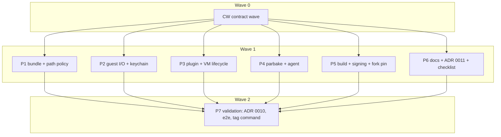

# Plan: Parbake release audit, stage 1 (release blockers for v0.1.0)

## Status

- State:   review
- Tier:    xhigh
- Tier-grammar: 5
- Updated: 2026-10-23
- Next:    /hex-finalize
- Reviewed: 6b14c1de08b1328d0b6856a8bb377dedad32b9d4
- Notes:
  - /hex-execute R1–R3 (2026-10-23), base 1412ab5: R1 979e1ca, c421a47, f346b73, 806f974; R2 d6767a2; R3 a48030d,
    88e2bd1, 5723ef5, a8f0fee. Integration gate `task clean check` exited 0 at 806f974. No /hex-review was run, by
    the meta-orchestrator's budget. One spec-reviewer check of 1412ab5..HEAD found F-01..F-06, H-08 and H-12
    fixed, and C-080..C-085 fixed.
  - Warn findings: 23 of 26 actionable closed (F-07..F-23, F-25, F-27, F-28, F-30..F-32; F-09 by the user's
    anonymization in 29eea78; F-15 without the wrong-owner row, which needs root). Skipped: F-24 and F-26 (actor
    concurrency without a plugin test target, stage 2) and F-29 (keychain ACL migration needs a host measurement).
  - Residue for the maintainer: ADR 0012 Impl 4 checks the agent binary for the version string, not the
    bundle's `Agent` file (no VM in the release build). ADR 0012 Val 6 (a source-archive build) has no check.
    ADR 0013 Impl 5 and Val 1–4 need protected tag rules and a pushed tag. Checklist step 13 was not re-run on a
    guest; `task release:build VERSION=0.1.0` with `RELEASE_ALLOW_NON_MAIN=1` printed 0.1.0 from both CLIs. Other
    leftovers: a `/` line in bundle-roots admits every path (pinned by a test), and release.yml runs `task check`
    before `release:build` runs it again.
  - /hex-review xhigh of main...hex/release-audit (2026-10-22): Request Changes, with 2 Block and 4 High.
    Unconverged: rows R1 and R2 appended to Parallelization. Report:
    `.agents/research/research_release_audit_stage1_review.md`.
  - Q1 save/restore (P7 step 4): saving succeeds, but restore fails across tested instance and
    overlay combinations with Virtualization.framework errors. A stable signature does not make
    restore work.
  - Requirement 5 passed: see ADR 0010. The generalized e2e findings are in
    `docs/end_to_end_checklist.md`.
  - Final gate: `task clean check` exited 0 on the tree with the P7 doc fixes.
  - Tag command (C-071), proposed and not run: `git tag -s v0.1.0 -m "Parbake 0.1.0" <release commit>`.

---

## Overview

**Author:** Christian Semmelmann, with an automated planning assistant
**Date:** 2026-10-22
**Source:** [.agents/discussions/release-audit.md](../discussions/release-audit.md) › Stage 1, requirements 3–11.
**Goal file:** [.agents/goals/release-audit.md](../goals/release-audit.md) (S1.1, S1.3–S1.11).
**Review report:** [research_release_audit_full_review.md](../research/research_release_audit_full_review.md):
B-01..B-04, H-01..H-25, D-01, D-02.
**Design ADR:** [ADR 0009](../../docs/adr/adr_0009_module_boundaries_and_one_version_target.md) (Proposed; this
plan carries out its Implementation list and does not re-decide it).
**ADRs this plan writes:** ADR 0010 (keychain ACL follows the signing identity; amends ADR 0004), ADR 0011
(guest sudo rules and the provisioning config, D-02).
**Research reused, not repeated:** `research_release_audit_codebase_recon.md`, `_full_review.md`,
`_field_pitfalls.md`, `_council.md`, `_archaeology.md`, `research_release_readiness_bar.md`.

### Classification

| Axis | Value |
|---|---|
| Scope | Large: 29 High+ findings, 9 requirements, 4 code areas plus docs, build and CI |
| Reversibility | One-way door (medium). The one-way part, the agent version line in every bundle's `Agent` file, is ADR 0009's. The exit-code table (C-012) and the bundle-roots file (C-020) are public contracts but cheap to extend |
| Tier | xhigh (auto). The classifier picked high, and Phase 3's Large-scope rule raised it |
| Overlays | architect=inline (ADR 0009 covers the one-way door; the new decisions are small ADR steps), research=skip (persisted research), adversary=off (none pinned in `hex.md`) |
| Artifacts | this plan; ADR 0010 and ADR 0011 as steps; no new research artifact |

### Out of scope

- Stage 2 as a whole: test targets beyond the two seams named here, `task coverage`, the duplication list, and the
  three force unwraps (W-13, W-41, W-62, S-07 and the R2/R4/R8 systemic fixes).
- Everything the discussion lists as out of scope: notarization and Developer ID, binary artifacts, a VZ CI runner,
  SSH host-key pinning, restore-image checksums, C-007 file copy, save/restore as a feature, the network-volume
  cache layer, upstreaming, and pushing.
- Warn, Suggest and deferred findings that are not folded in (see [Coverage](#coverage)).

---

## Decisions taken by this plan (question → decision)

| # | Question | Decision | Basis |
|---|---|---|---|
| Q1 | Save/restore under the stable Apple Development signature (discussion open question 1) | Measure it as a side step of requirement 5 (P7 step 4). Record only generalized results. It does not block anything | Discussion recommendation |
| Q2 | Missing WWDR G3 when requirement 5 runs (discussion open question 2) | Treat identity availability as a run-time precondition. If no valid identity is present, P7 still lands the plumbing and conditional ACL with tests, defers the host measurement, and records a note | Discussion recommendation; goal decisions log |
| Q3 | Helper branches `audit/empty`, `audit/all` | Already deleted after the S1.1 review | Goal decisions log |
| Q4 | How to determine the team identifier for an Apple Development identity | The certificate's common name does not necessarily contain its team identifier. P7 step 1 reads `TeamIdentifier` from `codesign -dv`; identity-specific values are not recorded in public documentation | Explorer report; `docs/signing.md` |
| Q5 | D-01: where do the allowed bundle roots come from? | The plugin user's home directory is always a root. More roots come from a plugin-owned file, `~/Library/Application Support/container-runtime-macos/bundle-roots`, with one absolute path per line. Not `PARBAKE_HOME`, which launchd never passes to the plugin | Explorer: the plugin reads no env and no config; apple/container owns `config.toml`'s schema |
| Q6 | Keychain ACL with a stable identity: `security -T <binary>` or the in-process Security framework? | The readers are `parbake` only (Provision, AgentSetup, Agent; the plugin never reads the item). With a team identity, `parbake` creates, reads and deletes the item in-process (`SecItemAdd` default ACL: the creating, signed binary). Without one it keeps `security -i … -A` and warns. `-T` cannot work, because reads go through `/usr/bin/security`, which would then need to be on the list | ADR 0004 measurements; explorer report |
| Q7 | H-10: test the GUI-session check without stage 2's agent test target? | Add a minimal `ParbakeAgentTests` target now, holding one suite. Stage 2 extends it | SwiftPM tests executable targets with `@testable import` |
| Q8 | H-12 / D-06: the parbake exit codes | 64 usage, 66 bundle or restore image missing, 69 VM limit or keychain locked/refused, 75 lock held or a timeout, 3 guest script failed, 1 anything else (C-012) | sysexits.h plus one script code; documented in README and ADR 0008 |
| Q9 | H-11: refuse, or document only? | Refuse mounts, published ports and published sockets in `bootstrap`. Document that the run command, run-level `--env`, `--workdir` and `--user` do not reach the guest, because the guest is the init process and refusing them would break every `container run` | Explorer: `initProcess` is always filled by the CLI |
| Q10 | H-07: wait longer, or reword? | Both. Wait up to the 60 s shutdown floor. A guest that stopped gives the existing `.interrupted` error; a guest still running gives a new, distinct message and gets a row in ADR 0008 | Review fix text |
| Q11 | os_log subsystem name | `container-runtime-macos`, with categories `runtime` (plugin) and `parbake` (CLI). The runtime's name stays on the plugin, labels and keychain service, so the log follows it | AGENTS.md naming; plan_macos_runtime 2026-10-19 |
| Q12 | Where the e2e checklist and its record live | `docs/end_to_end_checklist.md` (`doc_type: runbook`) holds the checklist and a "Recorded runs" table. The record names the tested code commit; the record commit itself follows it | Requirement 10 |
| Q13 | Pipeline worktrees each need the fork | Each worktree resolves the pinned fork revision through SwiftPM into its own `.build/`. The main checkout's `.build/dev-env/container` is only read | Execution: `.build/` is per worktree |
| Q14 | C-040's default `keychainPreflight` and C-011's `adHocWarning` live in P2's file while P4 wires them | P4 runs its step 3 last; if P2 has merged by then, the feature branch is merged into P4 first. Otherwise the integration seam commit sets the default closure and the warning call | Execution: contract wave left `keychainPreflight` defaulting to a no-op |
| Q15 | C-011 and C-041 contract tests belong in suites the contract wave does not touch | P2 adds the C-011 tests to `GuestCredentialsTests`; P4 adds the C-041 tests to `RestoreImagesTests` | Contract wave report |
| Q16 | P3's stale-agent warning needs the bundle's recorded line, while `agentVersionLine` is P1's | P3 reads the raw `agentVersion` string for the warning text | File-set disjointness |
| Q17 | C-030 cases the contract leaves open | Accepted as built: a container neither running nor stopping refuses every signal with "not running" first; running and stopping both true counts as stopping; the `unsupportedInputs` text reads "<flags> are not supported for macOS guests; see README › Limitations" | P3 step 1 |
| Q18 | `GuestAgent.waitUntilReady` timeout and parbake exit 75 | `waitUntilReady` throws `RuntimeFailure.agentTimeout(seconds:label: nil)`; the plugin rethrows with its label | P4 step 2 seam |
| Q19 | `BundleConfigurationTests` expects `checkSudoCommand("/usr/sbin/softwareupdate -i *")` to pass, which ADR 0011's rule refuses | P4 changes that test to a bare absolute path and adds the refused form | P2 step 3 seam |
| Q20 | A team-signed plugin fails to start the DHCP interface when its signing identity differs from the network services | The validation run signed the plugin and services with different identity modes. `docs/signing.md` and `dev-env.sh` document the required signing setup. A per-binary identity in `Taskfile.yml` is left to the review | E2E validation, unified log |
| Q21 | Checklist step 10: a restarted guest gets a new address | The network service allocates a new address and MAC on every start, so the plugin cannot keep it; the expectation needs review | E2E validation, network helper log |
| Q22 | Checklist step 17: `sudo shutdown -r now` restarts the guest inside the VM | `exec` reports that the guest kept running rather than that it stopped (S-005's alternative branch) | E2E validation |
| Q23 | Checklist step 18: editing `Agent` to `1` does not make the live agent stale | C-031 compares the live agent's version line; the step needs a bundle with an older agent | E2E validation; C-031 |
| Q24 | Checklist step 7 needs a no-agent bundle; step 16 used `sudo`, which needs a password | Step 7 uses a `parbake layer` of the fresh bundle whose script removes the agent's LaunchDaemon plist. Step 16 uses `exec -u root` and boots out `com.openssh.sshd`; the checklist and README log command gain these fixes and `--info` | E2E validation |
| Q25 | Where does the release stamp logic live: Taskfile shell or a script? | `scripts/release.sh`, called by `task release:build`, so `--self-test` can prove the guard red and green and shellcheck covers it, like `lint-boundaries.sh` | C-081, ADR 0012 contract step 3 |
| Q26 | Which tests exercise the Warn findings F-24, F-26 and F-29? | None in stage 1. F-24 and F-26 change actor concurrency in `RuntimeService`, which has no test target (stage 2, S2.1). F-29 changes a keychain ACL and needs a host keychain measurement | Review R-B; plan § Out of scope |

No `[NEEDS CLARIFICATION]` marker remains. Every open question took its recommended answer.

---

## Component contracts

Signatures are Swift. "RM" is `Sources/RuntimeMacOS/`. Every contract names its test home. A tester can write the
failing test from the contract alone.

### Contract wave (shared values every pipeline builds on)

**C-001 `ParbakeVersion` target (ADR 0009 (b)).** Implemented in full in the contract wave, exactly as ADR 0009
› Component contracts: `Parbake.release = "0.1.0"`, `AgentVersionLine` with `protocolVersion = 1`,
`variable = "CONTAINER_RUNTIME_MACOS_AGENT"`, `current`, `init?(_:)` and `description`. Package.swift: a target
with no dependencies. `RuntimeMacOS` (`public import`), `container-runtime-macos`, `parbake` and `parbake-agent`
depend on it. Tests in `Tests/ParbakeVersionTests/AgentVersionLineTests.swift`:
- `"1"` → (1, nil); `"1 0.1.0\n"` → (1, "0.1.0"); `"1 0.52.0 x"` → (1, "0.52.0");
- `"x 0.1.0"`, `""` and `"+1"` → nil; `"1  0.1.0"` → (1, nil);
- a 33-character release → release nil; a 32-character one is kept;
- `current.description == "1 0.1.0"`.

**C-002 `RuntimeFailure` (RM `RuntimeFailure.swift`; requirement 9, R5).** Implemented in full in the contract wave.

```swift
public enum RuntimeFailure: Error, Equatable, Sendable, CustomStringConvertible {
    case lockHeld(path: String, holder: String?)
    case dhcpTimeout(macAddress: String, seconds: Int, leaseFile: String)
    case sshTimeout(username: String, address: String, seconds: Int)
    case agentTimeout(seconds: Int, label: String?)
    case keychainLocked(service: String)
    case keychainRefused(service: String, status: Int32)
    case bundleMissing(path: String, missing: String?)
    case vmLimitReached
    public var description: String
    public var exitCode: Int32                       // C-012 table
    public var containerizationCode: ContainerizationError.Code
}
```

Each description is one or two sentences that name the cause and one remedy. Tests in
`Tests/RuntimeMacOSTests/RuntimeFailureTests.swift` assert these substrings:

| Case | Must contain | exitCode | containerizationCode |
|---|---|---|---|
| lockHeld | the path; "another process"; the holder when non-nil | 75 | .invalidState |
| dhcpTimeout | the MAC; "no DHCP lease"; the lease file path | 75 | .timeout |
| sshTimeout | `user@address`; "did not answer over SSH"; "Remote Login" | 75 | .timeout |
| agentTimeout | the seconds as an integer (no "180.0"); `runtime-macos.readiness-timeout` when label non-nil; `parbake agent-probe` (W-28) | 75 | .timeout |
| keychainLocked | the service; "unlock the login keychain"; "GUI session" | 69 | .invalidState |
| keychainRefused | the service; the status; "Keychain Access" | 69 | .invalidState |
| bundleMissing | the path; the missing file when non-nil; `parbake create` | 66 | .notFound |
| vmLimitReached | "two macOS guests"; "stop one"; "reboot the host"; "slot" (H-05: the leaked-slot hint) | 69 | .unsupported |

**C-003 Validated inputs (RM `Validated.swift`; R1, H-13, H-14, W-19, W-20, S-13).** Implemented in full in the
contract wave.

```swift
public struct GuestUsername: RawRepresentable, Hashable, Sendable {
    public init?(rawValue: String)          // full match \A[a-z_][a-z0-9_-]{0,30}\z, so at most 31 chars
    public static let rule: String          // "1 to 31 characters: a lowercase letter or _ first, then a-z, 0-9, _ or -"
}
public struct SudoCommand: RawRepresentable, Hashable, Sendable {
    public init?(rawValue: String)          // full match \A/[A-Za-z0-9._/+-]+\z (ADR 0011; W-18)
}
public enum ScriptInput {
    /// Throws ContainerizationError(.invalidArgument) naming `field` when `value` holds a control
    /// character (U+0000–U+001F, U+007F) or the text "PARBAKE_".
    public static func check(_ value: String, field: String) throws
}
public enum IPv4Address {
    public static func isValid(_ value: String) -> Bool   // dotted quad, inet_pton AF_INET, no leading/trailing space
}
```

Tests in `Tests/RuntimeMacOSTests/ValidatedTests.swift`, a hostile table:
- usernames: `runner`, `_ci`, 31 and 32 characters, `Runner`, `1ci`, `ci\n`, `ci;id`, `-l`, `""`;
- sudo: `/usr/sbin/softwareupdate`, `ALL`, `/bin/sh -c x`, `/usr/bin/*`, `/x#y`, `/a=b`, `/a:b`;
- script input: `"\n"`, `"\r"`, `"\u{0}"`, `"a PARBAKE_ROOT b"`, a plain password with `'` and `$` (accepted);
- IPv4: `192.168.64.3` accepted; `192.168.64.3 `, `::1`, `-oProxyCommand=x` and `256.1.1.1` refused.

**C-004 Log subsystem (RM `LogSubsystem.swift`; requirement 9).** Implemented in full in the contract wave.
`public enum LogSubsystem { public static let name = "container-runtime-macos"; public static func logger(category: String) -> os.Logger }`.
Test: the name constant, and `logger(category: "parbake")` is constructible.

**C-005 Host-requirement test traits (`Tests/RuntimeMacOSTests/HostRequirements.swift`; H-25).** Implemented in
the contract wave. Tags `.keychain`, `.hdiutil` and `.asif`. Booleans
`HostRequirement.loginKeychainUsable` (`security show-keychain-info` on the default keychain exits 0),
`.hdiutilAvailable` (`/usr/bin/hdiutil` is executable) and `.asifSupported` (macOS 27 or later). Owner pipelines
apply `.tags(…)` and `.enabled(if: …)` to their suites (C-019, C-024). A test of the probes themselves: each returns
without throwing.

**Stubs only, in the contract wave** (signatures below; bodies `fatalError("stub")` or placeholder values;
contract tests committed red). The owning pipeline makes them green: C-010, C-011, C-013, C-020, C-021, C-030, C-031,
C-040 and C-041.

### P1 — Bundle layout and the bundle path policy

**C-020 `BundlePathPolicy` (RM `BundlePathPolicy.swift`; D-01, requirement 4, W-23).**

```swift
public struct BundlePathPolicy: Sendable {
    public static func defaultRootsFile(home: URL) -> URL   // home/Library/Application Support/container-runtime-macos/bundle-roots
    public let roots: [URL]                                  // canonical (symlinks resolved), home first
    /// Reads `rootsFile` when it exists: one absolute path per line; blank lines and lines starting with
    /// `#` are skipped; a relative path, a missing directory or a file that is not owned by `uid` or is
    /// group- or world-writable throws BundlePathError.
    public init(home: URL, rootsFile: URL? = nil, uid: uid_t = getuid()) throws
    /// Returns the canonical bundle URL or throws.
    public func validate(_ label: String) throws -> URL
}
public enum BundlePathError: Error, Equatable, CustomStringConvertible {
    case notAbsolute(String)
    case outsideRoots(path: String, roots: [String])
    case wrongOwner(path: String)
    case writableByOthers(path: String)
    case linkOutsideRoots(file: String, target: String)
    case badRootsFile(path: String, reason: String)
}
```

`validate` rules, in order:
1. Empty, not starting with `/`, or containing NUL → `notAbsolute`. `~` and relative paths are refused, not expanded.
2. `realpath` fails → `RuntimeFailure.bundleMissing(path:, missing: nil)`.
3. The canonical path equals a root or lies under one, compared by path components. `/Users/a` does not admit
   `/Users/ab`. Otherwise `outsideRoots`.
4. The bundle directory and each existing layout file (`MacOSVMBundle.fileNames` plus Overlay, Layer, Provisioned,
   GuestKey and Agent) are owned by `uid`, else `wrongOwner`. None is group- or world-writable, else
   `writableByOthers`.
5. A layout file that is a symlink resolves, through `realpath`, under a root, else `linkOutsideRoots`. The target is
   owned by `uid` and not writable by others.

Tests in `Tests/RuntimeMacOSTests/BundlePathPolicyTests.swift`, on temp directories with `home:` injected:
- a bundle under home is accepted and returned canonical;
- a symlink to a bundle outside the roots is refused;
- `..` escaping the root is refused;
- the `/Users/a` vs `/Users/ab` prefix case;
- a mode `0o777` bundle is refused;
- a `Disk.img` symlink to `/etc/hosts` gives `linkOutsideRoots`;
- a roots file with comments and an extra root admits that root;
- a group-writable roots file gives `badRootsFile`;
- a relative label gives `notAbsolute`;
- a missing path gives `bundleMissing`.

`wrongOwner`: the injected `uid` is compared with the owner of the bundle directory and of each layout file and
link target. The test passes `uid: getuid() + 1` and expects `wrongOwner(path:)` naming the bundle directory, which
is checked first.

**C-021 Atomic instances and kind-aware validity (RM `MacOSVMBundle.swift`; H-01, W-24, W-42).**
- `instance(at:)` builds in `<destination>.parbake-new` and renames it onto `destination` only once the overlay
  exists. On any throw it removes the staging directory. `destination` never exists half-built.
- `instance(at:)` and `layerBundle(at:)` refuse a source whose `hasOverlay` is true, with
  `ContainerizationError(.unsupported)`: "… is a container's instance, not a bundle" (W-24).
- `resetOverlay(from:)` builds the new overlay set in a staging directory and swaps it in. It re-clones `Provisioned`,
  `GuestKey`, `Agent` and `HardwareModel` from `source` (removing ones the source lacks), and keeps
  `MachineIdentifier` (W-42).
- `init(url:)` throws `ContainerizationError(.notFound)` "… is not a directory" when the directory itself is
  missing (W-23). It throws `ContainerizationError(.invalidState)` "… is an incomplete instance; remove the
  container" when `Disk.img` is a symlink and neither `Overlay.asif` nor a regular-file `Layer.asif` exists, or when
  `Layer.asif` is a symlink without `Overlay.asif`.
- `storageDeviceAttachment()` never opens a symlinked `Disk.img` read-write. That follows from the check above, and
  a test pins it.
- `agentVersionLine: AgentVersionLine?` parsed from `agentVersion` (ADR 0009).
- `provisionedUsername` returns nil when the file's content is not a `GuestUsername` (H-13 read-side validation).

Tests (`MacOSVMBundleTests.swift`, ASIF-gated per C-005):
- an injected failure after the link (a read-only parent for the overlay) leaves no `destination` and no staging
  directory;
- a directory holding only `Disk.img` → symlink, AuxiliaryStorage, HardwareModel and MachineIdentifier fails
  `init(url:)`;
- an instance passed as a source is refused;
- `resetOverlay` refreshes `GuestKey` from a rebuilt base;
- `provisionedUsername` is nil for `"ci\n-oProxyCommand=x"`;
- `agentVersionLine` for `"1 0.1.0"`.

**C-024 Host-dependent bundle tests are gated (H-25).** `MacOSVMBundleTests` suites carry
`.tags(.asif)`, `.enabled(if: HostRequirement.asifSupported)`; `OtherVolumeTests` carries `.tags(.hdiutil, .asif)`
and both `enabled` conditions.

### P2 — Guest I/O, credentials and generated scripts

**C-010 `GuestShell` bounds and hardening (RM `GuestShell.swift`; H-03, H-13, W-01, W-02).**

```swift
public func run(_ command: String, on address: String, input: String = "", timeout: Duration = .seconds(300)) -> Result
public func run(_ command: String, on address: String, input: Data, timeout: Duration = .seconds(300)) -> Result   // no default for input, so a call without input is unambiguous
public static func arguments(username: String, address: String, credential: Credential, command: String) -> [String]?
// Result gains: public let timedOut: Bool
```

- `arguments` returns nil when `username` is not a `GuestUsername` or `address` is not `IPv4Address.isValid`.
  `run` then returns `Result(status: -1, output: "", errorOutput: "invalid guest username or address", timedOut: false)`.
- The argv ends `["-l", username, "--", address, command]`. It always holds `-F /dev/null`, `ForwardAgent=no`,
  `ClearAllForwardings=yes`, `ControlMaster=no`, `ControlPath=none`, `IdentityAgent=none`, `ServerAliveInterval=5`,
  `ServerAliveCountMax=3` and `ConnectTimeout=5`, besides today's host-key options (documented, not changed).
- The child gets a minimal environment: `PATH=/usr/bin:/bin:/usr/sbin:/sbin`, `HOME`, and the askpass variables in
  password mode only.
- stdin is written with `write(contentsOf:)` on its own thread, after both readers start; a write error does not
  crash (W-01).
- When `timeout` passes, the child gets SIGTERM, then SIGKILL after 2 s. `run` returns `timedOut: true` and status -1.

Tests in `Tests/RuntimeMacOSTests/GuestShellTests.swift`, pure argv tests plus one process test:
- the argv for key and password mode contains the hardening options and ends with `-l u -- 192.168.64.3 cmd`;
- nil for username `-oProxyCommand=x` and for address `-x`;
- `run` against a stub `ssh` is injected through `static var sshPath` (internal, `@testable`). The stub sleeps
  30 s, the test passes `timeout: .seconds(1)`, and it gets `timedOut == true` in under 5 s;
- a stub that exits at once without reading stdin, given 1 MiB of input, returns without crashing.

**C-011 Keychain access follows the signing identity (RM `GuestCredentials.swift`, new `SigningIdentity.swift`;
requirement 5, H-24, W-20).**

```swift
public enum SigningIdentity: Equatable, Sendable {
    case adHoc
    case team(String)
    /// SecCodeCopySelf + SecCodeCopySigningInformation; `.team` when kSecCodeInfoTeamIdentifier is present.
    public static func ofCurrentProcess() -> SigningIdentity
}
public enum KeychainAccess: Equatable, Sendable {
    case anyApplication      // created by `security -i add-generic-password -A`; read and deleted through `security -i`
    case creatorOnly         // created, read and deleted in-process (SecItemAdd/SecItemCopyMatching/SecItemDelete)
    public static func `for`(_ identity: SigningIdentity) -> KeychainAccess   // adHoc → anyApplication; team → creatorOnly
    public static let restrictsWithStableIdentity: Bool                       // true; P7 sets it false if the measurement fails
}
public struct GuestCredentials {
    public init(service: String = defaultService, access: KeychainAccess = .for(.ofCurrentProcess()))
    public static let adHocWarning: String   // names "every application of this user", CODESIGN_IDENTITY and docs/signing.md
    /// Probes the keychain without touching an item: a lookup for a reserved account
    /// "parbake-preflight". Item-not-found counts as success; anything else throws the classified failure.
    public func preflight() throws
    static func classify(status: Int32, errorOutput: String, service: String) -> RuntimeFailure?
}
```

- `classify`: "User interaction is not allowed" or `-25308` → `.keychainLocked`. `-25293`, `-128`, or
  "authorization"/"denied" → `.keychainRefused(status:)`. Status 0 or 44 → nil. Anything else → nil, and the
  caller keeps today's `.internalError`. In-process calls map `errSecInteractionNotAllowed` and `errSecAuthFailed`
  the same way.
- `store`, `password(for:)` and `remove(for:)` throw a classified `RuntimeFailure` when `classify` matches (H-24).
- Every argument `quoted()` receives is checked with `ScriptInput.check` first (W-20).
- `.anyApplication` behaviour is otherwise unchanged (ADR 0004).
- With `restrictsWithStableIdentity == false`, `.for(_:)` returns `.anyApplication` for every identity.

Tests in `GuestProvisioningTests.swift` › `GuestCredentialsTests`, keychain-gated per C-005:
- `classify` table: locked text, `-25308`, `-25293`, 44, 0 and an unknown status;
- `.for(.adHoc) == .anyApplication` and `.for(.team("X")) == .creatorOnly`;
- `ofCurrentProcess()` in the ad-hoc test binary is `.adHoc`;
- `preflight()` on an unlocked keychain succeeds;
- a service containing `\n` is refused before `security` runs;
- a `creatorOnly` round trip guarded by `.enabled(if: SigningIdentity.ofCurrentProcess() != .adHoc)`, skipped on
  ad-hoc builds;
- the existing round-trip tests keep passing.

**C-013 Generated root scripts take only validated input (RM `GuestPreparation.swift`,
`GuestAgentInstallation.swift`; H-14, W-18, D-02).**
- `GuestPreparation.checkSudoCommand` delegates to `SudoCommand(rawValue:)` and throws
  `ContainerizationError(.invalidArgument)` naming ADR 0011's rule.
- `GuestPreparation.script(username:password:publicKeys:…)` becomes `throws`. It calls `ScriptInput.check` on the
  password and each key, and requires a `GuestUsername`, before building. `GuestAgentInstallation.script(password:)`
  becomes `throws` and checks the password only; it has no username.
- The contract wave makes both signatures `throws` (stub bodies unchanged) and adds the `try` at their callers,
  Provision.swift:105 and Agent.swift:63. P2 and P4 then compile independently.
- Hostile-input tests (`GuestPreparationTests`) cover a password with `\nPARBAKE_PASSWORD\n`, a key with a line
  break, and a username `a'b`; each throws. A second test runs the user half of the generated script with
  `/bin/bash`, with `sudo` stubbed by a `PATH` shim that appends its stdin to the file named by the env variable
  `PARBAKE_TEST_SUDO_LOG`, which the test sets to a temp path and reads back. For a password holding `'`, `$(id)` and
  `` ` ``, it asserts that the shim received the password byte-for-byte and that no command substitution ran.

**C-014 DHCP parser negative tests (`DHCPMessageTests`; H-15).** A parameterized test takes a valid DISCOVER frame
and applies each mutation: truncate at every offset below the options end; corrupt the magic cookie; op = 2;
htype = 6; hlen = 0; IHL = 6; option 53 with length 0 and with length 2; an option length running past the frame;
no end marker. Each must return nil, except the missing end marker: when option 53 with length 1 was parsed before the frame
ends, `parse` returns that Request (the loop stops at the frame end), and otherwise nil. The test pins both. Any mutation that crashes or returns a wrong Request is fixed in
`DHCPMessage.swift`.

**C-019 Keychain tests are gated (H-25).** `GuestCredentialsTests` carries `.tags(.keychain)` and
`.enabled(if: HostRequirement.loginKeychainUsable)`.

### P3 — Runtime plugin and VM lifecycle

**C-030 Lifecycle decisions as pure functions (RM `RuntimeLifecycle.swift`; H-06, H-07, H-11, W-38).**

```swift
public enum InitSignalAction: Equatable, Sendable { case forceStop, shutDown, alreadyStopping, refuse(String) }
public enum RuntimeLifecycle {
    public static let guestLossTimeout: Duration          // .seconds(60), equal to the shutdown floor
    public static func initSignalAction(signal: Int32, isRunning: Bool, isStopping: Bool) -> InitSignalAction
    public static func lostProcessMessage(processID: String, guestExitCode: Int32?) -> String
    public static func unsupportedInputs(mounts: Int, publishedPorts: Int, publishedSockets: Int) -> String?
}
```

- `initSignalAction`:
  - SIGKILL while running or stopping → `.forceStop` (H-06);
  - SIGTERM, SIGINT or SIGQUIT while running → `.shutDown`, and while stopping → `.alreadyStopping`;
  - any other signal → `.refuse("signal N is not a stop signal; send TERM, INT, QUIT or KILL")` (W-38);
  - neither running nor stopping → `.refuse("cannot kill: container is not running")`.
- `lostProcessMessage`:
  - with an exit code: "the macOS guest stopped with exit code N while process ID ran; the process has no exit
    code";
  - nil: "lost the guest agent's stream for process ID while the guest kept running; its exit code is unknown".
- `unsupportedInputs`: nil when all are 0. Otherwise one message that names each nonzero input
  (`-v/--mount`, `-p/--publish`, `--publish-socket`) and README › Limitations.

Tests in `Tests/RuntimeMacOSTests/RuntimeLifecycleTests.swift`: the full signal × state table, both message
forms, and the `unsupportedInputs` combinations.

**C-031 `RuntimeService` wiring (`Sources/container-runtime-macos/`; H-03, H-05, H-06, H-07, H-11, D-01, W-16,
requirements 4, 8 and 9).**
- `bootstrap`:
  1. Throws `.unsupported` with `unsupportedInputs(…)` when the configuration has mounts, published ports or
     published sockets.
  2. Resolves the label through `BundlePathPolicy(home: FileManager.default.homeDirectoryForCurrentUser).validate(_:)`
     before `MacOSVMBundle(url:)`.
  3. Maps `BundlePathError` to `.invalidArgument`, and `RuntimeFailure` to its `containerizationCode`, keeping
     its description.
- `kill` on the init process follows `initSignalAction`. `.forceStop` in `.stopping` calls
  `virtualMachine.forceStop()`.
- `processExit` waits `RuntimeLifecycle.guestLossTimeout` and throws `.interrupted` with `lostProcessMessage`.
- `shutDownOverSSH` runs `GuestShell.run(…, timeout:)` in a detached task, so the actor is not blocked. The
  timeout is `min(stop timeout, 60 s)`. `state`, `wait` and `kill` stay answerable while it runs.
- Readiness failure throws `RuntimeFailure.agentTimeout(seconds:label: readinessTimeoutLabel)`, mapped to
  `.timeout`.
- Once the agent is ready, `RuntimeService` logs one warning if `AgentVersionLine(line)?.release !=
  Parbake.release`, a nil release included (ADR 0009). The warning names the live line, the bundle's recorded line
  and `parbake agent install`. A release mismatch never fails the start.
- `RuntimeMacOSHelper` has `version: Parbake.release`. The helper's logger is a `MultiplexLogHandler` of the file
  logger and an `OSLogHandler` (plugin target, `Sources/container-runtime-macos/OSLogHandler.swift`). It writes to
  `LogSubsystem.name`, category `runtime`, at the same level.
- `MacOSVirtualMachine.start()` and `start(options:)` both map `virtualMachineLimitExceeded` to
  `RuntimeFailure.vmLimitReached`, never in a retry loop (H-05). When `isLockContention` still holds after the
  deadline, `start(options:)` throws `RuntimeFailure.lockHeld(path: <aux storage path>, holder: nil)` (W-16).
- `GuestAgent` drops `protocolVersion`, `versionVariable` and `protocolNumber(of:)` for `AgentVersionLine`, per
  ADR 0009. `waitUntilReady` still returns the raw line.

Tests:
- C-030's suite;
- `GuestAgentTests` moves the `protocolNumber(of:)` cases out, since they live in C-001;
- `MacOSVirtualMachine` has a pure `static func mapStartError(_:) -> any Error`, tested in
  `Tests/RuntimeMacOSTests/MacOSVirtualMachineTests.swift` (new; stub in CW, owned by P3) with a constructed
  `VZError(.virtualMachineLimitExceeded)` and a nested EAGAIN `NSError`.

The actor wiring itself is covered by P7's checklist (stage 2 adds the plugin test target).

### P4 — parbake CLI and the guest agent

**C-012 Exit codes and failure output (`Sources/parbake/ParbakeExit.swift`; H-12, D-06, requirement 9).**

```swift
enum ParbakeError: Error, CustomStringConvertible {
    case failure(RuntimeFailure)
    case scriptFailed(name: String, status: Int32)
    case runtime(String)
}
enum ParbakeExit {
    static func code(for error: any Error) -> Int32
    static func message(for error: any Error) -> String
}
```

| Code | Meaning |
|---|---|
| 0 | success |
| 1 | `ParbakeError.runtime`, or any error not listed below |
| 3 | `scriptFailed`; the message names the script and its exit status |
| 64 | usage: `ValidationError` and argument-parser errors (stderr contains `Usage:`) |
| 66 | `RuntimeFailure.bundleMissing`; a restore image path that does not exist |
| 69 | `vmLimitReached`, `keychainLocked`, `keychainRefused` |
| 75 | `lockHeld`, `dhcpTimeout`, `sshTimeout`, `agentTimeout` |

- `ParbakeTool.main()` is overridden. It calls `signal(SIGPIPE, SIG_IGN)` first (H-02). It runs the parsed command,
  and for a non-`ValidationError` failure prints `Error: <message>` to stderr with no usage block. It logs the same
  line to `LogSubsystem.logger(category: "parbake")` and exits with `code(for:)`.
- Rule: a `ValidationError` thrown once work on a guest, the host or the network has started becomes
  `ParbakeError` or `RuntimeFailure`. A `ValidationError` about the given arguments, config or input files stays.
  Known runtime sites:
  - Provision: 110, 151, 162, 169;
  - Agent: 86, 93;
  - AgentProbe: 61, 105, 123, 181, 196;
  - AgentSetup: 15, 24, 48, 58, 65, 70;
  - GuestScript: 25;
  - Install: 33.

  Usage sites that stay: Provision 67 and 137 (bad username, unreadable key file); Create 133, 142 and 234 (the
  target exists without `--replace`); GuestScript 13; BundleConfiguration 92, 98 and 131; StateProbe 45 (the work
  directory exists). R1 moved these bundle-state preconditions to `ParbakeError.runtime` (exit 1, no usage banner):
  already provisioned (Provision), no provisioned account (Agent, AgentProbe), no guest agent (Layer, StateProbe),
  and not enough free space (Create).
- The wait-for-guest loops in Provision (158), Agent (82) and AgentProbe (171) throw `.dhcpTimeout` when no lease appeared, and `.sshTimeout`
  when a lease appeared but SSH did not answer. The three loops are not merged here; merging is stage 2. Provision's
  error includes ssh stderr (W-29).
- `agent-probe` and `state-probe` get `shouldDisplay: false` (S-12).

Tests in `Tests/ParbakeTests/ParbakeExitTests.swift`: the code table per case; `message` for a `RuntimeFailure` has
no `Usage:`; that `message` for
`scriptFailed("setup.sh", 2)` names both, and that `ValidationError` maps to 64.

**C-040 `create` validates every input before the download (`Sources/parbake/Create.swift`, `Provision.swift`;
H-08, H-24, W-19, W-25 partial, S-13).**

```swift
struct ProvisionInputs {
    static func validate(username: String, authorizedKeys: [URL], sudo: [String], agent: String?, noAgent: Bool,
                         scripts: [URL], keychain: Bool, keychainService: String,
                         keychainPreflight: (String) throws -> Void = { try GuestCredentials(service: $0).preflight() }) throws
}
```

- `Create.run()` calls `ProvisionInputs.validate` after the config merge and before `cache.fetch`, whenever
  `username` is set. Without `username`, an account flag (`--authorized-key`, `--sudo`, `--keychain`,
  `--full-name`, `--tidy`) is a `ValidationError` (W-25).
- `Provision.run()` calls the same function, so both paths share it.
- The checks:
  - `GuestUsername` (message: `GuestUsername.rule`, S-13; W-19 via the full match);
  - each key file is readable and one line, with no control characters and no `PARBAKE_`;
  - each sudo entry is a `SudoCommand`;
  - the agent binary exists (default path from `Bundle.main.executableURL`, W-34) unless `noAgent`;
  - `--agent` with `--no-agent` is a `ValidationError`;
  - each script is readable;
  - with `keychain`, `keychainPreflight(service)` runs (H-24).
- `parbake` prints `GuestCredentials.adHocWarning` to stderr once when `--keychain` is used and
  `KeychainAccess.for(.ofCurrentProcess()) == .anyApplication` (requirement 5).

Tests in `Tests/ParbakeTests/ProvisionInputsTests.swift`, with temp files and `keychainPreflight` injected as a
closure (one throwing `RuntimeFailure.keychainLocked`, one succeeding). They never call P2's real `preflight()`, so
they pass in either merge order:
- each failing input throws the right error before any download. The test passes a cache dir and restore-image URL
  `file:///nonexistent` and asserts that the input error is thrown, not the restore-image error;
- the `--agent` plus `--no-agent` conflict;
- an account flag without `--username`.

**C-041 Locks for concurrent `create` (RM `FileLock.swift`, `RestoreImages.swift`; H-09).**

```swift
public final class FileLock: @unchecked Sendable {
    /// flock(LOCK_EX), with LOCK_NB when `wait` is false. A held lock without waiting throws
    /// RuntimeFailure.lockHeld(path:, holder:). The lock file records the holder's pid and command line.
    public static func acquire(_ url: URL, wait: Bool, holder: String) throws -> FileLock
    public func release()
}
```

- `Create.create()` takes `FileLock.acquire(<target>.parbake-lock, wait: false, holder: "parbake create")` before
  the exists check, and keeps it until the end.
- `RestoreImageCache.fetch` and `prune` take `<cache>/.lock` with `wait: true`, printing "waiting for another
  parbake download" when the lock is busy for more than 1 s.
- `BundleReplacement.build(replacing: false)` never removes a target that existed before it started.

Tests in `RestoreImagesTests`:
- a second `acquire` on the same file from another file descriptor in-process throws `lockHeld` whose description
  names the path;
- after `release`, acquiring succeeds;
- `BundleReplacement.build` on an existing target with `replacing: false` throws `.exists` and leaves the target's
  contents intact.

**C-042 Agent: SIGPIPE, the GUI-session precondition, the version line (`Sources/parbake-agent/`; H-02, H-10,
ADR 0009).**
- `main.swift` calls `signal(SIGPIPE, SIG_IGN)` as its first statement. It sets `AgentVersionLine.variable` to
  `AgentVersionLine.current.description` and drops its local constants.
- New `GUISession.require(uid: uid_t, name: String, probe: (uid_t) -> Bool = GUISession.launchctlPrint) throws`:
  - `launchctlPrint` runs `/bin/launchctl print gui/<uid>` and returns `exit == 0`;
  - when the probe returns false, it throws `AgentError.failedPrecondition("account <name> has no GUI session; log
    it in (auto-login on a CI host) before running processes as it")`;
  - `GuestProcess` calls it before `launchctl asuser` whenever the account's uid differs from 0 (spec C-002).
- The SIGPIPE line is verified by C-051's lint (a grep of the entry points, with a self-test), and S-016 by the P7
  checklist step 15. No unit test covers a process-wide signal disposition.
- New test target `ParbakeAgentTests` (`@testable import parbake_agent`) with `GUISessionTests`: the probe false →
  `failedPrecondition` naming the account; the probe true → no throw; uid 0 is not probed.
- `ParbakeTool` has `version: Parbake.release`; `AgentProbe` reads `AgentVersionLine.variable` (ADR 0009).

### P5 — Build, signing, fork pin and lint

**C-050 `CODESIGN_IDENTITY` (`Taskfile.yml`, `scripts/dev-env.sh`; requirement 5).**
- `CODESIGN_IDENTITY` defaults to `-`, and may come from the environment or `task … CODESIGN_IDENTITY=…`.
- `CODESIGN_OPTS` defaults to `--force --sign "{{.CODESIGN_IDENTITY}}" --timestamp=none`, so an explicit
  `CODESIGN_OPTS` still overrides.
- `sign` prints `signing with <identity>`. When the identity is not `-`, it fails before building if
  `security find-identity -v -p codesigning` does not list it.
- `dev-env.sh` passes `CODESIGN_IDENTITY` through to `task`.
- Acceptance:
  - `task sign` with no variable gives ad-hoc signatures: `codesign -dv` shows `Signature=adhoc`;
  - `task sign CODESIGN_IDENTITY=<listed identity>` gives `TeamIdentifier` not `not set` for all three binaries;
  - an unlisted identity fails with a message naming `docs/signing.md`.

**C-051 Boundary and hardening lint (`scripts/lint-boundaries.sh`, `Taskfile.yml` › `lint`; ADR 0009, H-02).**
The shell script, run by `task lint`, exits 1 with `file:line` for:
- `import AppKit` in any Swift file other than `Sources/parbake/Setup.swift`;
- `import RuntimeMacOS` or `import Virtualization` under `Sources/parbake-agent/`;
- an entry point (`Sources/parbake-agent/main.swift`, `Sources/parbake/ParbakeTool.swift`,
  `Sources/container-runtime-macos/RuntimeMacOSHelper+Start.swift`) without `signal(SIGPIPE, SIG_IGN)`.

A self-test (`scripts/lint-boundaries.sh --self-test`, run by `task lint`) plants each violation in a temp copy and
expects exit 1, then expects exit 0 on the tree. The script passes shellcheck and shfmt.

**C-052 The fork pin matches the branch (`Package.swift`, `Package.resolved`, `.github/workflows/ci.yml`; H-04).**
- `Package.swift` pins the extra-code/container `parbake` branch tip by revision: `804209b1` plus three commits,
  `3b9b5b75`, `13ff2d85` and `0f824548`, in that order. Tag `parbake-804209b1` names the same commit.
- `ci.yml` keys its cache on `hashFiles('Package.resolved')` (W-46).
- Acceptance:
  - the `Package.resolved` revision equals `git ls-remote` of the fork's `parbake` branch;
  - `task check` passes against it.

### P6 — Documentation

**C-060 Docs match the code (B-01..B-04, H-16..H-23, requirements 3, 6 and 7, W-40, W-53, W-54, S-15).**
Each item is a checkable claim. `docs-review` (or the docs-quality checks) runs on every changed page.
- B-01: README separates what `create` chains (install, provision or setup, agent install via provision, scripts)
  from the standalone commands.
- B-02: AGENTS.md › Verification says `task check` signs three executables: the plugin and `parbake` with the
  virtualization entitlement, `parbake-agent` without it.
- B-03: `docs/architecture.md` describes both `create` branches, with and without `--username`.
- B-04: spec_guest_agent C-005 lists the real routes: createProcess, startProcess, resize, wait and kill. It says
  stdin closes when the vsock stream closes, and delete is internal.
- Requirement 3 for `docs/specs/spec_guest_agent.md`:
  - Status reads "Implemented (experimental); C-007 reserved; V-4 simulator half open";
  - C-002 states the GUI-session precondition (C-042) and defers `gid`/`additionalGids` with a reason (W-50);
  - C-003 defers `consoleSize` with a reason (W-52), with resize after start as the path;
  - C-005 and the bundle-file table give `1 0.1.0` (ADR 0009).

  Every C-n in the three specs is implemented or marked deferred with a reason. The Approval boxes keep their
  state, with a line saying they are the user's (W-53).
- Requirement 3: README has a `--config` keys table (top level, `[account]`, `[guest]`) with types and the
  command-line precedence (H-21).
- H-16: README › Requirements names the fork, its tag and `scripts/dev-env.sh build`, links CONTRIBUTING.md,
  and says a stock `container` release is unsupported. AGENTS.md › Architecture rules names the base and the
  three commits.
- H-17: README › Build and install covers:
  - the services restart command;
  - `INSTALL_ROOT` with sudo and ownership, and the debug-build default;
  - `exec`, `stop` and `rm` examples with `--name`;
  - the dev CLI path after `dev-env.sh up`.
- H-18 and requirement 7: a "Remove everything" section lists containers and overlays, `~/.container-macos-dev`,
  the bundle with its `.parbake-new`, `.parbake-old` and `.parbake-lock` leftovers, the restore-image cache, the
  keychain item and `task uninstall`.
- H-19: a "Logs and troubleshooting" section names:
  - `/var/log/parbake-agent.log`;
  - the plugin log path;
  - `log show --predicate 'subsystem == "container-runtime-macos"'`;
  - each `RuntimeFailure` with its remedy.
- H-20: README points to `scripts/dev-env.sh help`. That help lists every command, flag and variable.
- H-21 and H-22: one line per standalone command with its flags, and the `layer` options.
- H-11: README › Limitations lists the refused mounts, ports and sockets, and that the run command, `--env`,
  `--workdir` and `--user` of `container run` do not reach the guest.
- H-12: README "Exit codes" table equal to C-012. ADR 0008 gets the parbake table and the H-07 lost-process row.
- H-23 and requirement 6: `SECURITY.md` covers:
  - private reporting through GitHub private vulnerability reporting;
  - the trust model: a dedicated CI user; with ad-hoc signing every process of that user can read the guest
    password; with a stable identity only the creating `parbake` can;
  - SSH host-key checking off (`GuestShell.swift`);
  - restore images without checksums;
  - ad-hoc signing as the default;
  - the bundle-roots allow-list (C-020);
  - the `--sudo` trust (ADR 0011).

  README links it.
- H-23 and requirement 8: `CHANGELOG.md` (`doc_type: changelog`) with a `## v0.1.0` entry.
- Requirement 7: README marks the guest agent experimental. It names the supported host (macOS 27, ADR 0007) and
  the tested guest versions, and the apple/container `804209b1` plus fork commits dependency.
- ADR 0009 docs half: AGENTS.md › Architecture rules carries the import table as one rule.
- W-40: ADR 0001, 0002 and 0003 drop the clauses that contradict `.macOS("27")` and the agent. W-54: AGENTS.md names
  `--restore-image` and `--replace`. S-15: `docs/architecture.md`'s readiness example reads `1 0.1.0`.
- `docs/signing.md` uses `CODESIGN_IDENTITY` (C-050).
- AGENTS.md › Verification declares the host requirements of the gated tests (C-005).

**C-061 ADR 0011: guest sudo rules and the provisioning config (D-02).** `docs/adr/adr_0011_guest_sudo_rules_and_provisioning_config.md`
(MADR, Accepted). It records:
- the context: `--sudo` and `[guest] sudo` grant NOPASSWD rules beyond ADR 0003's `/sbin/shutdown`; `--script`
  runs as root;
- three options:
  - remove `--sudo`;
  - keep it with absolute command paths only, no arguments, no wildcards (chosen);
  - keep it with free sudoers syntax;
- the trust boundary: the operator who builds the bundle owns its guest. A rule widens what a job, as the CI
  account, can do as root;
- the `SudoCommand` rule (C-003);
- that the README keys table (C-060) is the specification of `--config` and `--script`.

**C-062 The end-to-end checklist (`docs/end_to_end_checklist.md`, `doc_type: runbook`; requirement 10).**
- The header block records the date, host macOS version, guest macOS version, the tested commit, the signing
  identity's team ID, and the bundle-roots line used.
- Each step has a command and its expected result (column "Expect") and a "Result" column to fill:
  1. `task clean check`;
  2. `parbake create --keychain --username runner --authorized-key … --bundle <fresh>`;
  3. `scripts/dev-env.sh up -y`;
  4. `run --name mac1`, then the address appears in `container ls`;
  5. `exec mac1 sw_vers` and `exec -t mac1 /bin/zsh -c tty`;
  6. stop, with exit 0 within the timeout;
  7. readiness timeout: a bundle copy whose agent is disabled with label `readiness-timeout=20` gives
     `RuntimeFailure.agentTimeout` text;
  8. two guests run, and a third start gives the `vmLimitReached` text;
  9. five start/shutdown cycles of one container, then a sixth start succeeds;
  10. the only guest on a network restarts and keeps its address;
  11. after a stop, and after `kill -9` of the plugin process, `container rm` leaves no overlay under the data root
      (`find ~/.container-macos-dev -name Overlay.asif` is empty);
  12. `log show --last 10m --predicate 'subsystem == "container-runtime-macos"'` shows the runtime entries;
  13. `parbake --version` and the plugin's `--version` print `0.1.0`, and the bundle's `Agent` reads `1 0.1.0`;
  14. `run` with `-v /tmp:/tmp`, then with `-p 8080:80`: each is refused, naming the flag (S-003);
  15. a label `~/VM.bundle` is refused as not absolute; a bundle on `/Volumes/…` is refused until its line is added
      to `bundle-roots`, then it boots (S-001, S-002);
  16. `container kill -s KILL mac1` during a stop whose agent and SSH are blocked (`exec mac1 sudo pkill -STOP
      sshd` and the agent's LaunchDaemon unloaded) force-stops at once; `kill -s HUP` is refused (S-004);
  17. `exec mac1 sudo shutdown -r now` ends with the "guest stopped" message within 60 s (S-005);
  18. a bundle copy whose `Agent` reads `1` starts and logs the stale-agent warning once (S-013);
  19. an `exec` whose output is piped into `head -c1` leaves the agent serving a second `exec` (S-016);
  20. `scripts/dev-env.sh down` restores the installed services.
- A "Recorded runs" table at the end.

### P7 — Host release run (after all code lands)

**C-070 ADR 0010: the keychain ACL follows the signing identity (requirement 5).**
`docs/adr/adr_0010_keychain_access_follows_the_signing_identity.md` records:
- the measurement of P7 step 2 (date, host, team ID, results);
- the decision: `creatorOnly` with a team identity, `anyApplication` plus the warning without one;
- the identity check (C-011).

ADR 0004 gets "Amended by ADR 0010" in its metadata and a changelog line. If the measurement fails (a prompt or a
failed read by the rebuilt binary), ADR 0010 records that instead. `KeychainAccess.restrictsWithStableIdentity`
becomes false, `SECURITY.md`'s keychain line says so, and ADR 0004 stays as it is, with a "see ADR 0010" link.

**C-071 Release record and tag command (requirements 10 and 11).** The checklist is filled for the tested commit
and appended to "Recorded runs". The plan's Status notes the save/restore result (Q1). The handoff proposes, and
never runs:

```bash
git tag -s v0.1.0 -m "Parbake 0.1.0" <release commit>
```

### R3 — Release tag version and generated notes (ADR 0012, ADR 0013)

Added on 2026-10-23, when the user accepted ADRs 0012 and 0013 (goal decisions log). The contracts trace to the
Implementation and Validation lists of both ADRs.

**C-080 Development sentinel and stamp marker (ADR 0012 Impl 1, 6; Val 1, 6).** `Parbake.release` in
`Sources/ParbakeVersion/ParbakeVersion.swift` is `"0.0.0-dev"` on a line carrying `// STAMP:release`. The marker
appears exactly once in the tree. An ordinary build prints `0.0.0-dev` from both CLIs, and the agent line is
`1 0.0.0-dev`. Tests: `ParbakeVersionTests` pin the sentinel shape and `AgentVersionLine` parsing of `0.0.0-dev`.

**C-081 Stamp guard (ADR 0012 contract step 3; Val 3).** `scripts/release.sh stamp <dir> <X.Y.Z>` replaces the
single marked sentinel and fails on a missing marker, a duplicate marker, or a marked line without the sentinel.
`scripts/release.sh --self-test` proves the guard red on planted copies (missing, duplicate, no sentinel, bad
version) and green on the tree. `task lint` runs the self-test.

**C-082 Release build task (ADR 0012 Impl 2–5; Val 2–5).** `task release:build VERSION=X.Y.Z` (no default)
checks the `X.Y.Z` grammar (no prerelease, no metadata) and that `vX.Y.Z` or `HEAD` is reachable from `main`. It
then creates a detached worktree beside the checkout at that commit, stamps it (C-081), runs `task check` there,
and checks that `parbake --version`, `container-runtime-macos --version` and the agent's version line give the
version. It removes only the worktree it created, on success or failure, and leaves the primary checkout
unchanged. A sibling worktree resolves the fork from the same `Package.resolved` as the checkout.

**C-083 Release notes (ADR 0013 Impl 1, 2; Val 3–5).** `cliff.toml` matches `v[0-9]+.[0-9]+.[0-9]+` tags, skips
merge commits, and renders each commit subject with its bullet body. `task release:notes` runs the pinned
`git-cliff` through `ocx exec -g release` and writes only `.build/release-assets/changelog.md`.

**C-084 Release workflow (ADR 0013 Impl 3, 4, 6–8; Val 1, 2, 6).** `.github/workflows/release.yml` triggers only on
pushed tags `v[0-9]+.[0-9]+.[0-9]+`. It has `permissions: contents: read`, checks out with `fetch-depth: 0` and
tags, rejects a tag outside `main`, builds the fork's `container` as `ci.yml` does, and runs `task check`, then
`task release:build`, then `task release:notes`. It uploads the notes and binaries with `upload-artifact`. It
publishes nothing and creates no GitHub Release. Pull-request runs never see it. Protected tag rules (ADR 0013
Impl 5) are the maintainer's repository setting and are not part of this run.

**C-085 Docs consistency (ADR 0012/0013 follow-through).** ADR 0009 reads "Amended By ADR 0012", and ADR 0012
reads "Amends: ADR 0009". ADR 0012 and ADR 0013 each state in one sentence that CI signs ad hoc. They also say a
team identity is local and for `parbake` only, because a team-signed plugin cannot start vmnet DHCP (status 1001,
ADR 0010). ADR 0013 says protected tag rules need a GitHub plan that offers them for this repo, and that applying
them is the maintainer's step. CHANGELOG.md, `spec_guest_agent.md` (the C-005 example and the Agent row) and
checklist step 13 say that local builds report `0.0.0-dev` and a release build reports the tag version.
`docs/signing.md` or the README names `task release:build` and `task release:notes`, and says how CHANGELOG.md
and the generated notes differ (ADR 0013 Impl 9). The docs stay anonymized: no host details, emails or team IDs.

---

## User-experience scenarios

| ID | Action | Expected outcome | Error cases |
|---|---|---|---|
| S-001 | `container run --runtime container-runtime-macos --label runtime-macos.bundle=~/VM.bundle …` | Refused at bootstrap: the path must be absolute | Relative label → `notAbsolute`; a path outside the roots → `outsideRoots`, naming the roots file (C-020) |
| S-002 | The same run with a bundle on an external volume after adding its parent to `bundle-roots` | Boots | Roots file group-writable → `badRootsFile`; a bundle owned by another user → `wrongOwner` |
| S-003 | `container run … -v /tmp:/tmp` or `-p 8080:80` | Refused before the VM starts, naming the flag and README › Limitations | — |
| S-004 | `container kill -s KILL mac1` while a `stop` hangs | The guest is force-stopped at once | `kill -s HUP` → refused, naming the allowed signals (C-030) |
| S-005 | A job runs `sudo shutdown -r now` inside `exec` | The guest restarts inside the VM and `exec` ends with the "kept running" message within about 70 s | `shutdown -h now` → the `.interrupted` "guest stopped with exit code …" message |
| S-006 | A third macOS guest starts, or a start hits a leaked slot | Error says two guests run, stop one, or reboot the host if fewer run; `parbake` exits 69 | Never retried in a loop |
| S-007 | `parbake create --username 'Bad'` | Exits 64 at once, with the username rule, before any download | A bad key file, sudo entry, missing script, missing agent, locked keychain: each before the download (C-040) |
| S-008 | Two `parbake create --bundle X` at once | The second exits 75: "held by another process", naming X's lock | Two creates for different bundles share the cache: the second waits for the download |
| S-009 | `parbake create … --script fails.sh`, where the script exits 2 | Exits 3: "fails.sh exited with 2", no usage block | SSH never answers → 75 with `sshTimeout`; no lease → 75 with `dhcpTimeout` |
| S-010 | `parbake create --keychain` from an ad-hoc build | Works, and prints the ad-hoc warning once | Keychain locked (SSH session) → 69, "unlock the login keychain" |
| S-011 | `parbake create --keychain` from a team-signed build, then a rebuilt team-signed `parbake agent install` | No dialog; the item admits only `parbake` | Measurement fails → ADR 0010 records it, and the build falls back to `-A` and the warning |
| S-012 | `exec --user ci` into a guest whose `ci` has no GUI session | `FAILED_PRECONDITION`: "account ci has no GUI session; log it in" | — |
| S-013 | Start a bundle whose installed agent comes from an older or differently versioned build | Starts; the runtime log warns once that the agent is stale, naming `parbake agent install` | Protocol `2` → readiness fails with VersionMismatch, as before |
| S-014 | `task sign CODESIGN_IDENTITY="Apple Development: …"` | Three binaries signed with a team ID | Identity not in the keychain → fails before building, naming docs/signing.md |
| S-015 | A new user follows README and CONTRIBUTING on a clean clone | Gets the fork's `container` built, builds, installs, runs, execs, stops and removes everything | Stock CLI → README says a stock release is unsupported |
| S-016 | A job writes to a closed pipe through the agent | The agent keeps serving other processes | — |
| S-017 | `log show --predicate 'subsystem == "container-runtime-macos"'` | Shows plugin bootstrap, start, stop and errors, and parbake failures | — |
| S-018 | A crash leaves a half-built `vm/` (plugin killed during bootstrap) | The next start refuses the incomplete instance with "remove the container", and never opens the base read-write | — |

Scenario → contract: S-001/S-002 C-020, C-031; S-003 C-030, C-031; S-004/S-005 C-030, C-031; S-006 C-002, C-031,
C-012; S-007 C-040; S-008 C-041; S-009 C-012; S-010/S-011 C-011, C-040, C-070; S-012 C-042; S-013 C-001, C-031;
S-014 C-050; S-015 C-052, C-060; S-016 C-042; S-017 C-004, C-031, C-012; S-018 C-021.

---

## Error taxonomy

The seven requirement-9 failures are `RuntimeFailure` (C-002), plus these:
- `BundlePathError` (C-020), mapped to `.invalidArgument`;
- `ParbakeError` (C-012) for the CLI;
- the `.interrupted` lost-process messages (C-030);
- `AgentError.failedPrecondition` for the GUI session (C-042).

Where each failure surfaces:

| Failure | Plugin (XPC) | parbake |
|---|---|---|
| lock held | aux-storage EAGAIN after 30 s | `create` target lock |
| DHCP timeout | — (guest DHCP is served, not awaited) | Provision and Agent wait loops |
| SSH timeout | shutdown fallback, logged | Provision and Agent wait loops |
| agent timeout | readiness gate | `agent install` |
| keychain locked/refused | — | preflight, store, read |
| missing bundle | label resolution | `--bundle` of every command |
| VM limit (code 6) | `start()` | `start(options:)` in install, provision, setup, layer |

## Edge cases

- Bundle roots: a root that is itself a symlink (canonicalized at load); `/` as a root (allowed, documented as
  unwise); a bundle exactly equal to a root; a layer instance, whose `Layer.asif` is a symlink into the layer bundle
  and must be under a root.
- External APFS volumes mounted with "ignore ownership" report files as the current user's, which passes the owner
  check.
- `container start` of a leftover container reuses `vm/` (D-12, unchanged). An incomplete `vm/` is refused, never
  repaired automatically (D-13, unchanged).
- A version line from an old agent (`1`) and from a new one (`1 0.1.0`) are both accepted.
- SIGKILL during a stop whose SSH fallback runs in a detached task: `forceStop` wins, and the task's result is
  ignored.
- Keychain probe account `parbake-preflight` must never exist; preflight never creates it.
- With `CODESIGN_IDENTITY` set, `task check` signs with it. The keychain tests then run in an ad-hoc test bundle,
  since the test bundle is not re-signed. The `creatorOnly` round trip is skipped unless the test runner is
  team-signed.

## Trade-offs

The one-way choices are ADR 0009's, with its weighted options, and this plan does not repeat them. The two new ADRs
carry three options each (C-061, C-070). The contracts' smaller choices are recorded in
[Decisions](#decisions-taken-by-this-plan-question--decision). Q5, Q6, Q8 and Q9 each name the option rejected
and why.

## Migration and rollout

- Bundles provisioned before this change keep working. Their `Agent` reads `1`, and the plugin logs the release
  warning until `parbake agent install` runs (ADR 0009).
- Existing keychain items made with `-A` stay readable. With a team build, the next `store` deletes and re-adds the
  item `creatorOnly`.
- Bundles outside the home directory need a `bundle-roots` line before their next `container run`. README and
  CHANGELOG say so.
- A `container run` with `-v` or `-p` that used to be silently ignored now fails. CHANGELOG lists this as a change.
- Scripts that relied on `parbake` exiting 64 for runtime failures see the new codes (C-012).

---

## Parallelization

The contract wave comes first and is committed once:
- `Package.swift`: targets `ParbakeVersion`, `ParbakeVersionTests` and `ParbakeAgentTests`, plus the new
  dependencies;
- C-001 to C-005 in full;
- stubs and red contract tests for C-010, C-011, C-013, C-020, C-021, C-030, C-031 (the `mapStartError` stub),
  C-040, C-041 and C-042 (the `GUISession` stub);
- `HostRequirements.swift`.

Existing suites (`GuestProvisioningTests`, `MacOSVMBundleTests`, `OtherVolumeTests`, `RestoreImagesTests`,
`GuestAgentTests`, `GuestAgentInstallationTests`) are not touched by CW. Their owners extend them in wave 1, so CW
commits red tests only in the new files listed in its row.

`Package.resolved` changes only if `/usr/bin/swift package resolve` changes it. The new targets are local, so it
should not.

| Pipeline | Repo | Scope | Expected files | Wave | Depends on | Marks | Status |
|---|---|---|---|---|---|---|---|
| CW | — | C-001, C-002, C-003, C-004, C-005; stubs for the rest | Package.swift; Sources/ParbakeVersion/ParbakeVersion.swift; RM RuntimeFailure.swift, Validated.swift, LogSubsystem.swift; stub files RM BundlePathPolicy.swift, SigningIdentity.swift, RuntimeLifecycle.swift, FileLock.swift, Sources/parbake/ParbakeExit.swift, Sources/parbake/ProvisionInputs.swift, Sources/parbake-agent/GUISession.swift; Tests/ParbakeVersionTests/*, Tests/ParbakeAgentTests/GUISessionTests.swift, Tests/RuntimeMacOSTests/{RuntimeFailureTests,ValidatedTests,HostRequirements,BundlePathPolicyTests,RuntimeLifecycleTests,GuestShellTests,MacOSVirtualMachineTests}.swift, Tests/ParbakeTests/{ParbakeExitTests,ProvisionInputsTests}.swift; the `throws` signatures of C-013 with `try` at Provision.swift:105 and Agent.swift:63 | 0 | — | — | merged |
| P1 | — | C-020, C-021, C-024; S-001, S-002, S-018 | RM BundlePathPolicy.swift, MacOSVMBundle.swift; Tests/RuntimeMacOSTests/{BundlePathPolicyTests,MacOSVMBundleTests,OtherVolumeTests}.swift | 1 | CW | — | merged |
| P2 | — | C-010, C-011, C-013, C-014, C-019; S-010, S-011 (code half) | RM GuestShell.swift, GuestCredentials.swift, SigningIdentity.swift, GuestPreparation.swift, GuestAgentInstallation.swift, DHCPMessage.swift (only if C-014 finds a bug); Tests/RuntimeMacOSTests/{GuestShellTests,GuestProvisioningTests,GuestAgentInstallationTests}.swift | 1 | CW | review | merged |
| P3 | — | C-030, C-031; S-003, S-004, S-005, S-006, S-013, S-017 (plugin half) | RM RuntimeLifecycle.swift, MacOSVirtualMachine.swift, GuestAgent.swift; Sources/container-runtime-macos/{RuntimeService,RuntimeMacOSHelper,RuntimeMacOSHelper+Start,OSLogHandler}.swift; Tests/RuntimeMacOSTests/{RuntimeLifecycleTests,GuestAgentTests,MacOSVirtualMachineTests}.swift | 1 | CW | hard | merged |
| P4 | — | C-012, C-040, C-041, C-042; S-007, S-008, S-009, S-012, S-016, S-017 (CLI half) | Sources/parbake/*.swift; Sources/parbake-agent/{main,GuestProcess,GUISession}.swift; RM FileLock.swift, RestoreImages.swift; Tests/ParbakeTests/*; Tests/ParbakeAgentTests/*; Tests/RuntimeMacOSTests/RestoreImagesTests.swift | 1 | CW | — | merged |
| P5 | — | C-050, C-051, C-052; S-014 | Taskfile.yml; scripts/lint-boundaries.sh; scripts/dev-env.sh; Package.swift; Package.resolved; .github/workflows/ci.yml | 1 | CW | review | merged |
| P6 | — | C-060, C-061, C-062; S-015 | README.md; SECURITY.md; CHANGELOG.md; AGENTS.md; CONTRIBUTING.md; docs/architecture.md; docs/signing.md; docs/specs/*; docs/adr/adr_0001…0003, adr_0008, adr_0011 (new); docs/end_to_end_checklist.md (new) | 1 | CW | — | merged |
| P7 | — | C-070, C-071; S-011, S-015 (walk), and every S-n confirmed on the host | docs/adr/adr_0010 (new), adr_0004 (metadata); docs/end_to_end_checklist.md (record); SECURITY.md (one line, only if the measurement fails); RM GuestCredentials.swift (one constant, only if it fails); this plan's Status | 2 | P1–P6 | — | merged |
| R1 | — | Review round 1, code gaps: C-012 (exit 66 for a missing bundle and restore image; `--help` to stdout and not logged), C-040 (stdin password read before the download), C-013 (`GuestPreparation.script` checks `sudoCommands`), C-021 (`resetOverlay` swap), C-004 (LogSubsystem test), C-050 (identity for `parbake` only) | Sources/parbake/{ParbakeTool,ParbakeExit,Create,Install,Provision,AgentSetup}.swift; RM MacOSVMBundle.swift, GuestPreparation.swift; Taskfile.yml; scripts/dev-env.sh; Tests/ParbakeTests/{ParbakeExitTests,ProvisionInputsTests}.swift; Tests/RuntimeMacOSTests/{LogSubsystemTests (new),GuestProvisioningTests,MacOSVMBundleTests}.swift | 3 | P1–P7 | review | merged |
| R2 | — | Review round 1, doc gaps: C-060 (README exit 66 and keychain lines, ADR 0008 66 row, CHANGELOG), C-062 (expectations of steps 7, 10, 17 and 18), S-005 and S-013 wording, ADR 0010 identity line redacted, host-run limits recorded (ADR 0002, ADR 0008, docs/signing.md) | README.md; CHANGELOG.md; docs/end_to_end_checklist.md; docs/signing.md; docs/adr/adr_0002, adr_0008, adr_0010; this plan's S-005 and S-013 rows | 4 | R1 | — | merged |
| R3 | — | ADR 0012/0013: C-080..C-085 | Sources/ParbakeVersion/ParbakeVersion.swift; Tests/ParbakeVersionTests/*; scripts/release.sh (new); Taskfile.yml; cliff.toml (new); .github/workflows/release.yml (new); docs/adr/adr_0009, adr_0012, adr_0013; CHANGELOG.md; docs/specs/spec_guest_agent.md; docs/end_to_end_checklist.md (step 13); docs/signing.md | 4 | R1 | review | merged |

`hard` is set on 1 pipeline of 8. P3 changes actor transitions and the stop path, with no plugin test target.
`review` is set on P2 and P5: keychain ACL, script generation and the ssh argv; signing and the fork pin. Both
are security-sensitive paths per `hex.md` › Preferences.



**Critical path:** CW → P3 → P7. P3 is the longest wave-1 pipeline (6 steps, `hard`).
**Shippable after wave: 1.** All code and docs fixes land, and `task clean check` is green. The v0.1.0 release
gate (ADR 0010, the recorded e2e run and the tag command) ships after wave 2.

Wave 1 is as wide as file-disjointness allows. `RuntimeService.swift`, `MacOSVMBundle.swift` and
`GuestCredentials.swift` each have exactly one owner. P7 is serial by nature: one host, two VM slots, and the
installed services.

### Steps

Each step runs Stub → Specify → Implement against its contracts, and ends with the selective tests named, plus
`task lint`.

**CW (contract wave)**
1. Package.swift targets and dependencies; ParbakeVersion in full with its tests (C-001). `/usr/bin/swift package
   resolve`, then confirm `Package.resolved` is unchanged.
2. `RuntimeFailure`, `Validated`, `LogSubsystem`, `HostRequirements` in full, with their tests (C-002..C-005).
3. Stub files and red contract tests for C-010, C-011, C-013, C-020, C-021, C-030, C-031 (`mapStartError`),
   C-040, C-041 and C-042. `swift build` is green, and the new suites are red only where a stub stands.

**P1 — bundle**
1. `BundlePathPolicy` (C-020) green: `swift test --filter BundlePathPolicyTests`.
2. Atomic `instance(at:)`, the source guard, kind-aware `init(url:)`, `provisionedUsername` validation and
   `agentVersionLine` (C-021).
3. `resetOverlay` staging and provisioning-file refresh (C-021, W-42). Trait gating of the bundle suites (C-024).

**P2 — guest I/O and keychain** (`review`)
1. `GuestShell.arguments`, the hardened options, the minimal environment, the timeout and the stdin thread
   (C-010).
2. `SigningIdentity`, `KeychainAccess`, `creatorOnly` in-process store, read and delete, `classify`, `preflight`,
   and the argument check (C-011). Gate `GuestCredentialsTests` (C-019).
3. Script builders take validated input; hostile-input and stubbed-sudo tests (C-013).
4. DHCP mutation tests; fix any failure they find (C-014).

**P3 — plugin and VM lifecycle** (`hard`)
1. `RuntimeLifecycle` pure functions green (C-030).
2. `MacOSVirtualMachine.mapStartError`: VM limit and lock held in both `start` paths (C-031, H-05, W-16).
3. `GuestAgent` on `AgentVersionLine`; move the parsing tests (C-031, ADR 0009).
4. `RuntimeService` bootstrap: refuse unsupported inputs, apply `BundlePathPolicy`, and map `BundlePathError` and
   `RuntimeFailure` (C-031).
5. `RuntimeService` lifecycle: the kill path follows `initSignalAction`; `processExit` uses the 60 s wait and the
   new messages; the readiness `agentTimeout`; the release warning (C-031).
6. SSH shutdown off the actor with a timeout; `OSLogHandler` and the multiplexed logger; `version: Parbake.release`
   (C-031). Smoke: `task sign`, then `container-runtime-macos --version` prints `0.1.0`.

**P4 — parbake and agent**
1. `ParbakeExit` and `ParbakeError`; `ParbakeTool.main` with SIGPIPE, stderr, os_log and exit codes; probes hidden;
   `version: Parbake.release` (C-012, C-042 part).
2. Replace the runtime-failure `ValidationError` sites. DHCP/SSH split in the Provision and Agent loops, with ssh
   stderr (C-012).
3. `ProvisionInputs.validate` shared by Create and Provision; preflight before the download; the ad-hoc warning;
   `Bundle.main.executableURL` (C-040).
4. `FileLock`; the target and cache locks; the `BundleReplacement` guard (C-041).
5. Agent: SIGPIPE, `AgentVersionLine`, `GUISession.require` wired in `GuestProcess` (C-042).
   `swift test --filter GUISessionTests`.

**P5 — build and signing** (`review`)
1. `CODESIGN_IDENTITY` in Taskfile and dev-env.sh (C-050). Check ad-hoc and the listed identity with `codesign -dv`.
2. `scripts/lint-boundaries.sh` with `--self-test`, wired into `task lint` (C-051).
3. Pin the fork's `parbake` branch tip. Verify the revision against `git ls-remote` of the fork; never push to
   the fork. Update the CI cache key (C-052).

**P6 — docs**
1. README, first half: the boundaries (agent experimental, versions, dependency), requirements with the
   fork setup, build and install, and run (B-01, H-16, H-17, requirement 7).
2. README, second half: the config keys, the commands and flags, limitations, exit codes, logs and troubleshooting,
   and remove-everything (H-11, H-12, H-18..H-22, requirement 3).
3. `SECURITY.md`, `CHANGELOG.md`, and the README links (C-060).
4. Specs, ADR 0001–0003 and ADR 0008 edits, architecture.md, AGENTS.md, CONTRIBUTING.md and signing.md (C-060).
5. ADR 0011 (C-061).
6. `docs/end_to_end_checklist.md` (C-062).
7. Run the docs-quality checks on every changed page, and `docs-review` on README and SECURITY.md.

**P7 — host release run** (after the wave-1 merge and a green `task clean check`)
1. Sign with the Apple Development identity (`task clean sign CODESIGN_IDENTITY=…`). Record `TeamIdentifier` from
   `codesign -dv` (Q4).
2. Requirement 5 measurement, with every keychain step under a 30 s timeout so that an unanswered dialog counts as a
   prompt:
   1. `parbake create --keychain` for a fresh bundle (this is also checklist step 2);
   2. rebuild and re-sign with the same identity;
   3. `parbake agent install --bundle <fresh>` reads the password with no dialog (expected pass);
   4. `security find-generic-password -s container-runtime-macos.guest -a runner -w` does not return the password
      silently (expected: refused or prompt; no value is ever printed to a log).
3. Write ADR 0010 and amend ADR 0004 (C-070). On a failed measurement: set `restrictsWithStableIdentity = false`,
   update the SECURITY.md line, and re-run `task check`.
4. Q1 side measurement: `parbake state-probe` on the fresh bundle under the team-signed build. Record restore
   success or the VZ error in this plan's Status notes.
5. `scripts/dev-env.sh up -y` (it stops the installed container services; the user allowed this), then checklist
   steps 4–19.
6. `scripts/dev-env.sh down` (step 20). Fill the record (date, host and guest versions, tested commit, team ID) in
   `docs/end_to_end_checklist.md`.
7. Put the tag command (C-071) into the handoff; do not run it.

**R1 — review round 1, code** (`review`; findings in `.agents/research/research_release_audit_stage1_review.md`)
1. `ParbakeTool.main`: route an error whose `exitCode(for:)` is success through `exit(withError:)`, so help goes to
   stdout and is not logged. Test that `--help` and `--version` write to stdout and exit 0 (C-012).
2. A missing `--bundle` and a missing restore-image path throw `RuntimeFailure.bundleMissing` (exit 66). Check a
   restore image's `.file` source before the lock and the download. Add `ParbakeExitTests` rows (C-012).
3. `Create.validateAccount` reads the stdin password before the download when `--username` has no `--keychain`
   (C-040, H-08).
4. `GuestPreparation.script` checks each `sudoCommands` entry with `SudoCommand` and throws. Add a hostile case
   (C-013).
5. `resetOverlay` swaps the staged set in a fixed order (the overlay last), or its doc comment says the swap is not
   atomic (C-021).
6. `LogSubsystemTests` for the name and `logger(category:)` (C-004).
7. `PARBAKE_CODESIGN_IDENTITY` (default `CODESIGN_IDENTITY`) signs `parbake` alone, and the plugin keeps its own
   identity. `dev-env.sh` passes both (C-050, Q20).

**R2 — review round 1, docs**
1. README exit-code and keychain lines, ADR 0008 and CHANGELOG match R1 (C-060).
2. Checklist step 7 command as run; step 10 expects an address after the restart, not the same one; step 17
   expects the "kept running" message within 70 s (or uses `shutdown -h now` for "guest stopped"); step 18 uses
   a guest with an older agent binary (C-062). S-005 and S-013 say the same.
3. Dropped: the user anonymized ADR 0010 in 29eea78, so no email remains.
4. Record the host-run limits: a new address per start in ADR 0002, the in-guest reboot in ADR 0008, and the
   team-signed plugin with vmnet status 1001 in docs/signing.md and ADR 0010's consequences.

**R3 — release tag version and notes** (`review`; ADRs 0012 and 0013)
1. `Parbake.release = "0.0.0-dev" // STAMP:release`; `scripts/release.sh` with `stamp`, `build` and `--self-test`;
   `task release:build VERSION=X.Y.Z`; the self-test in `task lint` (C-080..C-082).
2. `cliff.toml`, `task release:notes`, `.github/workflows/release.yml` (C-083, C-084).
3. ADR 0009/0012/0013 metadata and sentences, CHANGELOG, spec_guest_agent, checklist step 13, release procedure
   (C-085).

A failing checklist step is a defect in its owning pipeline's contract. It runs the goal's issue-resolution
protocol, with a fix in that pipeline's files, and the checklist re-runs from the failed step.

---

## Coverage

### Requirements → contracts

| Requirement | Contracts | Pipeline |
|---|---|---|
| 1 Full-repo review: fix every High+ | the findings table below | all |
| 2 Architecture ADR | done: ADR 0009. Its code: C-001, C-021 (`agentVersionLine`), C-031 (GuestAgent, warning, helper), C-042, C-051, C-060 (spec, AGENTS.md) | CW, P1, P3, P4, P5, P6 |
| 3 Specs/ADRs; agent Status; `--config` documented | C-060, C-061; C-042 implements C-002's GUI clause | P6, P4 |
| 4 XPC bundle path | C-020, C-031, plus C-010/C-021 for H-13 | P1, P3, P2 |
| 5 Signing identity and keychain ACL; re-measure; ADR | C-050, C-011, C-040 (warning), C-070 | P5, P2, P4, P7 |
| 6 SECURITY.md | C-060 | P6 |
| 7 README boundaries | C-060 | P6 |
| 8 Versioning, skew warning, CHANGELOG | C-001, C-031, C-042, C-060 | CW, P3, P4, P6 |
| 9 Seven actionable errors, os_log | C-002, C-004, C-012, C-031, C-040, C-041 | CW, P3, P4 |
| 10 E2E validation, checklist in `docs/` | C-062 (doc), C-071 (run) | P6, P7 |
| 11 Tag command proposed | C-071 | P7 |

### Findings → contracts

| ID | Contract | ID | Contract | ID | Contract |
|---|---|---|---|---|---|
| B-01 | C-060 | H-08 | C-040 | H-18 | C-060 |
| B-02 | C-060 | H-09 | C-041 | H-19 | C-060, C-004 |
| B-03 | C-060 | H-10 | C-042, C-060 | H-20 | C-060 |
| B-04 | C-060 | H-11 | C-030, C-031, C-060 | H-21 | C-060 |
| H-01 | C-021 | H-12 | C-012, C-060 | H-22 | C-060 |
| H-02 | C-012, C-042, C-051 | H-13 | C-003, C-010, C-021 | H-23 | C-060 |
| H-03 | C-010, C-031 | H-14 | C-003, C-013 | H-24 | C-011, C-040 |
| H-04 | C-052, C-060 | H-15 | C-014 | H-25 | C-005, C-019, C-024, C-060 |
| H-05 | C-002, C-031 | H-16 | C-060 | D-01 | C-020, C-031 |
| H-06 | C-030, C-031 | H-17 | C-060 | D-02 | C-003, C-013, C-061 |
| H-07 | C-030, C-031, C-060 | | | | |

No High+ finding needs an ADR deviation. A contingent deviation exists for requirement 5 only: ADR 0010 records a
failed measurement (C-070).

### Warn and Suggest folded in (cheap, in files already owned)

W-01, W-02 (C-010) · W-16 (C-031) · W-18 (C-003, C-013) · W-19, S-13 (C-003, C-040) · W-20 (C-011) · W-23 (C-020,
C-021) · W-24, W-42 (C-021) · W-25 partial: the `--agent`/`--no-agent` conflict and account flags without
`--username` (C-040) · W-28 (C-002) · W-29 (C-012) · W-34 (C-040) · W-38 (C-030) · W-40, W-53, W-54 (C-060) · W-43
(C-001) · W-46 (C-052) · S-11 (C-001) · S-12 (C-012) · S-15 (C-060).

### Out of scope (not folded), with the reason

- Stage 2, item 3 or 1: W-13, W-41, W-62, S-07, and the force unwraps (W-62 / stage 2 item 4).
- Concurrency rework that needs the plugin and agent test seams first (stage 2 item 1): W-03 (pending D-04), W-04,
  W-05, W-06, W-07, W-08, W-09, W-10, W-11, W-14, W-15.
- Behaviour or policy changes needing a decision outside this stage: W-17 (D-05), W-21, W-22, W-26, W-27, W-30,
  W-31, W-32, W-33, W-35, W-36, W-37, W-39, W-44, W-45, W-47, W-48, W-49, W-50 and W-52 (deferred in the spec by
  C-060), W-51, W-55, W-56 (the user's file), W-57, W-58, W-59, W-60, W-61; S-01 (keep), S-02..S-06, S-08..S-10,
  S-14 (`Package.resolved` churn), S-16, S-17.
- Deferred Warn and Suggest D-03..D-21. D-06 is answered by C-012, and D-19 by ADR 0009.

These become follow-up issues per the goal's issue-resolution rule 6, when the loop reaches its DONE block.
Security-class items (W-03, W-17, W-21, W-22, W-26) are never filed as issues and stay recorded here by location and
class only.

---

## Review record

- Plan review, spec focus, one round (2026-10-22): 3 High, 11 Warn, 0 Block. All were folded in:
  - the C-013 `throws` signatures moved into CW, and `script(password:)` checks no username;
  - only the `String` overload of `GuestShell.run` keeps a default `input`;
  - `MacOSVirtualMachineTests.swift` has a home;
  - CW's file list is explicit;
  - the injected keychain preflight in C-040;
  - the C-012 rule with usage sites;
  - the SIGPIPE check by lint;
  - checklist steps 14–19 for S-001..S-005, S-013 and S-016;
  - acceptance wording for C-012, C-014, C-013 and C-020;
  - P3 step 4 and P6 step 1 split;
  - `git diff --exit-code` in C-052.
- No re-validation round: no Block finding was fixed. The panel was not run: no new one-way door without an ADR.
  The cross-model plan review was skipped: no adversary is pinned in `hex.md`, and no second harness is on `PATH`.

## Verification

- Every pipeline: its selective tests, then `task check` before merge (hex run gates satisfy "verify before
  commit"; commits use `--no-verify`, SSH-signed).
- Integration gate after wave 1: `task clean check` green; `scripts/lint-boundaries.sh --self-test`;
  `otool -L "$(task bin-path)/container-runtime-macos"` lists no AppKit (ADR 0009).
- Release gate (P7): the recorded checklist; ADR 0010; no open High+ finding (`/hex-review` on the stage 1 branch).
- Never: push, tag, branch, PR, or push to the fork.
