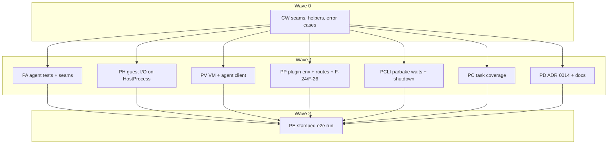

# Plan: Parbake release audit, stage 2 (hardening)

## Status

- State:   review
- Tier:    xhigh
- Tier-grammar: 5
- Updated: 2026-10-25
- Next:    /hex-finalize for stages 1 and 2 (C-180 met; PE2 done)
- Reviewed: 1ff0d8de4293547a2af941cd5404ef76949c53f5
- Notes:
  - Attended e2e resumed (2026-10-25) from step 3 on the same stamped build and bundles, after the human granted the
    plugin removable-volume access in System Settings. Steps 3–20 pass; with steps 1–2 of 2026-10-24 the whole
    checklist passes on the swift-subprocess runners (tested commit 49fa86c, run recorded at deb1061). Step 15's
    third run boots `<volume-bundle>` and answers `exec` (C-180, PE2). Step 13 reads `0.1.0` three times; step 18
    warns once for the `0.0.0-dev` agent. Result column rewritten. Observations: plugin helpers of removed
    containers stay alive until killed (three at step 11, two for removed containers); the checklist's `pkill -9 -f
    container-runtime-macos` also matches any shell whose command line names the plugin, so the run used `pkill -9 -x`.
    Cleanup: no container, overlay or plugin process left, installed services run, bundle-roots file removed,
    `.build/dev-env/container` status unchanged; the bundles stay on the external volume for the human. `task coverage` not re-run.
  - Attended e2e (2026-10-24), tested commit 49fa86c (stamped `0.1.0` dry-run build, `RELEASE_ALLOW_NON_MAIN=1`; plugin
    and agent signed ad hoc, `parbake` with the Apple Development identity). Every bundle on the external volume
    (`parbake-e2e`, `<volume-bundle>` in `parbake-vol`, both kept), the cached restore image passed as `--restore-image`.
    Steps 1–3 pass: `task clean check` exit 0; `create` exit 0 with `Provisioned` `runner` and `Agent` `1 0.1.0`;
    noagent, stale (`1 0.0.0-dev`, stamped `agent install --agent <unstamped agent> --keychain`, no keychain prompt)
    and volume bundles built; `dev up -y` with the stamped binaries copied in. Step 4 blocks: the new plugin build
    waits in `open()` on the bundle's disk image while tccd prompts for kTCCServiceSystemPolicyRemovableVolumes (an
    entry for an older build fails its code requirement). The prompt stayed unanswered over two 10-minute windows; the
    stuck plugin was killed both times. Steps 4–19 not run, PE2 open, the checklist's Result column unchanged.
    Step 20 done: no container or overlay left, installed services run, bundle-roots file removed, `.build/dev-env/container`
    status unchanged. Three retro entries (zsh `log` builtin in steps 12 and 18, identity name vs hash for
    `PARBAKE_CODESIGN_IDENTITY`, the prompt arriving at step 4).
  - /hex-review xhigh of bcef49a..1ff0d8d (2026-10-24, re-run after the lost report): Request Changes, 0 Block, 4 High
    (3 actionable), 33 Warn (30 actionable), 12 Suggest; two systemic causes behind 3+ findings. 9214eae: C-144 fixed,
    C-142 partially fixed (the readiness-wait exit now force-stops a guest under a graceful stop). Unconverged: C-142,
    C-146, C-180 partial; rows PR2 and PE2 appended. Stage 1 F-01..F-06 and C-020 hold. Report:
    `.agents/research/research_release_audit_stage2_review.md`.
  - /hex-review xhigh of bcef49a..deeff1f (2026-10-24): Needs Work, 0 Block, 1 High, 15 Warn (7 actionable). Unconverged:
    C-142 and C-144 partial; row PR appended to Parallelization. Report:
    `.agents/research/research_release_audit_stage2_review.md`.
  - Base: `12aa486` on `hex/release-audit`. Stage 1 (`plan_release_audit_stage1.md`) is at State review, and
    `task clean check` exits 0 there.
  - One `/hex-finalize` follows this plan, for stages 1 and 2 together (goal decisions log, "Finalize timing").
  - Pipeline worktrees resolve the fork into their own `.build/`, as in stage 1 Q13;
    PE runs in the main checkout against `.build/dev-env/container`.
  - Execution (2026-10-23): contract wave 261af94..f0fa75d; `task check` exited 0 there. PD and PC started from
    38053ee before the wave landed (disjoint files, no dependency on wave code) and merged at 6fa248e and f178e98.
    Wave 1 branches from f178e98.
  - Execution decisions (question → decision):
    - C-103 `shutdownIfAllowed` text differs from the code → the code's string is kept byte-identical:
      `sudo -n -l /sbin/shutdown >/dev/null && echo 'parbake: shutting down' && sudo -n /sbin/shutdown -h now
      >/dev/null`, `acceptedMarker = "parbake: shutting down"`. `shutdownDiscardingOutput` (`… >/dev/null`) added
      for GuestPreparation.
    - C-105 `ProbeError` did not exist → defined in `GuestReachability.swift` as a struct wrapping a description.
    - `guestStopped` → code `.interrupted`; nil exit code prints "the guest stopped before it answered".
    - `agentVersionMismatch` → code `.timeout`, the code of the plugin's agent-not-ready wrap it replaces.
    - `incompatibleOverlay` stores the bundle and base paths as `String`.
    - C-160 `llvm-cov report` strips the path prefix, so module attribution fails → `coverage.sh` aggregates
      `llvm-cov export -format=lcov`; the fixture is `scripts/fixtures/coverage-report.lcov`.
    - SW-IO-05 (swift-subprocess) → `Foundation.Process` kept per Q3, each site marked `// legacy:`; ADR 0014
      records the deviation and the swift-subprocess follow-up.
    - Wave-1 worktrees seed `.build` by clonefile from the main checkout and prebuild once (about 100 s each instead
      of a cold build); `Package.resolved` re-resolves locally in a worktree and is never committed.
    - `RuntimeFailure.exists(String)` was missing for four `.exists` sites → added as a seam commit (56459f1) and
      cherry-picked into PV and PH.
    - C-120 an `async` overload named `run` breaks parbake's existing async callers → the cancellable form is
      `GuestShell.runCancellable`. A timed-out sync `run` still reports -1; a signal death now reports 128 + signal.
    - C-107 sites with `cause:` printed ` (cause: "…")` through parbake → the message keeps that suffix
      (`causedMessage` in PV, inline in PH). The plugin's XPC message for those sites now carries the cause text too.
    - C-126 `respond(to:lease:serverMAC:)` also returns the reply kind (`onReply` needs it); the start parse is
      `interfaceSettings(macAddress:maxPacketSize:defaultPacketSize:)`.
    - C-132 `retryOnLockContention` takes a leading `path:` to build `.lockHeld`.
    - C-133 `GuestAgent`'s test init has no machine; a call that needs one throws `.internalError`.
    - C-150 the guest-stopped text is the shared one ("the guest stopped with exit code N before it answered") in
      Provision and Agent; exit 1 unchanged. AgentProbe's SSH wait now also ends on a guest exit.
    - C-151 AgentProbe's post-shutdown wait runs the full `GuestShutdown` ladder (120 s, power button 60 s, force).
    - C-153 non-usage `ValidationError` in `Provision.publicKey` → `ParbakeError.runtime`, same text; the other
      `ValidationError` sites validate user input and keep exit 64.
    - C-140 `allocateNetwork` also takes the `ContainerConfiguration`; `.live` is `live(log:)`; the agent is built
      at bootstrap (no I/O in `GuestAgent.init`).
    - C-142 a start interrupted by a stop throws `ContainerizationError(.interrupted, "the container was stopped
      while it started")`; KILL during `.starting` stays refused ("cannot kill: container is not running").
      Follow-ups (not in stage 2): bootstrap's check-then-await window and the unstored guest-exit task.
    - C-143/C-144 the shell shutdown request runs in a tracked task that KILL cancels; the ladder ignores
      `requestStop`/`forceStop` errors, and an accepted request that hangs gets the power button before the force.
      Agent `RuntimeFailure`s in createProcess, start, kill, resize and wait now reach XPC as `ContainerizationError`.
  - Integration gate at c010f6a: `task clean check` exit 0; every Verification grep clean; `Package.resolved`
    unchanged; `scripts/lint-boundaries.sh` passes.
  - PE (2026-10-23), tested commit 3567642 (stamped `0.1.0` dry-run build, `RELEASE_ALLOW_NON_MAIN=1`): plugin and
    agent signed ad hoc, `parbake` with the Apple Development identity. Steps 1–14 and 16–20 pass; step 15 passes
    its two refusals and its path check, and the boot from the volume is skipped (it waits on the macOS
    removable-volume access prompt, which an unattended run cannot answer). Results in docs/end_to_end_checklist.md.
  - PE decisions (question → decision):
    - A plugin build signed ad hoc blocks in `open()` on a bundle on an external volume (tccd: removable-volume
      prompt) → `<bundle>`, `<noagent-bundle>` and `<stale-bundle>` live under the home directory; only
      `<volume-bundle>` stays on the volume. The checklist's Prerequisites say so.
    - The unstamped ad hoc `parbake agent install --keychain` waits on a keychain prompt for the item that the
      identity-signed `parbake` stored → the stale bundle is built with the stamped `parbake agent install --agent
      <unstamped parbake-agent>`; its `Agent` reads `1 0.0.0-dev`.
    - On the faster home disk the agent install failed with `Bootstrap failed: 5` right after boot (launchd still
      held the old daemon) → 3567642 retries the bootstrap up to five times with a bootout in between; the
      release was rebuilt at that commit, and the install passes.
    - The first noagent layer timed out waiting for the agent on the volume; it passed on retry.
    - Final gate: `task clean check` failed once in `testAChildThatIgnoresTermIsKilled` (66 s on ContinuousClock in
      a 2.5 s run; the power log shows an idle sleep during the gate). It passes 5× in isolation. 8ac92f0 times the
      GuestShell timeout tests on SuspendingClock, the time base of HostProcess's Dispatch timers.
  - `task coverage` at 97953da (line coverage): ParbakeVersion 98.0% (49/50), RuntimeMacOS 58.0% (1800/3101),
    container-runtime-macos 58.1% (484/833), parbake-agent 58.3% (676/1159), parbake 24.7% (278/1125), total 52.4%
    (3287/6268).
  - Cleanup: development services down, installed services run, no guest; temporary bundles, restore-image download,
    guest key and bundle-roots file removed; the `runner` keychain item predates this run and stays; `.build/dev-env/container`
    status unchanged. Two empty folders remain at the top level of the external volume (the removal tool refuses
    top-level paths on a mounted drive).
  - PR (2026-10-24): one pipeline on `hex/release-audit`, code commit 9214eae. Red before, green after:
    `testAFailedForceStopWhileTheGuestBootsIsLoggedAndStillStopsTheContainer`,
    `testABootThatReturnsAfterAStopIsForceStoppedAndClosesTheAgent`, `testARejectedStopRequestIsLogged`, and
    `GuestShutdownTests` `testAFailedPowerButtonRequestAndForceStopAreNoted` and
    `testALadderWhoseStepsSucceedNotesNothing` (red as a compile failure: no `note` parameter). Integration gate:
    `task clean check` exit 0 at 9214eae. No `/hex-review` (review budget spent); one spec-reviewer worker
    checked C-142 and C-144: both met. Open test gaps for finalize: no test stops during the
    readiness wait and then lets the start reach `abandonStart`, and none covers its `currentExit` skip.
  - R-A/R-B (2026-10-24), sub-orchestrated from the release-audit loop. Decisions (question → decision):
    - Which findings R-A takes → every actionable one except the ADR 0014 items R-B rewrites (W-14, W-15, W-17,
      W-25, W-27) and the runner internals the switch replaces (W-16, W-28, W-29, W-30). H-4 stays with PE2 (attended).
      Suggest items are not folded in; S-5 and S-12 go away with the switch.
    - Worktrees → none: both pipelines change the host-process runners and their call sites, so they would
      conflict; both run serially on `hex/release-audit`.
    - swift-subprocess version → 1.0.2, the latest stable tag (2026-10-24). Its manifest: tools 6.2, macOS 13, Swift 6
      mode, one dependency (swift-system `from: 1.5.0`, already pinned here at 1.6.x). Fits tools 6.2 / Swift 6.4 /
      macOS 27 host and guest.
    - B1 first attempt (no commit): a sync `runBlocking` over swift-subprocess 1.0.2 deadlocks the cooperative pool.
      Every `Subprocess.run` starts an unstructured `Task {}` on the global pool (measured, also under a task-executor
      preference and a custom actor executor), so callers that block pool threads exhaust it: 48 concurrent
      `runBlocking` calls hung past 300 s, where the `Foundation.Process` body passed in 1.2 s. Which bridge →
      none: the runner is async only. `HostProcess.runBlocking` is removed; `AgentCommand.capture`, `GuestShell.run`,
      `GuestCredentials.security` and parbake's `createGuestKey` become `async`, and so do their callers. The R-A
      contract tests that called the sync forms change only by `async`/`await` keywords (the caller's rule: a
      changed contract test is recorded here); their assertions stay byte-identical. Not a human decision: the
      API is internal to this package's executables, and no message, exit code or behaviour changes.
    - B1 stdin writer → our own pipe (`F_SETNOSIGPIPE`, `FD_CLOEXEC`) written on a dedicated thread, not
      Subprocess's `StandardInputWriter`: that writer's pipe has no `F_SETNOSIGPIPE`, and its failed write throws out
      of `run`, so a child that exits without reading would raise SIGPIPE in the test runner or turn into a spawn
      failure. The write end is taken exactly once (by the writer thread or by `abandon` on a spawn failure).
    - B1 capture limit → none: captured streams are `.sequence`s drained in the body, as `Foundation.Process` read
      to EOF; `ProcessOutput` and `AgentCommand` keep their unbounded contract.
    - B1 exit codes → `.exited(code)` is masked with `& 0xFF`: on Darwin Subprocess reports up to 24 bits of the
      exit() argument (`security -i` gave 16751916 for status 44), which broke the four `.keychain` tests until masked.
    - B1 `GuestShell` → one async `run` (both overloads); `runCancellable` stays only as a forward because
      `GuestShellTests` calls it by name. The plugin's `runShell` uses `run`. `AgentSetup.promptedPassword` splits the
      keychain-free path out of `password(for:keychainService:)`, so `Create.readStdinPassword` stays sync.
    - B1 ripple beyond the named callers: `GuestCredentials.preflight/password/store/remove/passwordCreatingIfNeeded`,
      `ProvisionInputs.validate` (its `keychainPreflight` closure is `async throws`), `Create.validateAccount`,
      `AgentSetup.stage/password`, and in the agent `GUISession.require`, `TemporaryDirectories.directory(for:)`,
      `Launch.init` and `GuestProcess.start`. All parbake commands were already `AsyncParsableCommand`.
    - B1 mechanically changed tests (only `async`/`await` added, `runBlocking(` → `await … run(`; a script
      checked the 153 changed test lines normalise to the removed ones): HostProcessTests (helper `shell` and all 16
      sync tests: testTheExitStatusAndBothStreamsAreReturned, testLargeOutputOnBothStreamsWithInputDoesNotDeadlock,
      testInputTheChildIgnoresNeitherBlocksNorFails, testDiscardedStreamsAreNotCaptured,
      testAGivenEnvironmentReplacesTheInheritedOne, testAnInheritedEnvironmentKeepsThePath,
      testATimeoutStopsTheChildWithSIGTERM, testATimeoutOfZeroStopsTheChild, testATimeoutStopsAChildThatIgnoresSIGTERM,
      testASignalDeathReportsTheSignalAndNoTimeout, testEmptyInputGivesTheChildAnImmediateEndOfFile,
      testAChildThatExitsWithoutReadingLargeInputKeepsItsStatus, testBothStreamsOfAMegabyteEachWithInputDoNotDeadlock,
      testAnInheritedStreamIsNotCaptured, testAMissingExecutableThrows); GuestShellTests (testRunRefusesAnInvalidTarget,
      testATimeoutKillsTheChild, testAChildThatIgnoresTermIsKilled, testASignalDeathReportsTheSignalPlusOneTwentyEight,
      testAChildThatIgnoresStdinDoesNotCrash, testLargeOutputOnBothStreamsWhileInputIsWritten,
      testTheChildGetsAMinimalEnvironment, testTheExitStatusAndStandardInputReachTheCaller); GuestProvisioningTests
      (testStoresReplacesAndRemovesAPassword, testTheSecurityToolReadsThePasswordWithoutAPrompt,
      testSecurityArgumentsAreCheckedAndQuoted, testPreflightNeverCreatesTheProbeAccount,
      testPreflightSucceedsOnAnUnlockedKeychain, testAServiceWithANewlineIsRefusedBeforeSecurityRuns,
      testACreatorOnlyRoundTrip, testTheStatusAndStandardErrorReachTheCaller,
      testTheCommandReachesTheToolOnStandardInputAndItsOutputIsReturned, aPasswordWithANewlineIsRefused);
      GuestKeyTests (testCreatingTheGuestKeyWritesAPrivateAndAPublicKey); ProvisionInputsTests (helper `validate` and
      all 15 tests that call it or `validateAccount`); AgentCommandTests (all 5); GUISessionTests (all 4);
      GuestProcessTests (the 7 tests that call `start()`). ExitLatchTests and RestoreImagesTests needed no change.
      New: HostProcessConcurrencyTests.testMoreConcurrentRunsThanPoolThreadsAllFinish (48 timed runs at once, 0.3 s).
    - B1 AgentCommand bound → 30 s (`AgentCommand.timeout`, ContinuousClock), then SIGTERM and SIGKILL 2 s later;
      capture returns the status the child ended with. W-16 verified: a scratch run of
      `trap '' TERM; echo partial; sleep 60` returned (137, "partial\n") after 32.3 s; `kill -TERM $$` returned 143.
    - B1 W-30 verified: `HostProcess` and `AgentCommand` time out with `Task.sleep(for:)` (ContinuousClock), and
      Subprocess's teardown grace is `Task.sleep(for:)` too; no Dispatch timer, semaphore or `asyncAfter` is left in
      either file, so timeouts share the ContinuousClock base of the poll and shutdown deadlines.
    - B1 S-12 → not gone, moved into swift-subprocess 1.0.2: our code no longer holds a pid, but on Darwin
      Subprocess signals by pid (`kill`; process descriptors only on Linux and FreeBSD), and its cancellation teardown
      runs concurrently with the reap in `Configuration.run`; its `kill(pid, 0)` liveness check passes for a zombie, so
      a SIGTERM or SIGKILL sent between the reap and the teardown's cancellation can reach a reused pid. The window is
      the same nanosecond class as before.
  - R-A/R-B result (2026-10-24): fixed H-1, H-2, H-3, W-1..W-16, W-18..W-30, D-1, D-2; D-3 implemented as the
    swift-subprocess switch (W-16, W-28, W-29, W-30 resolved by R-B; W-14, W-15, W-17, W-25, W-27 in ADR 0014). Open:
    H-4 (PE2, attended run). Suggest items not folded in; S-5 is gone with the `// legacy:` markers, S-12 moves into
    swift-subprocess (it signals by pid on Darwin). Not covered: grandchildren survive a timeout (no process group, F-37).
  - PR decisions (question → decision):
    - Which state a `.starting` stop leaves when `forceStop` throws → `.stopped`; the error is logged ("could not
      stop the guest while it starts") and the pending start force-stops the guest again when its boot returns.
    - Whether the start's stopped-while-starting exits force-stop a guest that already exited → only while
      `currentExit` is nil; a failure there is logged. A `start` that throws after a stop is not force-stopped.
      `testStopWhileTheGuestBootsForceStopsItAndEndsTheStartInterrupted` now makes the stop's `forceStop` end the
      fake machine, so its single `forceStop` stays asserted.
    - `note`'s shape → `(GuestShutdown.Step, any Error) -> Void`, `Step` = `.requestStop | .forceStop`, default a
      no-op so parbake's callers stay unchanged. `stopGuest` logs a failed `forceStop` as an error ("could not stop
      the guest forcibly").
    - Logging a test can read → `FakeRuntimeEnvironment.makeService(log:)` (outside the row's file list, a
      default-argument change) and a `LogRecorder` handler in `RuntimeStartStopRouteTests.swift`.
  - A3 (2026-10-24) supersedes the PR bullets and the C-143/C-144 note that the ladder ignores errors and that a failed
    `.starting` force stop leaves `.stopped` (human decision D-1: a failed forced stop fails `stop`, as at 12aa486):
    - What `stop` returns when the forced stop fails → the forced stop's own error through
      `RuntimeLifecycle.containerizationError(from:)` (C-146): a non-`RuntimeFailure` error such as the VZ `NSError`
      passes through unchanged, as at 12aa486; the log line stays. `GuestShutdown` is unchanged: `stopGuest` captures
      the error from the `.forceStop` note and throws after the ladder.
    - Which state a failed forced stop leaves → `.stopping` on the running path (12aa486 left it there) and on the
      `.starting` path (the guest may still run). The pending start ends it: `abandonStart`, and a start whose boot throws,
      set `.stopped` once the guest is force-stopped (or never booted); if that force stop fails too the state stays
      `.stopping`.
    - W-19 → "guest did not shut down in time, stopped it forcibly", logged only when the forced stop succeeded.

---

## Overview

**Author:** Christian Semmelmann, with an automated planning assistant
**Date:** 2026-10-23
**Source:** [.agents/discussions/release-audit.md](../discussions/release-audit.md) › Stage 2, requirements 1–4,
plus the stage 2 Verification bullet that re-runs the end-to-end checklist.
**Goal file:** [.agents/goals/release-audit.md](../goals/release-audit.md) (S2.1–S2.4; S1.10 closes with PE).
**Findings folded in:** F-24, F-26 and F-41 from
[research_release_audit_stage1_review.md](../research/research_release_audit_stage1_review.md); W-04 (partial),
W-13, W-41, W-62 (test half) from [research_release_audit_full_review.md](../research/research_release_audit_full_review.md);
root causes R2, R4, R5 and R8 from that report.
**Sites:** [research_release_audit_stage2_recon.md](../research/research_release_audit_stage2_recon.md) re-locates
every site at `12aa486`. The discussion's line numbers are stale; use the recon's.
**Decided, not re-decided:** ADR 0009 (module boundaries; `parbake-agent` imports neither `RuntimeMacOS` nor
`Virtualization`; `ParbakeVersion` is the shared leaf), ADR 0010 (keychain ACL follows the identity), ADR 0011,
ADR 0012 (tag is the version source; stamped worktree build), ADR 0013.
**ADR this plan writes:** ADR 0014, a small record of where the stage 2 list ends at a module boundary (C-170).
**Research reused, not repeated:** every `research_release_audit_*.md`, plus `research_release_readiness_bar.md`.

### Classification

| Axis | Value |
|---|---|
| Scope | Large: two new test seams in executables, six duplication classes across four modules, two concurrency fixes, a coverage task and a host run |
| Reversibility | Two-way door. Every seam and helper is internal. Exit codes, XPC error codes and user-visible messages stay as they are and are pinned by tests (C-107) |
| Tier | xhigh (auto). The classifier picked high; Phase 3's Large-scope rule raised it, as in stage 1 |
| Overlays | architect=inline (ADRs 0009–0013 cover the boundaries; ADR 0014 records two in-boundary choices), research=skip (persisted research), adversary=off (none pinned in `hex.md`) |
| Artifacts | this plan; `research_release_audit_stage2_recon.md`; ADR 0014 as a step of PD |

### Out of scope

- F-29 (deferred, Q13), F-33..F-42 except F-41, and every Warn or Suggest the stage 1 plan's Coverage lists as not
  folded, unless a contract below names it.
- W-03, W-05..W-12, W-14, W-15, W-17 and S-07. The seams of this plan make them testable; fixing them is not on the
  stage 2 list. They stay follow-ups per the goal's issue-resolution rule 6 (security-class items by location and
  class only).
- Everything the discussion lists as out of scope. No push, tag, PR, branch, or push to the
  fork.

---

## Decisions taken by this plan (question → decision)

| # | Question | Decision | Basis |
|---|---|---|---|
| Q1 | Tier | xhigh, gate pre-approved by the goal loop and announced | classify.md; stage 1 precedent |
| Q2 | "One process helper" for six `Process()` sites, two of them in `parbake-agent`, which may not import `RuntimeMacOS` | `HostProcess` in `RuntimeMacOS` serves the four host sites (GuestShell, GuestCredentials, RestoreImages, parbake Provision). The agent gets one in-module helper, `AgentCommand`, for its two sites. No new shared leaf target: that would amend ADR 0009's "ParbakeVersion is the shared leaf". ADR 0014 records it | ADR 0009; AGENTS.md › Architecture rules; recon §3 |
| Q3 | swift-quality SW-IO-05 prefers swift-subprocess over `Foundation.Process` | Keep `Foundation.Process`, now in exactly one host file and one agent file. A new package dependency changes `Package.resolved`, a hub file, for no stage 2 requirement. ADR 0014 names the single swap point | swift-quality row 18 ("do not widen its use"); hex.md hub files |
| Q4 | GuestShell callers check `status == 0` and rely on `-1` for a spawn failure | `HostProcess` throws on a spawn failure; `GuestShell.run` catches it and keeps `Result.status == -1`, so no caller changes | recon §3 |
| Q5 | "One error type per module" while `RuntimeFailure` already exists (stage 1) | RuntimeMacOS: `RuntimeFailure` is the only `Error` type. `BundlePathError`, `IncompatibleOverlayError`, `GuestAgent.VersionMismatch`, `GuestAgent.ProcessLost` and every constructed `ContainerizationError` become its cases, with unchanged text and codes. Plugin: it throws only `ContainerizationError`, the type apple/container's client decodes, and converts `RuntimeFailure` in one function. parbake: `ParbakeError` only; ArgumentParser's `ValidationError` stays for usage errors (exit 64), which ArgumentParser requires. Agent: `AgentError` only; `RPCError` is built in its one mapping | recon §3; ADR 0009; C-012 of stage 1 |
| Q6 | `ProcessLost.cause: any Error` breaks `RuntimeFailure: Equatable, Sendable` | The case stores the cause's description as a `String` | Equatable/Sendable conformance |
| Q7 | One shutdown path: five ssh sites, two agent argv sites, four stop ladders | Strings and argv in `GuestCommands` (C-103); the ladder (request, wait, power button, wait, force) in `GuestShutdown` (C-106). The plugin keeps its state transitions in the actor and calls the ladder | W-41; recon §3 |
| Q8 | The wait-for-guest loop "shared by provision, agent, setup and layer" | `Setup` and `Layer` have no loop at HEAD. `GuestReachability.waitForSSH` serves Provision, Agent and AgentProbe; `GuestReachability.poll` serves `dialAgent`, `waitUntilReady` and the aux-storage lock retry. AgentSetup's stop wait moves to `GuestShutdown` | recon §3 |
| Q9 | The SSH poll interval differs (5 s in Provision, 3 s elsewhere) | One default, 3 s. Provision keeps its "last ssh error" output through the `onProbeError` callback | W-13 |
| Q10 | How to make the plugin testable | Protocols `GuestMachine` and `GuestAgentClient` in RuntimeMacOS (no VZ types), plus a `RuntimeEnvironment` of closures injected into `RuntimeService.init` in the plugin target. The live environment hides vmnet, `VZMACAddress`, DHCP and the lease file. Test target `ContainerRuntimeMacOSTests` with `@testable import container_runtime_macos` | recon §1; R4, R8 |
| Q11 | How to test agent operations without a guest | Real host processes (`/bin/echo`, `/bin/sleep`, `/bin/cat`) through `GuestProcess` and `SandboxService`, with one seam: an injected `connect` closure in place of `VsockConnection.toHost`, fed by `socketpair` ends. No launcher protocol | recon §2 |
| Q12 | F-26: what a `.starting` container reports, and what `stop`/`shutdown` do during it | `state` reports `.stopped` for `.starting`, as for `.prepared`. A second `startProcess` for the init process is refused with `invalidState`. `stop` during `.starting` force-stops the VM; the pending start then throws `interrupted` and never writes `.running`. `shutdown` during `.starting` is refused like `.running` | C-142; W-04 |
| Q13 | F-29: plan or defer | Defer. The code is small, but whether deleting an `-A` item from a team-signed binary prompts is a new host keychain measurement, and no unit seam exists (the round-trip test is gated on a team-signed runner). ADR 0010 lists the open item. It stays a security-class follow-up, recorded by location and class | Explorer report; ADR 0010 |
| Q14 | Where `task coverage`'s logic lives | `scripts/coverage.sh` with `--self-test` over a fixture report, called by `task coverage`; the self-test joins `task lint` like `release.sh`'s. It reports, never gates | stage 1 Q25 precedent |
| Q15 | How step 13 sees the tag version in a run whose services come from `dev-env.sh` | PE builds `task release:build VERSION=0.1.0 RELEASE_ALLOW_NON_MAIN=1`, uses the stamped `parbake` from `.build/release-assets/0.1.0/` for `create`, and copies the three stamped binaries into the development plugin directory after `dev up`. Step 13 then reads `0.1.0` from the installed plugin, the stamped `parbake` and `Agent` | ADR 0012; recon §5 |
| Q16 | Signing for the stamped build | Plugin and agent ad hoc (`CODESIGN_IDENTITY=-`, which the development network services accept, stage 1 Q20); `parbake` with the Apple Development identity when `security find-identity -v` lists one, else ad hoc with the warning | stage 1 Q20; docs/signing.md |
| Q17 | What "record the run in the checklist" means under the checklist's anonymization rule | PE rewrites the Result column with generalized outcomes and leaves the Run header's placeholders. Date, tested commit and coverage numbers go into this plan's Status notes, never into `docs/` | docs/end_to_end_checklist.md › Recorded runs |
| Q18 | Which version PE stamps | `0.1.0`, the tag stage 1 proposes (C-071). Nothing is tagged | stage 1 Status |

No `[NEEDS CLARIFICATION]` marker remains.

---

## Component contracts

Signatures are Swift. "RM" is `Sources/RuntimeMacOS/`. Each contract names its test home. Tests use Swift Testing,
never sleep to wait (inject a sleep or clock), and never mutate process-global state. New comments follow
`.claude/rules/code-docs.md` (no plan or finding IDs in comments; rationale goes to ADR 0014).

### Contract wave (CW)

**C-101 Package.swift.** Add `.testTarget(name: "ContainerRuntimeMacOSTests", dependencies:
["container-runtime-macos", "RuntimeMacOS"])` with one passing smoke test that constructs an `XPCMessage(route:)`.
`Package.resolved` is unchanged (`/usr/bin/swift package resolve`, then `git diff --exit-code Package.resolved`).

**C-102 `HostProcess` (RM `HostProcess.swift`, new; implemented in full).**

```swift
public struct ProcessOutput: Sendable, Equatable {
    public var status: Int32          // exit status, or 128 + signal
    public var output: Data
    public var errorOutput: Data
    public var timedOut: Bool
}
public enum HostProcess {
    public enum Stream: Sendable { case capture, inherit, discard }
    public static func runBlocking(_ executable: URL, arguments: [String], environment: [String: String]? = nil,
        input: Data? = nil, stdout: Stream = .capture, stderr: Stream = .capture,
        timeout: Duration? = nil) throws(RuntimeFailure) -> ProcessOutput
    public static func run(_ executable: URL, arguments: [String], environment: [String: String]? = nil,
        input: Data? = nil, stdout: Stream = .capture, stderr: Stream = .capture,
        timeout: Duration? = nil) async throws(RuntimeFailure) -> ProcessOutput
}
```

- Captured pipes drain concurrently, so output larger than a pipe buffer on both streams with input never
  deadlocks. `input` is written on its own thread with `F_SETNOSIGPIPE`; an early child exit never raises SIGPIPE
  and never fails the call.
- `environment: nil` inherits; a dictionary replaces the environment exactly.
- On `timeout`: SIGTERM, then SIGKILL after 2 s; `timedOut == true`. A child that ignores SIGTERM still ends.
- `run` terminates the child the same way when its task is cancelled, and returns with `timedOut == false` and the
  signal status.
- A spawn failure throws `RuntimeFailure.internalError("cannot run <path>: <reason>")`; no other path throws.
- Tests `Tests/RuntimeMacOSTests/HostProcessTests.swift`, with `/bin/sh -c` children: exit status, both streams
  large with input, stdin ignored by the child, `.discard`, a replaced environment, timeout, SIGTERM ignored,
  cancellation, a missing executable throws.

**C-103 `GuestCommands` (RM `GuestCommands.swift`, new; in full).** Byte-identical to the strings at HEAD:
`shutdown` = `sudo -n /sbin/shutdown -h now`; `shutdownIfAllowed` = the RS:547 form
`sudo -n -l /sbin/shutdown && echo accepted && sudo -n /sbin/shutdown -h now` with `acceptedMarker = "accepted"`;
`shutdownArguments(asRoot: Bool) -> [String]` = `["/sbin/shutdown", "-h", "now"]` or
`["/usr/bin/sudo", "-n", "/sbin/shutdown", "-h", "now"]`; `asRoot` = the shell fragment
`printf '%s\n' "$PARBAKE_PASSWORD" | sudo -S -p '' /bin/sh -c "$PARBAKE_ROOT"`. Tests
`GuestCommandsTests.swift` pin each value.

**C-104 Seams (RM `GuestSeams.swift`, new).** Signatures mirror the existing public API; conformances are
extensions only, no behaviour change.

```swift
public protocol GuestMachine: AnyObject, Sendable {
    var macAddress: String { get }
    var currentExit: GuestExit? { get }
    func start() async throws
    func requestStop() async throws
    func forceStop() async throws
    func wait() async -> GuestExit
    func wait(timeout: Duration) async -> GuestExit?
}
public protocol GuestAgentClient: Actor {
    func waitUntilReady(timeout: Duration) async throws -> String
    func createProcess(id: String, process: ContainerizationOCI.Process, stdio: [FileHandle?]) async throws
    func startProcess(id: String) async throws -> Int32
    func wait(id: String) async throws -> GuestExit
    func signal(id: String, signal: Int32) async throws
    func resize(id: String, columns: UInt32, rows: UInt32) async throws
    func shutDown(provisionedUsername: String?, timeout: Duration, note: (String) -> Void) async -> Bool
    func close() async
}
extension MacOSVirtualMachine: GuestMachine {}
extension GuestAgent: GuestAgentClient {}
```

Test: a compile-level test assigns a `MacOSVirtualMachine.Type` and `GuestAgent.Type` to the existentials, and
`FakeGuestMachine` (in `Tests/RuntimeMacOSTests/Support/`, copied into the plugin test target) conforms.

**C-105 `GuestReachability` (RM `GuestReachability.swift`, new; in full).**

```swift
public enum GuestReachability {
    public static func poll<T: Sendable>(every: Duration, timeout: Duration,
        sleep: @Sendable (Duration) async throws -> Void = { try await Task.sleep(for: $0) },
        now: @Sendable () -> ContinuousClock.Instant = { .now },
        _ probe: () async throws -> T?) async throws -> T?           // nil on timeout; probe errors propagate
    public static func waitForSSH(username: String, macAddress: String, leaseFile: String,
        every: Duration = .seconds(3), timeout: Duration,
        guestExited: () -> GuestExit?, lease: () -> String?,
        reach: (String) async -> Result<Void, ProbeError>,
        onProbeError: (ProbeError) -> Void = { _ in }, …sleep/now as above) async throws(RuntimeFailure) -> String
}
```

- `poll` probes at once, then every `every`, until the probe returns a value or `timeout` passes.
- `waitForSSH` returns the address that answered. With no lease ever seen it throws `.dhcpTimeout`; with a lease
  but no answer, `.sshTimeout` naming the last address; a guest exit throws
  `.guestStopped(exitCode:)` (new case, C-107) at the next probe.
- Tests `GuestReachabilityTests.swift` with an injected sleep and clock: immediate success, success on the third
  probe, timeout, DHCP vs SSH timeout, guest exit, `onProbeError` called per failed probe.

**C-106 `GuestShutdown` (RM `GuestShutdown.swift`, new; in full).**

```swift
public enum GuestShutdown {
    public enum Outcome: Equatable, Sendable { case stoppedAfterRequest, stoppedAfterPowerButton, forced }
    public static func run(_ machine: any GuestMachine, request: () async -> Bool,
        requestWait: Duration, powerButtonWait: Duration) async -> Outcome
}
```

`request` returns whether the guest accepted the shutdown. Accepted: wait `requestWait`; not accepted or not
stopped: `requestStop`, wait `powerButtonWait`; still running: `forceStop`. A machine that already stopped returns
`.stoppedAfterRequest` without calling anything. Tests `GuestShutdownTests.swift` with `FakeGuestMachine`: each
outcome, the call order, no call after an early stop.

**C-107 One error type in RuntimeMacOS (RM `RuntimeFailure.swift`, `RuntimeLifecycle.swift`, and the four type
sites).**

- New cases: `bundlePath(BundlePathReason)` (the six `BundlePathError` cases, as a non-`Error` enum),
  `incompatibleOverlay(bundle: String, base: String, reason: String)`, `agentVersionMismatch(agentVersion:
  String)`, `processLost(id: String, cause: String)`, `guestStopped(exitCode: Int32?)`, `invalidArgument(String)`,
  `invalidState(String)`, `notFound(String)`, `unsupported(String)`, `interrupted(String)`, `timeout(String)`,
  `internalError(String)`.
- Pin first: before any move, CW captures on `12aa486` a golden table (`RuntimeFailureGoldenTests`) of the
  description and code of each old type case and of every RM `ContainerizationError(` site it replaces; the
  table then runs against the new cases unchanged. Wave-1 pipelines add their sites' rows the same way before
  converting.
- Every new case's `description` equals the text the old type or the replaced `ContainerizationError` printed;
  `containerizationCode` equals the code the replaced site used; `exitCode` is 1 for every new case, so parbake's
  exit codes do not change. The nine stage 1 cases are untouched.
- `BundlePathError`, `IncompatibleOverlayError`, `VersionMismatch` and `ProcessLost` are removed; their throw and
  catch sites (RS bootstrap's `IncompatibleOverlayError` catch, `processExit`'s `ProcessLost` catch, the tests)
  move to the cases in CW.
- `RuntimeLifecycle.containerizationError(from:)` maps every `RuntimeFailure` to
  `ContainerizationError(code: containerizationCode, message: description)` and passes any other error through.
- Conversion rule for wave 1: each pipeline turns the `ContainerizationError(` constructions in its own RM files
  into `RuntimeFailure` cases with the same code and text. At the end, `grep -n 'ContainerizationError('
  Sources/RuntimeMacOS` lists only `RuntimeLifecycle.swift`.
- Tests: `RuntimeLifecycleTests` covers `containerizationError(from:)` for every case and a pass-through;
  `RuntimeFailureTests` gains one row per new case (description, `containerizationCode`, `exitCode`);
  `BundlePathPolicyTests`, `MacOSVMBundleTests` and `GuestAgentTests` assert the new cases with the old texts.

### PA — guest agent (`Sources/parbake-agent/`)

**C-110 vsock seam.** `GuestProcess.init(..., connect: @escaping @Sendable (UInt32) throws -> Int32 =
VsockConnection.toHost)`, stored and used in `start()` and `startWithTerminal()`. `SandboxService` takes the same
closure and passes it on. Default behaviour unchanged.

**C-111 Operation tests (`Tests/ParbakeAgentTests/SandboxServiceTests.swift`, `GuestProcessTests.swift`).**
Through `SandboxService` handlers or `GuestProcess` plus `ProcessTable`, with host processes:
- create: valid spec added; empty `args` → `invalidArgument`; duplicate id → `alreadyExists`;
- start: pid > 0; stdout to a `socketpair` end carries `echo`'s output; stdin from the pair reaches `/bin/cat`;
- wait: exit 0, exit 7, and 128 + signal after a kill;
- kill: `sleep 60` with SIGTERM ends with 143; a process not running → `failedPrecondition`;
- delete: running → `failedPrecondition`; exited → removed, then `notFound`;
- closeStdin: `/bin/cat` ends after it;
- resize: on a `PseudoTerminal` the `TIOCGWINSZ` read back matches; without a terminal it is a no-op;
- unknown id on every operation → `notFound`.
The pty start path (it re-execs the agent binary) stays manual (checklist step 5).

**C-112 `AgentCommand` (`Sources/parbake-agent/AgentCommand.swift`, new).** `static func capture(_ executable:
String, _ arguments: [String]) -> (status: Int32, output: String)?` — stdout captured, stderr discarded, nil on a
spawn failure. `TemporaryDirectories.directory(ofOther:)` and `GUISession.launchctlPrint` use it; the agent then
has one `Process()` site. Tests `AgentCommandTests.swift`: `/bin/echo`, `/usr/bin/false`, a missing executable.

**C-113 Force unwraps.** GuestProcess.swift:223 and :507 use `guard let base = …baseAddress` (a write returning
-1, and a `preconditionFailure` naming the terminator invariant, or `body` takes the buffer). After PA,
`grep -nE '[A-Za-z0-9_)\]]!([^=]|$)|try!|as!' Sources/parbake-agent` finds no force unwrap.

**C-114 One agent error type.** `SandboxService.unimplemented` throws `AgentError.unimplemented`; `RPCError` is
built only in `AgentError.rpcError`. Test: an unimplemented RPC maps to `.unimplemented` with the same message.

### PH — guest I/O in RuntimeMacOS

**C-120 `GuestShell` on `HostProcess`.** `run(_:on:input:timeout:)` keeps its signature and `Result` shape and
calls `HostProcess.runBlocking`; a thrown spawn failure becomes `status == -1` (Q4). New
`run(_:on:input:timeout:) async -> Result` calls `HostProcess.run`, so cancelling its task terminates ssh. Askpass
and environment construction become `static func environment(askpass: URL, password: String?) -> [String:
String]`. The existing stub-ssh suite passes unchanged; add cancellation and environment tests.

**C-121 `GuestCredentials.security` on `HostProcess`.** The `usleep` join and the second drain are gone. Its
`SecurityResult` mapping is unchanged. Test: an injected `securityPath` stub covers a status and a stderr text;
the gated keychain suite still passes where it runs.

**C-122 `RestoreImages` curl on `HostProcess`** with `stdout: .inherit, stderr: .inherit`, an injectable curl
URL, and the same arguments. Tests: a stub curl records its argv and exits 22 → the existing error text.

**C-123 Script builders on `GuestCommands`.** GuestPreparation and GuestAgentInstallation use `shutdown` and
`asRoot`. Generated scripts are byte-identical: a golden test per builder, written before the change, passes
after it.

**C-124 DHCPLeases.** Line 30 becomes `if newest.map({ lease >= $0.lease }) ?? true`. Tests: `currentAddress`
picks the newest lease and, on equal times, the later entry
(`Tests/RuntimeMacOSTests/DHCPLeasesTests.swift`, new; the existing `address(for:in:)` tests stay in
`GuestProvisioningTests`).

**C-125 GuestShell pure tests.** Key credential: `-i <path>`, `IdentitiesOnly=yes`, `BatchMode=yes`. Password
credential: `PubkeyAuthentication=no`, `PreferredAuthentications`, `NumberOfPasswordPrompts`. `--` comes right
before the target; every `-o` precedes it.

**C-126 DHCP pure logic.** `GuestDHCPServer.respond(to frame: [UInt8], lease:, serverMAC:) -> (request:
DHCPMessage.Kind, reply: [UInt8])?` and the start-callback parse are extracted; `readFrames` calls them. Tests:
DISCOVER → OFFER, REQUEST → ACK, a foreign MAC → nil, a malformed frame → nil; `ipChecksum` against a known
header, `ipv4`, `mac`, `mask(prefixLength:)` for 0, 24 and 32.

### PV — VM, agent client and the rest of RuntimeMacOS

**C-130 `ExitLatch`.** API `finish(exitCode: Int32)`, `wait() async -> GuestExit`, `wait(timeout: Duration)
async -> GuestExit?`, `current: GuestExit?`. `MacOSVirtualMachine`'s `finish`, `wait`, `wait(timeout:)` and
`currentExit` move into an internal `final class
ExitLatch: @unchecked Sendable` (lock-guarded, named in a comment); `MacOSVirtualMachine` delegates. Tests: wait
before and after finish, several waiters, timeout returns nil, a second finish is ignored.

**C-131 `MacOSVirtualMachine.resources(cpus:memoryInBytes:minimum:maximum:)`** returns
`(cpus: min(max(cpus, minimum.cpus), maximum.cpus), memory: min(max(memory, minimumMemoryInBytes, minimum.memory),
maximum.memory))`, the formula at HEAD; `configuration(...)` passes VZ's allowed counts and sizes. Table tests for
below, inside and above each range, written against HEAD's formula first.

**C-132 Lock retry on `GuestReachability.poll`.** `start()`'s aux-storage retry keeps 2 s and 30 s and still ends
in `.lockHeld`. Test through an internal `retryOnLockContention(timeout:every:sleep:now:_:)` with a fake start
that fails twice with EAGAIN.

**C-133 `GuestAgent`.** `waitUntilReady` uses `poll` (1 s); `shutDown` uses `GuestCommands.shutdownArguments`;
an internal init takes `versionProbe: @Sendable () async throws -> String?` for tests. Tests: ready, protocol
mismatch throws `.agentVersionMismatch` at once, timeout throws `.agentTimeout`.

**C-134 Conversions (C-107 rule)** in MacOSVirtualMachine, GuestAgent, BundlePathPolicy, MacOSVMBundle, FileLock,
Validated, GuestUser, GuestProvisioning, SigningIdentity and ParbakeHome. Existing suites pass with the same
texts. The golden rows for these sites go into `Tests/RuntimeMacOSTests/RuntimeMacOSErrorTextTests.swift` (new,
PV's), so PV never edits PH's `GuestProvisioningTests`.

### PP — runtime plugin (`Sources/container-runtime-macos/`)

**C-140 `RuntimeEnvironment`.** A struct of `@Sendable` closures passed to `RuntimeService.init`:

```swift
struct RuntimeEnvironment: Sendable {
    var loadConfiguration: @Sendable (URL) throws -> RuntimeConfiguration
    var validateBundlePath: @Sendable (String) throws -> URL           // BundlePathPolicy(home:).validate
    var openInstance: @Sendable (_ bundle: URL, _ instance: URL, _ resetOverlay: Bool) throws -> MacOSVMBundle
    var makeGuest: @Sendable (MacOSVMBundle, _ cpus: Int, _ memory: UInt64, AllocatedNetwork?) throws
        -> (machine: any GuestMachine, agent: any GuestAgentClient)
    var runShell: @Sendable (_ shell: GuestShell, _ command: String, _ address: String, Duration) async
        -> GuestShell.Result                                              // cancellable (C-120)
    var allocateNetwork: @Sendable (XPCMessage) async throws -> AllocatedNetwork?  // hides vmnet, VZMACAddress, DHCP
    var releaseNetwork: @Sendable (AllocatedNetwork) async -> Void
    var leaseAddress: @Sendable (_ macAddress: String) -> String?
    var now: @Sendable () -> Date
}
```

`AllocatedNetwork` is a plugin type holding the attachment and an opaque handle. `GuestAgent.init` does no I/O,
so `makeGuest` builds the agent at bootstrap; if PP finds otherwise, `makeGuest` returns a factory closure
instead and the contract is updated in the step's report. `RuntimeEnvironment.live`
reproduces HEAD's behaviour; `RuntimeService.swift` no longer imports `Virtualization` or `vmnet` (the live
environment's file does).

**C-141 Route tests (`Tests/ContainerRuntimeMacOSTests/RuntimeServiceTests.swift`)** with a fake environment, one
suite per route: createEndpoint (reply holds an endpoint), bootstrap (prepared; a second bootstrap refused; mounts
or ports refused; a bad bundle path maps to `invalidArgument` with the BundlePathReason text; an incompatible
overlay resets it), startProcess (running; agent timeout → `timeout` with the label text; VM limit →
`unsupported`), createProcess (the OCI user and args reach the fake agent), state (each state's status), stop
(each `GuestShutdown` outcome; prepared → stopped), kill (the signal table; KILL while stopping force-stops; HUP
refused), resize (forwarded), wait (exit code and date; the lost-process message), shutdown (network released
once; refused while running), unsupported (`unsupported`).

**C-142 F-26.** New state `.starting` with the transitions of Q12; every await in `startProcess`, `stop` and
`kill` re-checks state after it returns. Tests: two concurrent `startProcess` calls with a suspended fake start →
one `start` call, the second refused; stop during `.starting` → VM force-stopped, start throws, state `.stopped`;
shutdown during `.starting` refused.

**C-143 F-24.** `forceStop` wins: KILL during a stop cancels the in-flight shutdown request (its shell task is
cancelled, which terminates ssh through C-120) and the stop returns once the VM reports its exit. The post-request
check tests the machine's exit, not object identity. Tests: a fake shell that suspends until cancelled; KILL
during stop → shell cancelled, `forceStop` called once, stop returns; a request that completes after a force stop
does not change state.

**C-144** `stopGuest` uses `GuestShutdown.run` with the ADR 0003 floors, and the shell request uses
`GuestCommands.shutdownIfAllowed`; the stop ladder's log lines stay.

**C-145 F-41.** `OSLogHandlerTests`: `render` with and without metadata, and `osLogType` for every level.

**C-146 Boundary.** Every route error reaches XPC as `ContainerizationError`; `RuntimeFailure` is converted only by
`RuntimeLifecycle.containerizationError`. Covered by C-141's code assertions.

### PCLI — parbake (`Sources/parbake/`)

**C-150 Waits.** Provision's `waitForAccount`, Agent's and AgentProbe's `waitForSSH` call
`GuestReachability.waitForSSH`; `dialAgent` calls `poll`. Provision prints the last ssh error through
`onProbeError`. Exit codes 75 for DHCP and SSH timeouts stay (ParbakeExitTests).

**C-151 Shutdown.** Provision, Agent and AgentProbe use `GuestCommands.shutdown`; AgentSetup's `waitForStop` and
the three post-shutdown waits use `GuestShutdown.run` with their current durations.

**C-152 ssh-keygen** through `HostProcess.runBlocking` with inherited streams. Test: `createGuestKey` in a temp
directory writes a private and a `.pub` key (needs `/usr/bin/ssh-keygen`, present on every macOS host).

**C-153 One error type.** `ParbakeError` is parbake's only error type; `ValidationError` appears only for
argument validation. `ParbakeExitTests` rows pass unchanged (64, 66, 69, 75, 3, 1), plus a row for
`.guestStopped`.

### PC — coverage

**C-160 `task coverage`.** `scripts/coverage.sh` runs `/usr/bin/swift test --enable-code-coverage`, finds the
profdata beside `swift test --show-codecov-path`, passes every `*.xctest/Contents/MacOS/<name>` under
`swift build --show-bin-path` as an object to `xcrun llvm-cov report` with `-ignore-filename-regex
'\.build|/Tests/|checkouts'`, and prints one line per `Sources/<module>/`: module, lines, covered, percent, plus a
total. Exit 0 whatever the numbers; non-zero only when a step fails. `--self-test` checks the aggregation against
a fixture report. `task coverage` calls it; `task lint` runs `--self-test`. Shellcheck and shfmt clean.

### PD — documentation

**C-170 ADR 0014** (`docs/adr/adr_0014_one_runner_and_one_error_type_per_module.md`, MADR, `doc_type:
explanation`, Accepted): one process runner per binary (`HostProcess`, `AgentCommand`) and `Foundation.Process`
kept at those two points; one error type per module with the boundary conversions and `ValidationError` for usage
(Q2, Q3, Q5). It also records where the stage 2 list met the code as it is now: the sixth `Process()` site
(`GUISession`), no wait loop in `Setup` or `Layer` (Q8), one SSH poll interval (Q9), and the stop ladder split
between `GuestShutdown` and the plugin's actor (Q7), so every item is done or justified in an ADR. At least three options per decision, ADR 0009 linked, not amended.

**C-171** CONTRIBUTING task table and AGENTS.md › Verification name `task coverage` (report only, no target).
README › Limitations and CHANGELOG v0.1.0 state the Q12 behaviour (a second start is refused; stop during boot
force-stops). Docs-quality checks pass on every changed page.

### PE — release-candidate end-to-end run

**C-180** On the merged release-candidate commit, `docs/end_to_end_checklist.md` steps 1–20 pass on this host with
the stamped build of Q15 and Q16, and every service is restored at the end. Step 13 reads `0.1.0` three times.
Step 18 uses a stale bundle whose agent is the unstamped `0.0.0-dev` build, so the stamped plugin warns.
Result cells are generalized (Q17).

---

## User-experience scenarios

| ID | Action | Expected outcome | Error cases |
|---|---|---|---|
| S-101 | `task coverage` | One line per module with line coverage and a total; exit 0 | A failing test → non-zero exit before the report; no profdata → names the missing path |
| S-102 | Two `container start` of one container while the guest boots | One guest boots; the second start is refused with an "already starting" `invalidState` | — |
| S-103 | `container stop` while the guest still boots | The VM is force-stopped; the start ends with an interrupted error; the container is stopped | — |
| S-104 | `container kill -s KILL` while a stop waits on ssh | ssh is terminated, the guest stops at once, the stop returns | A guest already stopped → the stop returns with no extra force stop |
| S-105 | `parbake create` on a guest without a lease, or without SSH | Exit 75 with the same DHCP or SSH timeout text as today; Provision still prints the last ssh error | Guest powers off during the wait → exit 1 with the guest-stopped text |
| S-106 | Every parbake command and plugin route after the refactor | Same messages, exit codes and XPC error codes as at `12aa486` | — |
| S-107 | The agent serves create/start/wait/kill/delete/resize | Behaviour unchanged; a buffer or argv edge no longer traps | — |
| S-108 | The end-to-end checklist on the release candidate | All 20 steps match their Expect column; step 13 prints `0.1.0`; the installed services run again at the end | A failing step runs the goal's issue-resolution protocol in the owning pipeline |

Scenario → contract: S-101 C-160; S-102/S-103 C-142; S-104 C-143, C-120; S-105 C-105, C-150; S-106 C-107, C-134,
C-146, C-153, C-123; S-107 C-111, C-113; S-108 C-180.

---

## Error taxonomy

| Module | Type | Boundary |
|---|---|---|
| RuntimeMacOS | `RuntimeFailure` only (C-107) | — |
| container-runtime-macos | throws `ContainerizationError` | `RuntimeLifecycle.containerizationError` converts `RuntimeFailure` (C-146) |
| parbake | `ParbakeError` (wraps `RuntimeFailure`); `ValidationError` for usage | `ParbakeExit.code` (64, 66, 69, 75, 3, 1) |
| parbake-agent | `AgentError` | `AgentError.rpcError` (C-114) |

New failure texts: `guestStopped` ("the guest stopped with exit code N before it answered"), the "already
starting" refusal, and `HostProcess`'s spawn failure. Everything else keeps its text.

## Edge cases

- `HostProcess`: a child that closes stdout early but keeps running; a grandchild holding the pipes (F-37,
  deferred: the timeout kills the child, not the group); empty input; `timeout` of zero.
- `waitForSSH`: a lease that appears and then changes address; a probe that hangs (each `reach` is bounded by the
  shell timeout).
- `GuestShutdown`: `requestStop` throws on a guest that stopped meanwhile (F-25's race) — treated as stopped.
- F-26: a start whose agent wait times out while a stop arrives; the stop wins and no `.running` is written.
- F-24: a KILL arriving after the request finished but before the wait; `forceStop` on a stopped VM is a no-op.
- Agent tests: the runner is not root, so `launchctl asuser` never runs; a test that needs it does not exist.
- Coverage: a test bundle without coverage data (skipped with a note); a module with zero executable lines.

## Trade-offs

- Process helper (Q2): (a) `HostProcess` plus `AgentCommand` — chosen; (b) a new leaf target shared by both —
  rejected, amends ADR 0009's single-leaf rule for two small agent sites; (c) put the helper in `ParbakeVersion` —
  rejected, mixes a process runner into the version leaf. ADR 0014 carries the weighting.
- Errors (Q5): (a) one type per module with boundary conversion — chosen; (b) `RuntimeFailure` everywhere,
  including the agent and the plugin — rejected, the agent may not import RuntimeMacOS and the XPC client decodes
  `ContainerizationError`; (c) keep the ad hoc types and document — rejected, the discussion lists the item.
- Plugin seam (Q10): (a) two protocols plus an environment of closures — chosen; (b) one protocol per
  collaborator (seven) — rejected, more surface for the same tests; (c) test through a real XPC server —
  rejected, still needs the VM layer.

## Migration and rollout

- Internal only. No bundle format, label, config key, exit code or XPC code changes.
- The F-26 refusal and the stop-during-boot force stop are new behaviour; README and CHANGELOG say so (C-171).
- A refactor commit never lands ahead of its tests: in each pipeline the test step precedes the move.

---

## Parallelization

The contract wave comes first and is committed once: C-101 to C-107 in full, including the four type moves and
their catch sites in RS and the tests. Wave 1 then runs seven pipelines with disjoint file sets.
`Package.resolved` must not change.

| Pipeline | Repo | Scope | Expected files | Wave | Depends on | Marks | Status |
|---|---|---|---|---|---|---|---|
| CW | — | C-101..C-107 | Package.swift; RM HostProcess.swift, GuestCommands.swift, GuestSeams.swift, GuestReachability.swift, GuestShutdown.swift (new), RuntimeFailure.swift, RuntimeLifecycle.swift; the type sites in RM BundlePathPolicy.swift, MacOSVMBundle.swift, GuestAgent.swift; their catch sites in RS; Tests/RuntimeMacOSTests/{HostProcessTests,GuestCommandsTests,GuestReachabilityTests,GuestShutdownTests,RuntimeFailureGoldenTests,Support/FakeGuestMachine}.swift (new), RuntimeFailureTests, RuntimeLifecycleTests, BundlePathPolicyTests, MacOSVMBundleTests, GuestAgentTests; Tests/ContainerRuntimeMacOSTests/{SmokeTests,Support/FakeGuestMachine}.swift (new) | 0 | — | — | merged |
| PA | — | C-110..C-114; S-107 | Sources/parbake-agent/*; Tests/ParbakeAgentTests/* | 1 | CW | — | merged |
| PH | — | C-120..C-126, C-107 rule; S-104 (shell half), S-106 | RM GuestShell.swift, GuestCredentials.swift, RestoreImages.swift, GuestPreparation.swift, GuestAgentInstallation.swift, DHCPLeases.swift, DHCPMessage.swift, GuestDHCPServer.swift; Tests/RuntimeMacOSTests/{GuestShellTests,GuestProvisioningTests,RestoreImagesTests,GuestAgentInstallationTests,DHCPMessageTests,DHCPLeasesTests (new),GuestDHCPServerTests (new)}.swift | 1 | CW | review | merged |
| PV | — | C-130..C-134; S-106 | RM MacOSVirtualMachine.swift, GuestAgent.swift, BundlePathPolicy.swift, MacOSVMBundle.swift, FileLock.swift, Validated.swift, GuestUser.swift, GuestProvisioning.swift, SigningIdentity.swift, ParbakeHome.swift; Tests/RuntimeMacOSTests/{MacOSVirtualMachineTests,GuestAgentTests,BundlePathPolicyTests,MacOSVMBundleTests,ValidatedTests,OtherVolumeTests,RuntimeMacOSErrorTextTests (new)}.swift | 1 | CW | — | merged |
| PP | — | C-140..C-146; S-102, S-103, S-104, S-106 | Sources/container-runtime-macos/* (plus a new RuntimeEnvironment.swift); Tests/ContainerRuntimeMacOSTests/* except CW's Support/FakeGuestMachine.swift, which PP may extend | 1 | CW | hard, review | merged |
| PCLI | — | C-150..C-153; S-105, S-106 | Sources/parbake/*; Tests/ParbakeTests/* | 1 | CW | — | merged |
| PC | — | C-160; S-101 | scripts/coverage.sh (new), scripts/fixtures/coverage-report.lcov (new), Taskfile.yml | 1 | CW | — | merged |
| PD | — | C-170, C-171 | docs/adr/adr_0014_*.md (new); CONTRIBUTING.md; AGENTS.md; README.md; CHANGELOG.md | 1 | CW | — | merged |
| PE | — | C-180; S-108; S-101 run | docs/end_to_end_checklist.md (Result column); this plan's Status | 2 | PA, PH, PV, PP, PCLI, PC, PD | — | merged |
| PR | — | C-142 (partial: a failed force stop during `.starting`), C-144 (partial: the rejected-stop log line); S-103 | Sources/container-runtime-macos/RuntimeService.swift; Sources/RuntimeMacOS/GuestShutdown.swift; Tests/ContainerRuntimeMacOSTests/RuntimeStartStopRouteTests.swift; Tests/RuntimeMacOSTests/GuestShutdownTests.swift | — | PP, PE | review | merged |
| PR2 | — | C-142 (partial: the readiness-wait exit force-stops a guest whose graceful stop runs), C-146 (partial: `allocateNetwork` errors reach XPC as `.unknown`); S-103, S-106 | Sources/container-runtime-macos/RuntimeService.swift; Tests/ContainerRuntimeMacOSTests/RuntimeStartStopRouteTests.swift; Tests/ContainerRuntimeMacOSTests/RuntimeLifecycleRouteTests.swift | — | PR | review | merged (R-A A1) |
| PE2 | — | C-180 (partial: checklist step 15's boot from `<volume-bundle>` not run); S-108 | docs/end_to_end_checklist.md (Result column); this plan's Status | — | PR2 | — | done |
| R-A | — | Review fixes on `Foundation.Process`: H-1, H-2 (PR2's steps); H-3; runner and shell contract tests W-5, W-6, W-7, W-8, W-12; W-1..W-4, W-9..W-11, W-13, W-18..W-24, W-26; D-1 (a failed forced stop fails `stop`, as at 12aa486); D-2 (`.timeLimit` replaces the wall-clock upper bounds). C-142, C-146, C-102, C-106, C-105, C-120, C-153, C-160, C-171. Gate `task clean check` exit 0 | RuntimeService.swift, RuntimeEnvironment+Live.swift; RM GuestShutdown.swift, GuestReachability.swift, RuntimeFailure.swift, GuestShell.swift (comment); Sources/parbake/AgentSetup.swift, AgentProbe.swift, ProvisionInputs.swift; scripts/coverage.sh; README.md, CHANGELOG.md; their tests | — | PR | review | merged |
| R-B | — | swift-subprocess replaces the `Foundation.Process` bodies of `HostProcess` and `AgentCommand` (D-3, the human's decision); resolves W-16, W-28, W-29, W-30 (and S-5, S-12); removes the `// legacy:` markers; ADR 0014 records the dependency and covers W-14, W-15, W-17, W-25, W-27. C-102, C-112, C-170. R-A's contract tests stay unchanged. Gates `task clean check` exit 0, then the stamped dry run `RELEASE_ALLOW_NON_MAIN=1 task release:build VERSION=0.1.0` | Package.swift, Package.resolved (via `swift package resolve`); RM HostProcess.swift, ExitLatch.swift, GuestReachability.swift; Sources/parbake-agent/AgentCommand.swift; docs/adr/adr_0014_*.md | — | R-A | review | merged |

Marks: `hard` on 1 pipeline of 9 (PP: actor transitions across awaits, F-24/F-26). `review` on PH (ssh argv, the
keychain `security` runner, generated root scripts) and PP (XPC routes), both security-sensitive paths per
`hex.md` › Preferences.



**Critical path:** CW → PP → PE. PP has the most steps (6) and the `hard` mark; PE is serial by nature (one host,
two VM slots, the installed services).
**Shippable after wave: 1.** Seams, tests, coverage, the duplication removal and the force-unwrap fixes land with
`task clean check` green. The re-run checklist that closes S1.10 ships after wave 2.

Wave 1 is as wide as file-disjointness allows. `GuestAgent.swift`, `BundlePathPolicy.swift` and
`MacOSVMBundle.swift` are touched by CW (type moves only) and then owned by PV alone. `RuntimeService.swift` is
touched by CW (catch sites only) and then owned by PP alone. `RuntimeFailure.swift`, `RuntimeLifecycle.swift` and
their tests are CW's only; a wave-1 pipeline that needs a new case reports it, and the orchestrator adds it in a
seam commit. Hub file `Package.resolved` belongs to no pipeline.

### Steps

Each step runs Stub → Specify → Implement against its contracts, ends with its selective tests
(`/usr/bin/swift test --filter <Suite>`) plus `task lint`, and never moves code before the test that pins it is
green on the old code.

**CW (contract wave)**
1. C-101 test target and smoke test; `swift package resolve`, `git diff --exit-code Package.resolved`.
2. C-102 `HostProcess` in full, ported from GuestShell's runner, with `HostProcessTests`. GuestShell itself is not
   changed (PH moves it).
3. C-103 `GuestCommands`, C-104 seams and conformances, `FakeGuestMachine`.
4. C-105 `GuestReachability` and C-106 `GuestShutdown` with their tests.
5. C-107 a: the golden table on the old code; new `RuntimeFailure` cases; the boundary mapping;
   `RuntimeFailureTests` and `RuntimeLifecycleTests` rows.
6. C-107 b: remove the four ad hoc types and move their throw and catch sites (RM, RS, tests); the golden table
   passes. `task check` green.

**PA — agent**
1. Tests on the current code for create, delete, wait, kill and the error cases with nil stream ports (C-111
   part).
2. C-110 `connect` seam; socketpair tests for stdout, stdin and closeStdin; resize on `PseudoTerminal`.
3. C-112 `AgentCommand` (tests first), C-113 force unwraps, C-114 `unimplemented`.

**PH — guest I/O** (`review`)
1. Pin first: C-125 argv tests, C-123 golden scripts, C-124 tie-break test, a stub `security` test, a stub curl
   test — all green on the old code.
2. C-120 GuestShell on `HostProcess` (sync and async run, environment builder).
3. C-121 and C-122: `security` and curl on `HostProcess`; C-123 builders on `GuestCommands`; C-124 force unwrap.
4. C-126 DHCP extraction and tests.
5. C-107 conversions in PH's files, golden rows first. S-106 parity: every pre-existing suite passes unchanged.

**PV — VM and agent client**
1. C-130 `ExitLatch` and C-131 `resources` with tests.
2. C-132 lock retry on `poll`; C-133 GuestAgent `poll`, `GuestCommands` argv, `versionProbe` init, tests.
3. C-134 conversions in PV's files; `grep` check of C-107's rule over all of RM (PH's files may still be pending;
   the final grep runs at the integration gate).

**PP — plugin** (`hard`, `review`)
1. C-140 `RuntimeEnvironment` and `.live`, behaviour unchanged; `RuntimeService.swift` drops `Virtualization` and
   `vmnet`.
2. The fake environment and fake agent client in the test target; a bootstrap smoke test. Smoke: `task sign`, the
   helper answers `--version`.
3. C-141 route tests for createEndpoint, bootstrap, createProcess, state, resize, wait, shutdown and unsupported on
   the current transitions, plus C-145 OSLogHandler tests.
4. C-142 `.starting` and the re-checks; startProcess and stop route tests.
5. C-143 forceStop wins and the cancellable request; kill route tests.
6. C-144 `stopGuest` on `GuestShutdown` and `GuestCommands`; C-146: a bad bundle path reaches XPC as
   `ContainerizationError(.invalidArgument)` with the reason text, and a VM limit as `.unsupported`. S-106 parity:
   the route tests' codes match `12aa486`. `task check`.

**PCLI — parbake**
1. Pin first: ParbakeExit rows for timeouts and guest exit; a `createGuestKey` test.
2. C-150 waits and C-151 shutdown on the shared helpers.
3. C-152 ssh-keygen on `HostProcess`; C-153 `ValidationError` only for usage; `ParbakeExitTests` green
   (S-106 parity).

**PC — coverage**
1. `scripts/coverage.sh` with `--self-test` and the fixture; `task coverage`; `lint:coverage`. Run `task coverage`
   once and paste its table into the pipeline report.

**PD — docs**
1. ADR 0014 (C-170).
2. C-171 edits; the docs-quality checks of `.claude/rules/docs-quality.md` on every changed page.

**PE — release-candidate run** (after the wave-1 merge and a green `task clean check`; the user allowed the loop
to stop and restart the installed container services)
1. Checklist step 1 on the merged HEAD. `RELEASE_ALLOW_NON_MAIN=1 task release:build VERSION=0.1.0
   CODESIGN_IDENTITY=- PARBAKE_CODESIGN_IDENTITY=<identity or ->` (Q16), with a 60-minute timeout. Confirm
   `.build/release-assets/0.1.0/` holds three binaries that print `0.1.0`.
2. Step 2 with `.build/release-assets/0.1.0/parbake create …` (keychain steps under a 30 s timeout). Build
   `<stale-bundle>` with the unstamped `$(task bin-path)/parbake` (`layer` of the fresh bundle, then
   `agent install`), and `<noagent-bundle>` and `<volume-bundle>` as the Placeholders table says.
3. Record `git -C .build/dev-env/container status --porcelain`. `scripts/dev-env.sh up -y`, then copy the three stamped
   binaries into `.build/dev-env/container/libexec/container-plugins/container-runtime-macos/bin/` (git-ignored install
   output, as `task install` writes it). Steps 3–19 in order; step 13 reads the installed plugin and the stamped `parbake`.
4. Step 20: remove every listed container, `scripts/dev-env.sh down`, confirm `dev status` reports the installed
   services, no guest is running, and `git -C .build/dev-env/container status --porcelain` is unchanged from before step 3.
5. Rewrite the Result column with generalized outcomes; leave the Run header placeholders (Q17). Run `task
   coverage`. Write the date, tested commit, signing modes and the coverage table into this plan's Status notes.

A failing step is a defect in the owning pipeline's contract. It runs the goal's issue-resolution protocol, with a
fix in that pipeline's files, and the checklist re-runs from the failed step.

**PR — review gaps** (`review`; appended by `/hex-review` 2026-10-24)
1. C-142: tests first, with `FakeGuestMachine.failForceStop` during `.starting`, and a `start` that returns after a stop
   arrived. Then `stop` in `.starting` handles a `forceStop` error: it logs the error, leaves no `.stopping` state behind,
   and the route still answers. `startProcess`'s stopped-while-starting exits force-stop a VM whose `start` returned
   and close the agent before throwing `interrupted`.
2. C-144: `GuestShutdown.run` takes a `note` callback for a failed `requestStop`/`forceStop`, and `stopGuest` logs
   "guest rejected the stop request" as at `12aa486`. `GuestShutdownTests` covers the callback.

**PR2 — review gaps** (`review`; appended by `/hex-review` 2026-10-24)
1. C-142: test first — a stop during the agent-readiness wait, then `waitUntilReady` returns; `forceStop` runs only
   through the stop's ladder and the agent is not closed before it. Then the `state == .running` guard after the
   readiness wait throws `interrupted` without `abandonStart`; `abandonStart` stays on the boot exit only.
2. C-146: test first — a bootstrap whose fake `allocateNetwork` throws `GuestDHCPServer.startFailure(…)` replies with
   `.internalError` and the 12aa486 text. Then `startProcess`'s bootstrap converts `allocateNetwork` errors through
   `RuntimeLifecycle.containerizationError`.

**R-A — review fixes on Foundation.Process** (`review`; one pipeline on `hex/release-audit`, no worktree)
- [x] A1 plugin (PR2 + W-13): H-1, H-2 with PR2's tests first; W-13 one "allocated guest address" log line.
  - Result: 19b0dc3. Red then green: `testAStartWhoseAgentAnswersDuringAStopLeavesTheGuestToTheStop` (RuntimeStartStopRouteTests), `testAFailedNetworkAllocationReplyIsAnInternalError` (RuntimeServiceTests); `ContainerRuntimeMacOSTests` 90 tests pass.
  - Decision: the H-2 test sits in RuntimeServiceTests.swift beside the other bootstrap tests, not RuntimeLifecycleRouteTests.swift; the fake environment gained `failAllocateNetwork(with:)`.
- [x] A2 RuntimeMacOS helpers: W-4 (no note on the stopped-meanwhile race), W-12 note payload asserted, W-3 (a last
  probe at the deadline), W-21 (no `CancellationError()` text), W-20 (`guestStopped` names a next step; goldens),
  W-23 (rows drive the real sites or are labelled text pins).
  - Result: ce1919b. Red then green: `testPollProbesAtTheDeadlineAndNotPastIt`, `testACancelledSleepEndsTheWaitAsInterrupted`, `testAFailingPowerButtonRequestOnAStoppedGuestCountsAsStopped`, `testDescriptionExitCodeAndMapping`; the narrow RuntimeMacOS filter (57 tests) passes.
  - Decision: `poll` needs no sleep clamp; the post-sleep check is `now > deadline`. `testALockThatStaysHeldEndsInLockHeld` now expects 16 attempts. `guestStopped` text ends "; boot it again and check the guest's console". W-23: only the overlay-mismatch row drives production; the plugin-site forwarding rows and the rest stay labelled text pins.
- [x] A3 plugin stop: D-1 (a failed forced stop fails `stop` with an error, as at 12aa486; test), W-19, W-12 route
  interleavings (concurrent stops, KILL vs the stopping force stop, shutdown before stop).
  - Result: red then green, `ContainerRuntimeMacOSTests` 97 tests pass; `stop` throws the forced stop's error unchanged (state `.stopping`, also during `.starting`); log reworded; route tests for concurrent stops, KILL during the forced stop (two force stops, both finish) and shutdown before stop.
  - Decision: see the A3 bullets under PR decisions.
- [x] A4 runner contract tests (the R-B safety net, observable behaviour only): H-3, W-5, W-6, W-7, W-8, W-9, D-2
  (`.timeLimit`; lower bounds and results stay), W-26.
  - Result: 117fcd3. Cancellation tests hand-shake through a FIFO the child writes after its trap; `HostProcessTests`, `ExitLatchTests`, `GuestShellTests` (45 tests) pass 4 runs in a row; suites carry `.timeLimit(.minutes(1))`.
  - Decision: the timed SIGTERM-ignoring test accepts 137 or 143 (a timer cannot wait for a handshake); the deterministic 137 is the cancellation test. `wait(timeout: .zero)` replaces the 1 ms wait. GuestShell upper wall-clock bounds removed (D-2).
- [x] A5 rest: W-18, W-22 (pinned by a test), W-10, W-11, W-1, W-2, W-24.
  - Result: parbake, agent-test, coverage-script and docs commits; `ParbakeTests|ParbakeAgentTests` pass (34 + 34 tests), `task lint:sh lint:coverage` clean, no new docs-quality findings on README.md and CHANGELOG.md.
  - Decision: W-22 asks whether the exit-64 text keeps the bare message or the `12aa486` shape. C-107 and S-106 say "same messages", so ProvisionInputs and StateProbe print `RuntimeLifecycle.containerizationError(from:)`, which restores `invalidArgument: "<message>"`; two ProvisionInputsTests rows pin the sudo and public-key texts. AgentProbe's and Setup's prints carry no `RuntimeFailure` and stay. W-18: a failed forced stop prints "could not stop the guest forcibly: <error>" to stderr and `waitForStop` and `agent-probe` fail with "the guest did not shut down and may still be running"; no test, because both take a concrete `MacOSVirtualMachine`. W-11 covers a throwing body (a failed `#expect` does not skip cleanup).
- [x] Gate: `task clean check` exit 0 at 628a178 (287 + 97 + 34 + 34 + 6 tests; lint, boundaries, coverage self-test green).

**R-B — swift-subprocess** (`review`; after R-A's gate)
- [x] B1 `Package.swift` adds swift-subprocess 1.0.2 (`from: "1.0.2"`), `Package.resolved` through
  `/usr/bin/swift package resolve`; `HostProcess` and `AgentCommand` bodies on `Subprocess`; R-A's contract tests
  unchanged; W-16, W-30 verified; `// legacy:` markers removed; `scripts/lint-boundaries.sh`.
  - Result: e6df104, 442c781. Async-only runner on swift-subprocess 1.0.2; `RuntimeMacOSTests|ParbakeAgentTests|ParbakeTests` pass (288 + 34 + 34 + 97 tests), the runner filter 3 more runs green, 48-way concurrency test 0.3 s; `lint-boundaries.sh` and `lint:swift` clean.
- [x] B2 W-28 (`ExitLatch` timed wait in a task group), W-29 (`poll` clamps its sleep to the deadline).
  - Result: `ExitLatchTests|GuestReachabilityTests|MacOSVirtualMachineTests|GuestAgentTests` pass, ExitLatchTests 3 more runs green.
  - Decision: W-28 the timed wait races a cancellable waiter against the timeout sleep in a task group and cancels the loser; a cancelled caller returns nil at once. The untimed `wait()` returns a non-optional exit, so it ignores cancellation and stays uncancellable. W-29 `poll` sleeps `min(every, time left)`, so it never passes its deadline; the final probe at the deadline stays, so `testPollReturnsNilWhenTheTimeoutPasses` (every 3, timeout 10) counts 5 probes instead of 4, the only changed assertion (the 16-probe and zero-timeout pins are unchanged). In-flight probes need no new mechanism: the SSH probe is a `GuestShell.run` with `ConnectTimeout=5` and a 300 s run bound, and the agent dial and lock-retry probes are local calls.
- [x] B3 ADR 0014: dependency recorded, SW-IO-05 deviation removed; W-14, W-15, W-17, W-25, W-27.
  - Result: ADR 0014 now records swift-subprocess, async-only runners, the `ProbeError` exception, costs, the 30 s agent bound and poll intervals; its checkboxes are ticked; doc_declaration, prose and page_type clean.
- [x] Gates at e0ace6f: `task clean check` exit 0 (292 + 97 + 34 + 34 + 6 tests); `RELEASE_ALLOW_NON_MAIN=1 task release:build
  VERSION=0.1.0` exit 0 (`parbake` and `container-runtime-macos` print 0.1.0, the agent line reads `1 0.1.0`).
  Verification greps clean; `scripts/lint-boundaries.sh` passes; `Package.resolved` adds only swift-subprocess 1.0.2.

**PE2 — checklist step 15** (after PR2; needs an attended run)
- [x] 1. C-180: re-run checklist step 15's third run (boot from `<volume-bundle>`) with the removable-volume prompt answered,
   and record the generalized result; or, by the human's decision, amend C-180 and S-108 to accept the partial.
  - Result (2026-10-25): the third run boots the volume bundle with the access granted in System Settings; the full
    checklist passes and the Result column is rewritten.

---

## Coverage

### Requirements → contracts

| Item | Contracts | Pipeline |
|---|---|---|
| 1 Test targets, seams first | C-101, C-104, C-140 (seams); C-110 (agent seam) | CW, PP, PA |
| 1 Each XPC route tested without a VM | C-141, C-142, C-143, C-145 | PP |
| 1 Each agent operation (create, start, wait, kill, delete, resize) tested | C-111, C-114 | PA |
| 1 Pure logic: GuestShell | C-125, C-120 (environment builder) | PH |
| 1 Pure logic: GuestDHCPServer | C-126 | PH |
| 1 Pure logic: MacOSVirtualMachine (state, arguments) | C-130, C-131, C-132 | PV |
| 1 Extend the stage 1 agent target (H-10) | C-111..C-114 in `ParbakeAgentTests` | PA |
| 2 `task coverage`, per module, no gate | C-160; run recorded by PE | PC, PE |
| 3 One process helper | C-102, C-120, C-121, C-122, C-152; C-112 for the agent (Q2, ADR 0014) | CW, PH, PCLI, PA, PD |
| 3 One pipe drain | C-102 (the only drain in host code), C-121 | CW, PH |
| 3 One shutdown path | C-103, C-106, C-123, C-133, C-144, C-151 | CW, PH, PV, PP, PCLI |
| 3 One `sudo -S` wrapper | C-103 `asRoot`, C-123 | CW, PH |
| 3 One wait-for-guest loop | C-105, C-132, C-133, C-150 (Q8) | CW, PV, PCLI |
| 3 One error type per module; reconcile RuntimeFailure | C-107, C-134, C-146, C-153, C-114 (Q5, ADR 0014) | CW, PV, PH, PP, PCLI, PA |
| 4 Force unwraps GuestProcess ×2, DHCPLeases | C-113, C-124 | PA, PH |
| E2E re-run on the release candidate, stamped build | C-180 | PE |
| Stage 2 Verification: `task clean check`, `/hex-review` with no open High+ | [Verification](#verification) | integration gate, PE |

### Findings → contracts

| ID | Disposition |
|---|---|
| F-24 | C-143 (PP) |
| F-26 | C-142 (PP) |
| F-29 | Deferred (Q13): needs a host keychain measurement; no unit seam |
| F-41 | C-145 (PP), folded in: same file set |
| W-04 | Partial: `.starting`, re-checks after awaits, state-machine tests (C-142). The network-during-boot case is covered by C-141's shutdown-refused test |
| W-13, W-41 | C-105, C-150; C-103, C-106, C-151 |
| W-62 | Test half: C-111, C-141, C-125, C-126, C-130. The weak-assertion and string-matching items stay out |
| R2, R4, R5, R8 | C-102; C-142; C-107; C-101, C-104, C-140 |

## Review record

- Plan review, spec focus, one round (2026-10-23): 1 Block, 4 High, 10 Warn. All folded in:
  - Block: `RuntimeLifecycleTests` references the removed types; it is now CW's, with the mapping tests.
  - High: C-107 texts are pinned by a golden table on `12aa486` before any move; `GuestProvisioningTests` stays
    PH's, and PV's text pins go to a new file; `DHCPLeasesTests` is named; ADR 0014 also records Q7, Q8, Q9 and
    the sixth `Process()` site.
  - Warn: `GuestAgentClient` and `RuntimeEnvironment` written out; C-130 API and C-131 formula stated;
    `FakeGuestMachine` copy owned by CW; `RuntimeFailure`/`RuntimeLifecycle` ownership stated; CW step 5, PH step
    4 and PP step 1 split; S-106 parity and C-146 assertions named in steps; a Verification row in Coverage; the
    ignored install path and the `.build/dev-env/container` status check in PE.
- No re-validation round: the Block was a file-list fix, not a contract change. No panel: no new one-way door
  without an ADR. Cross-model plan review skipped: no adversary is pinned in `hex.md`.
- Executors follow AGENTS.md › Git: no AI attribution trailer in this repo.

## Verification

- Every pipeline: its selective tests, then `task check` before merge (hex run gates satisfy "verify before
  commit"; commits use `--no-verify`, SSH-signed).
- Integration gate after wave 1: `task clean check` green; `grep -n 'ContainerizationError(' Sources/RuntimeMacOS`
  lists only `RuntimeLifecycle.swift`; `grep -rn 'Process()' Sources` lists only `HostProcess.swift` and
  `AgentCommand.swift`; `grep -rn 'shutdown -h now' Sources` lists only `GuestCommands.swift`; `grep -rn
  'sudo -S' Sources` lists only `GuestCommands.swift`; the force-unwrap grep of C-113 over `Sources/parbake-agent`
  and `Sources/RuntimeMacOS/DHCPLeases.swift` is empty; `scripts/lint-boundaries.sh` passes; `task coverage`
  prints a line for each of the five modules.
- Release gate (PE): the checklist passes on the release candidate; `/hex-review` on the stage 2 branch has no open
  finding of severity high or above.
- Never: push, tag, branch, PR, or push to the fork.
