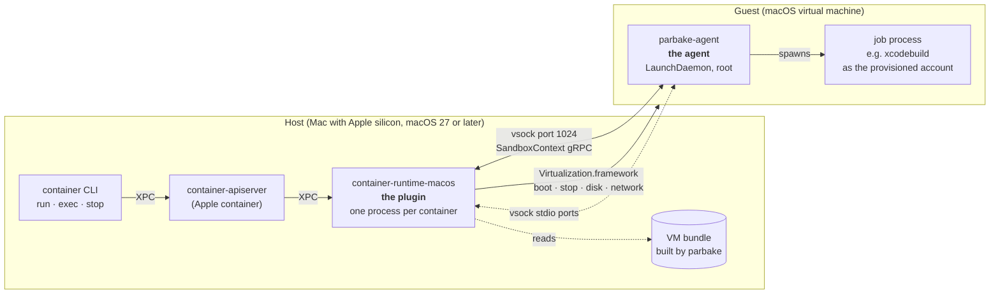
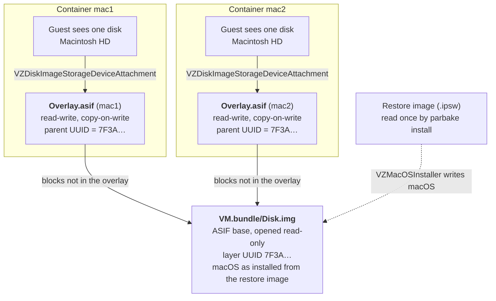
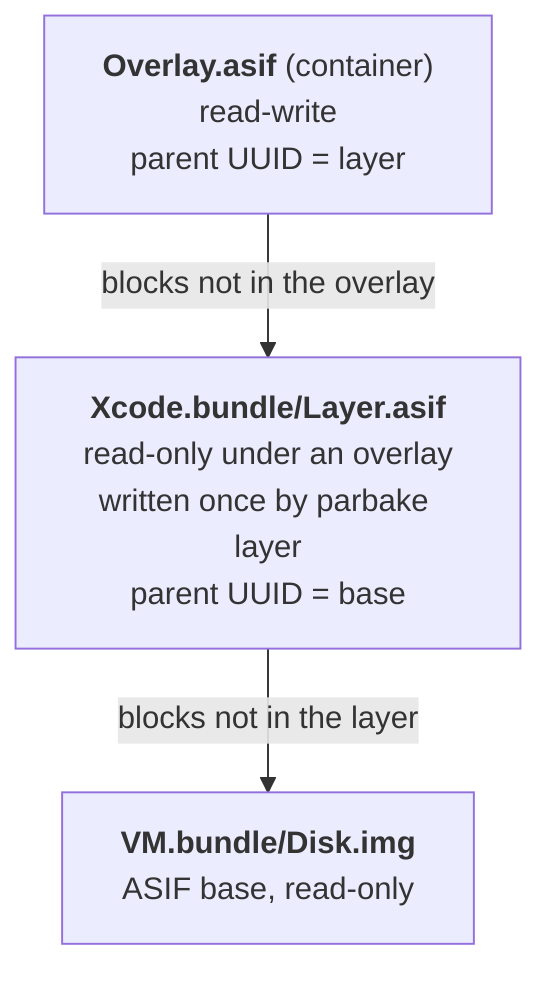
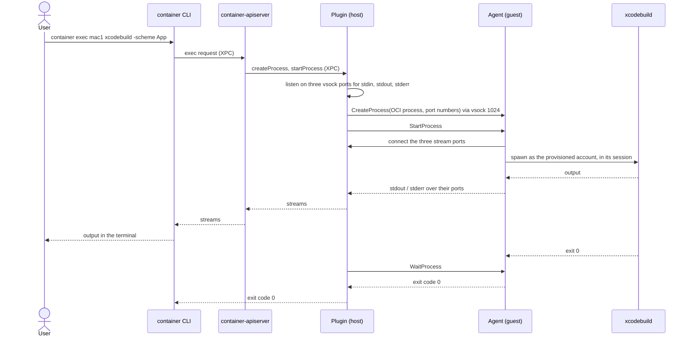
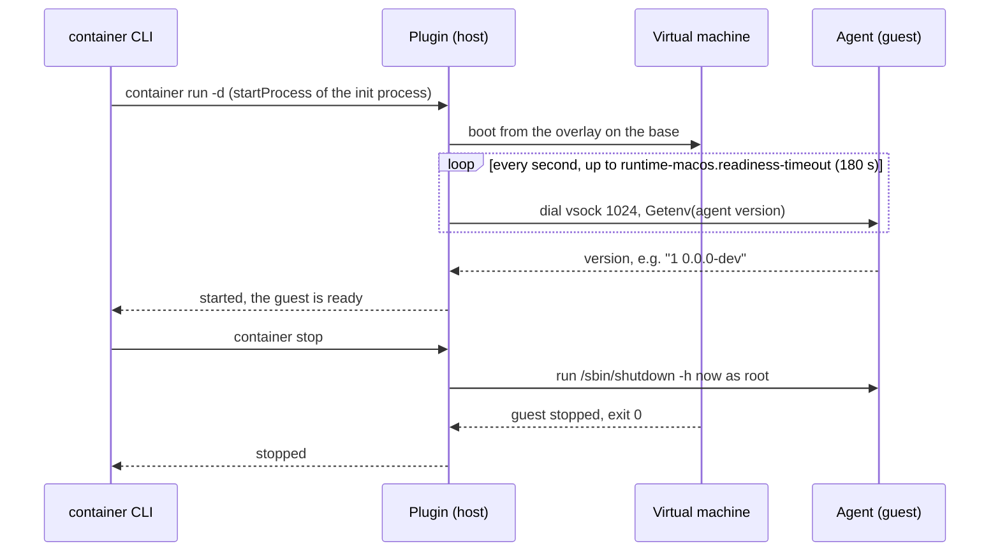

<!-- doc_type: explanation -->

# Architecture: plugin, guest agent and bundles

This page explains how Apple `container` runs a macOS guest. Three programs work together, two on
the host and one inside the guest. A fourth, `parbake`, builds the bundle they boot.

## Platform

The host runs macOS 27 or later on Apple silicon. The plugin and `parbake` need DiskImageKit, which
macOS 27 introduced, and they support no other disk format than ASIF
([ADR 0007](adr/adr_0007_hosts_run_macos_27_and_disks_are_asif.md)). The guest's macOS version is a
separate question, answered in [Host and guest versions](#host-and-guest-versions).

## The bundle and parbake

A bundle is a directory holding one installed macOS guest. `parbake create` builds it in three steps,
and the last step has two branches.

1. Download the restore image, the macOS installer from Apple, into the cache.
2. Install macOS from it onto a new ASIF disk image with `VZMacOSInstaller`.
3. Prepare the guest. The branch depends on `--username`:
   - **With `--username`,** `create` provisions the account without a window. It boots once to create
     the account, add the SSH keys and install the agent. It then runs any `--script` files as root
     through the agent and shuts the guest down through the agent.
   - **Without `--username`,** `create` opens the guest in a window for the Setup Assistant, and you
     create the account by hand. The bundle has no `Provisioned` file, no guest key and no agent. The
     `--no-setup` flag skips the window.

| File | Content | Per container |
|---|---|---|
| `Disk.img` | the ASIF disk image with the installed macOS, the **base** | shared, read-only |
| `AuxiliaryStorage` | the guest's boot and NVRAM state | own copy |
| `HardwareModel` | the virtual Mac model the guest was installed for | own copy |
| `MachineIdentifier` | serial number and platform UUID | new for every container |
| `Provisioned` | the account name | own copy |
| `GuestKey`, `GuestKey.pub` | the key the plugin logs in with | own copy |
| `Agent` | the installed agent's protocol version | own copy |

The restore image is read only in step 2. Running containers, `exec`, `stop`, `parbake agent
install` and resetting an overlay never touch it again. `PARBAKE_HOME` moves the default bundle
and the cache to another directory, such as an external SSD formatted as APFS.

## Disks: what DiskImageKit governs

DiskImageKit decides where a guest's disk blocks live and who may write them. It does not care
which operating system those blocks hold.

Every container gets an **overlay**, a small ASIF file stacked on the bundle's base. The guest
sees one ordinary disk. A read that the overlay does not hold falls through to the base. Every
write lands in the overlay, so the base stays as `parbake` built it.

Read from top to bottom, the layers are these.

| Layer | Who writes it | Lifetime |
|---|---|---|
| The disk the guest sees | nobody, it is the stack seen as one device | while the guest runs |
| `Overlay.asif` | the guest, through Virtualization.framework | from the first start to `container rm`, kept across `stop` and `start` |
| `Disk.img`, the base | `parbake install` once, then nobody | until the bundle is rebuilt |
| Restore image | Apple | read once, during `parbake install` |

### What DiskImageKit guarantees

- **The binding.** An overlay records its base's layer UUID. Stacked on any other base,
  DiskImageKit refuses with `IncompatibleStackingError`, so a container never boots against a base
  its writes were not made on.
- **Sparse files.** A fresh overlay takes 4 MB, and an ASIF base keeps its size when copied off
  APFS. That is why a bundle may live on another volume.
- **One stack per container.** Containers share the base and never see each other's writes.

### What DiskImageKit does not govern

- **The guest's macOS version.** That comes from the restore image and the host's
  Virtualization.framework.
- **The guest's identity.** The plugin writes a new `MachineIdentifier` and copies the auxiliary
  storage for every container, as Apple advises for clones of a virtual Mac.
- **Changes to the base.** Booting the bundle read-write keeps the layer UUID, so overlays built on
  it would stack on changed blocks. A bundle is rebuilt, never booted read-write while containers
  use it.
- **Merging.** No API folds an overlay back into its base. A new base is a new `parbake create`.

### Layer bundles

A layer bundle puts one more level between the base and the overlays. It holds software that every
container needs and that takes long to install, such as Xcode. `parbake layer` creates it.

- The layer bundle links `Disk.img` to the base and holds its own `Layer.asif`. While
  `parbake layer` runs its script, the layer is the writable top. Afterwards only overlays write.
- A container's instance links both files and stacks its overlay on them, so the stack is three
  levels. A layer on a layer is refused, since Apple advises keeping stacks shallow.
- The binding works at every level: a rebuilt base no longer carries the layer's parent UUID. A rebuilt layer no longer carries the overlays' parent UUID.

When a bundle is rebuilt, its base gets a new layer UUID. Existing overlays then fail to stack. The
label `runtime-macos.on-incompatible-overlay` decides what follows: `fail` stops the start, and
`discard` starts the container over on the new base
([ADR 0001](adr/adr_0001_overlay_per_container_on_an_asif_base.md)).

## Host and guest versions

Two different limits apply, and neither depends on the other.

| Limit | Set by | Rule |
|---|---|---|
| Host version | DiskImageKit | macOS 27 or later, for ASIF bases and overlays |
| Guest version | Virtualization.framework | at most what the host's framework supports |

The host provides the guest's virtual hardware: boot firmware, the hardware model and the
paravirtualized devices for graphics, network, disk and vsock. A newer guest may expect a hardware
model or device interface an older host does not offer. `VZMacOSRestoreImage.latestSupported`
therefore returns the newest restore image this host can install and boot, which `parbake create`
downloads.

A guest older than the host boots, but the agent needs macOS 27 in the guest. Without it, `exec` is
unavailable and the plugin shuts the guest down over SSH. A host update leaves existing bundles
bootable. Building a
bundle with a newer macOS first needs a host on that version.

## The plugin

`container-runtime-macos` runs on the host. The container API server starts one plugin process per
container, as it starts `container-runtime-linux` for a Linux container. The plugin does everything
that can be done to a virtual machine from the outside.

- It creates the container's directory from the bundle. The base is linked read-only, next to a
  new overlay, copies of the small files and a new machine identifier.
- It attaches the guest to the container's vmnet network and answers its DHCP
  ([ADR 0002](adr/adr_0002_guest_joins_the_container_network.md)).
- It boots the guest, waits for the agent, and stops it gracefully or forcibly.
- It reports status and address to `container ls`.

What happens inside macOS it neither sees nor controls.

## The agent

`parbake-agent` runs inside the guest as a LaunchDaemon that starts with macOS. It is the plugin's
hand inside the guest.

- It answers as soon as the guest is up, which is how the plugin knows the guest is ready.
- It starts processes for `container exec` as the provisioned account, inside that account's
  logged-in session, so the Keychain, code signing and simulators work.
- It carries stdin, stdout and stderr separately and reports the exit code and signals.
- It shuts the guest down on request.

Only the host reaches it. The agent refuses vsock connections from inside the guest. Its own socket
is open to root alone, so a guest account cannot use it to run anything as root.

Provisioning copies the agent into the guest. It is built and signed together with the plugin, so
both always speak the same protocol version. `parbake agent install` refreshes the agent in an
existing bundle.

## The connection: vsock

vsock is a virtual channel between host and virtual machine that Virtualization.framework provides
(`VZVirtioSocketDevice`). It is not IP networking. It needs no guest address and no sshd, and
macOS's Local Network privacy does not apply to it.

The plugin dials the agent on vsock port 1024. Each standard stream of a process gets a port of its
own, on which the plugin listens and to which the agent connects. On port 1024 both sides speak the
gRPC service `SandboxContext` from containerization, the protocol Apple's Linux guest agent vminitd
serves ([ADR 0006](adr/adr_0006_guest_agent_speaks_the_sandbox_context_protocol.md)). The plugin
therefore uses containerization's `Vminitd` client as it is. Linux-only calls such as mounts or
network configuration answer `UNIMPLEMENTED`.

## A `container exec`, step by step

Without `--user`, the process runs as the provisioned account. `--user root` runs it as root.

## Start, readiness and stop

`container run -d` returns only once the agent answers, so a caller needs no polling. When the agent
does not answer in time, the plugin stops the guest and the start fails.

## Without the agent

A bundle without an `Agent` file starts without the readiness wait. `container exec` then fails
with a message that names `parbake agent install`. The plugin shuts a provisioned guest down over
SSH with the bundle's `GuestKey` ([ADR 0003](adr/adr_0003_controlled_shutdown_over_ssh.md)), and
without a key it sends the power-button request.

## An analogy

The plugin is the caretaker who unlocks the building, switches on power and network, and locks it
again. The agent is the colleague inside who takes orders and carries them out. vsock is the
intercom between the two. Without the agent, the caretaker calls through the window over SSH, which
works only while the window, an IP connection, is open. DiskImageKit is the tenancy: every tenant
furnishes a room of their own, and the building's structure stays as the builder left it.

Stated plainly: the plugin controls the virtual machine from outside, and the agent acts inside it.
vsock connects them. DiskImageKit keeps each container's writes apart from the shared base.
