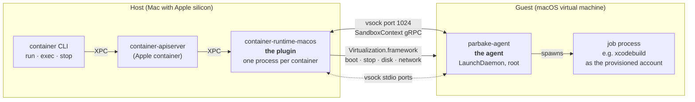
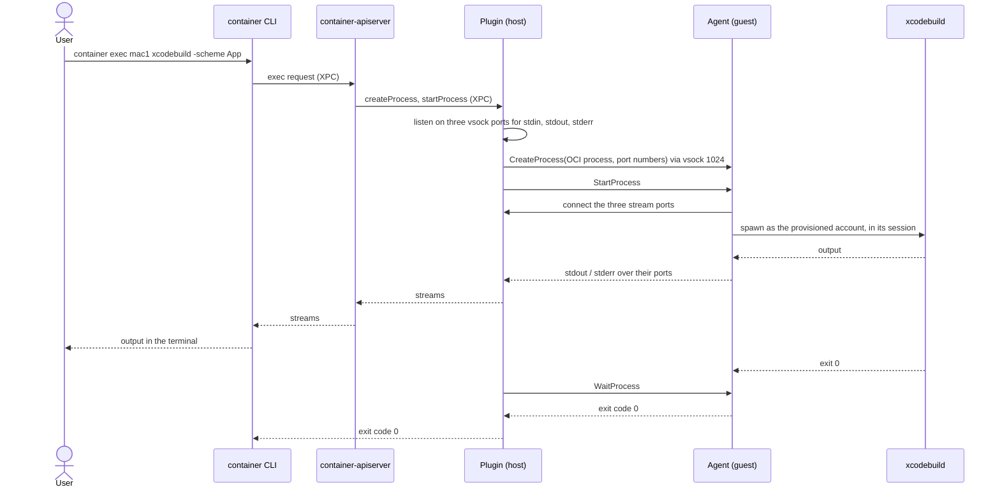
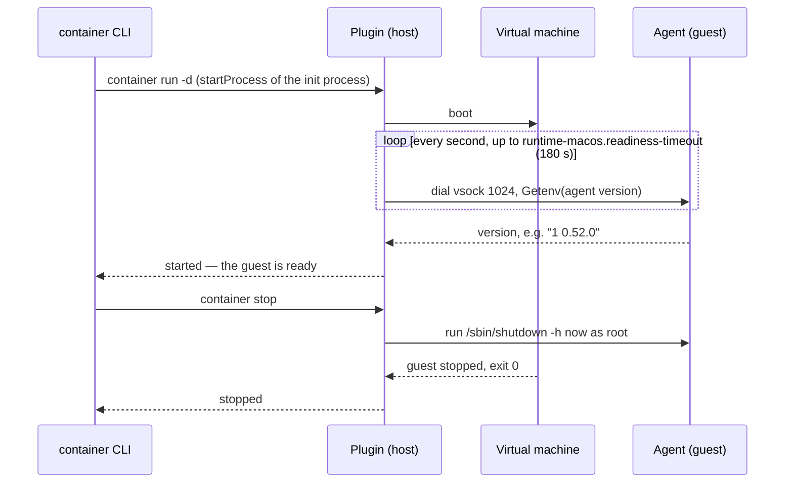

# Architecture: plugin and guest agent

Three programs work together when Apple `container` runs a macOS guest: two on the host, one inside
the guest.

The plugin is built and in use. The agent is specified in
[spec_guest_agent.md](specs/spec_guest_agent.md) and not built yet; until it is, the plugin reaches
into the guest over SSH (see "Today, without the agent").

## The plugin

`container-runtime-macos` runs on the host. The container API server starts one plugin process per
container, as it starts `container-runtime-linux` for a Linux container. The plugin does everything
that can be done to a virtual machine from the outside:

- creates the virtual machine from the bundle, with a DiskImageKit overlay of its own
  ([ADR 0001](adr/adr_0001_overlay_per_container_on_an_asif_base.md)),
- attaches it to the container's vmnet network and answers its DHCP
  ([ADR 0002](adr/adr_0002_guest_joins_the_container_network.md)),
- boots it, and stops it, gracefully or forcibly,
- reports status and address to `container ls`.

What happens inside macOS it neither sees nor controls.

## The agent

`parbake-agent` runs inside the guest as a LaunchDaemon that starts with macOS. It is the plugin's
hand inside the guest:

- it answers as soon as the guest is up, which is how the plugin knows the guest is ready,
- it starts processes for `container exec` as the provisioned account, inside that account's
  logged-in session, so the Keychain, code signing and simulators work,
- it carries stdin, stdout and stderr separately and reports the exit code and signals,
- it shuts the guest down on request.

Provisioning copies the agent into the guest; it is built and signed together with the plugin, so
both always speak the same protocol version. `parbake agent install` refreshes the agent in an
existing bundle.

## The connection: vsock

vsock is a virtual channel between host and virtual machine that Virtualization.framework provides
(`VZVirtioSocketDevice`). It is not IP networking: it needs no guest address and no sshd, and macOS's
Local Network privacy does not apply to it.

The plugin dials the agent on vsock port 1024. Each standard stream of a process gets a port of its
own, on which the plugin listens and to which the agent connects. On port 1024 both sides speak the
gRPC service `SandboxContext` from containerization — the protocol Apple's Linux guest agent, vminitd,
serves ([ADR 0006](adr/adr_0006_guest_agent_speaks_the_sandbox_context_protocol.md)). The plugin
therefore uses containerization's `Vminitd` client as it is; only the agent is new. Linux-only calls
such as mounts or network configuration answer `UNIMPLEMENTED`.

## A `container exec`, step by step

Without `--user`, the process runs as the provisioned account; `--user root` runs it as root.

## Start, readiness and stop

`container run -d` returns only once the agent answers, so a caller needs no polling. When the agent
does not answer in time, the plugin stops the guest and the start fails.

## Today, without the agent

Until the agent is built, the plugin uses SSH with the bundle's `GuestKey` to shut a provisioned guest
down ([ADR 0003](adr/adr_0003_controlled_shutdown_over_ssh.md)); without a key it sends the
power-button request. `container exec` is not available yet, and `container run -d` returns right
after the boot.

## An analogy

The plugin is the caretaker who unlocks the building, switches on power and network, and locks it
again. The agent is the colleague inside who takes orders and carries them out. vsock is the intercom
between the two. Without the agent, the caretaker calls through the window over SSH — which works only
while the window, an IP connection, is open.
